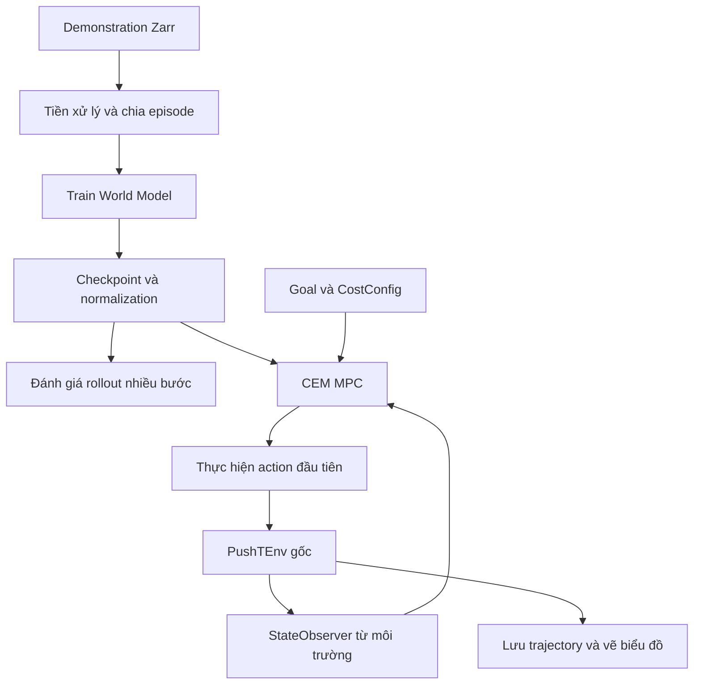

# Báo cáo kỹ thuật chi tiết — Push-T World Model, MPC và Diffusion Policy

> Bàn giao ngày **17/11/2026**: đọc [overall_context_detail.md](overall_context_detail.md) để lấy trạng thái và số liệu mới nhất. Artifact hiện có đã gồm policy tự viết train 100 epoch, native GitHub evaluation hoàn tất và phiên MPC mới đạt 6/7 lượt hoàn tất ở ngưỡng 95%. Các bảng lịch sử bên dưới giữ điều kiện đo ban đầu; không suy kết quả hiện tại từ tên thư mục hoặc mốc smoke test cũ.

> Dự án: `pusht-research`. Báo cáo được đối chiếu với source và kết quả thực nghiệm trong workspace ngày **15/11/2026**. Hướng dẫn chạy nhanh nằm trong [README.md](README.md). Tất cả đường dẫn tương đối trong báo cáo được tính từ thư mục `pusht-research/`, trừ khi có chỉ dẫn khác.

> Cập nhật ngày 16/11/2026: ngưỡng qua màn mặc định của **MPC và runner live Diffusion Policy pretrained GitHub là coverage ≥95%**; Diffusion Policy tự viết vẫn mặc định **≥99%**. Trong `--continuous`, tự lưu rồi bắt đầu episode mới. Các số đo cũ tại 99,5% được giữ nguyên ngưỡng đã đo.
>
> Cập nhật overlap: thêm chi phí diện tích target còn thừa, proposal căn chỉnh nhỏ và ngưỡng dừng coverage tùy chọn. [Báo cáo cập nhật](docs/overlap_refinement.md) mô tả các kiểm tra của thay đổi này. Bảng benchmark 2/5 trong phần 5.4 là kết quả lịch sử với cấu hình cũ ở ngưỡng >95%, không phải benchmark của cấu hình overlap hiện tại dù ngưỡng hiện tại cũng là 95% (dùng ≥).

> Cập nhật imitation learning: thêm `src/Diffusion_Policy_model.py`, học chuỗi action có điều kiện trên lịch sử state từ toàn bộ `.zarr`, dùng chung preprocessing và split với World Model. [Tài liệu Diffusion Policy](docs/diffusion_policy.md) trình bày toán diffusion, alignment dữ liệu, API, checkpoint, train và simulator. Đây là nhánh điều khiển độc lập; các benchmark MPC bên dưới không đo chất lượng policy mới.

> Mốc kiểm thử sau khi thêm Diffusion Policy tự viết: **99 test pass**; đã train thử một epoch trên 224 episode và chạy checkpoint trong simulator gốc. Mốc 72 test trong phần lịch sử bên dưới thuộc phiên bản overlap trước khi thêm policy. Số đo và giới hạn smoke test được ghi ở [mục kiểm chứng policy](docs/diffusion_policy.md#8-kiểm-chứng-và-diễn-giải-kết-quả).

> Mốc sau khi thêm runner pretrained live và đổi ngưỡng MPC/pretrained sang 95%: **114 test pass trong 5,876 giây**. Checkpoint GitHub đã được kiểm tra với continuous và Q ở cả cửa sổ simulation lẫn biểu đồ; các lượt kiểm tra ngắn lưu 3, 3 và 1 bước. Đây là kiểm tra giao diện/lưu trace, không phải benchmark tỷ lệ thành công.

> Cập nhật giảm độ trễ ngày 16/11/2026: thêm chế độ `--sampler ddim --inference-steps 20` cho checkpoint GitHub, giữ mặc định **DDPM100**. Log người dùng xác nhận khoảng khựng xảy ra khi lấy mẫu mới sau mỗi 8 action. Đo cùng observation trên CPU/1 thread: DDPM100 trung bình **2,278 giây**, DDIM20 **0,446 giây**, nhanh hơn 5,11 lần; vẫn có khoảng chờ ngắn và chưa đánh giá lại tỷ lệ thành công. Không cần train lại. Adapter giữ weights/normalizer, tạo DDIM theo noise schedule gốc và khôi phục trạng thái native sau inference; chặn giảm bước DDPM vì scheduler Diffusers 0.11.1 không xử lý đúng timestep bị bỏ qua. Chi tiết API, lý do và artifact nằm trong [tài liệu pretrained](docs/diffusion_policy.md#9-chạy-checkpoint-pretrained-gốc-trong-cùng-giao-diện). Mốc kiểm thử hiện tại: **119 test pass trong 5,892 giây**, cùng lượt chạy checkpoint thật DDIM20 trong simulator 16 bước.

> Để xem checkpoint GitHub điều khiển trực tiếp, dùng `src/run_pretrained_diffusion.py` với cửa sổ Push-T, biểu đồ và Q/Esc theo [README](README.md). `eval.py` của repo gốc là evaluator chạy batch và lưu video, không mở giao diện live này. Runner live dùng môi trường/reset và metric chung của project; đây không phải tái lập nguyên benchmark native của tác giả.

## Mục lục

- [1. Mục tiêu, phạm vi và tình trạng hiện tại](#overview)
- [2. Kiến trúc tổng thể và cơ sở điều khiển](#architecture)
- [3. Môi trường Push-T gốc và ý nghĩa vật lý](#environment)
- [4. Dữ liệu, World Model, huấn luyện và đánh giá dự đoán](#world-model)
- [5. Hàm chi phí, MPC và đánh giá điều khiển](#cost-mpc)
- [6. Chạy mô phỏng, quản lý episode và lưu kết quả](#runtime)
- [7. Phân tích động học và biểu đồ](#visualization)
- [8. Hướng dẫn sử dụng đầy đủ](#usage)
- [9. Kiểm thử, tái lập và giới hạn](#verification)
- [10. Bản đồ source, artifact và chuẩn bị GitHub](#source-map)
- [11. Thuật ngữ và tài liệu tham khảo](#references)

<a id="overview"></a>

## 1. Mục tiêu, phạm vi và tình trạng hiện tại

### 1.1. Bài toán cần giải quyết

Xây dựng hệ thống điều khiển một actuator hình tròn để đẩy block chữ T đến vùng mục tiêu. Dữ liệu demonstration do người dùng tự thu thập. Mô hình động lực học do dự án xây dựng và huấn luyện. Môi trường kiểm chứng là **source Push-T gốc** trong repository Diffusion Policy đã clone từ GitHub.

Các mục tiêu điều khiển:

1. Đưa T đến đúng vị trí và hướng của target.
2. Giảm biến thiên **vector vận tốc** actuator, bao gồm cả thay đổi hướng chuyển động.
3. Giảm tổng quãng đường actuator di chuyển.
4. Hoàn thành công việc sớm.

Hệ thống hiện tại thể hiện các yêu cầu này bằng một hàm chi phí có trọng số. Các trọng số xác định mức đánh đổi giữa những yêu cầu có thể xung đột. Ví dụ, đi vòng T có thể dài hơn nhưng tạo được hướng tiếp xúc phù hợp; phạt chuyển động quá mạnh có thể khiến bộ điều khiển không muốn đẩy T.

### 1.2. Phần đã hiện thực

| Thành phần | Hiện trạng |
|---|---|
| Đọc dữ liệu demonstration | Zarr, tách theo episode, không ghi ngược vào dữ liệu gốc |
| State dùng cho học/điều khiển | 10 chiều, gồm pose và vận tốc sai phân lùi |
| World Model cơ sở | `residual_mlp_v1`, MLP dự đoán 5 biến thiên pose |
| World Model được chọn | `contact_local_v2`, đặc trưng hệ tọa độ T và hình học tiếp xúc |
| Dự đoán chuỗi | Rollout tự hồi quy trên chuỗi action, hỗ trợ batch |
| Huấn luyện | Supervised one-step MSE, train/validation theo nhóm episode, checkpoint best/last |
| Đánh giá World Model | Horizon 1/5/10/20; persistence/constant-velocity; contact/no-contact |
| Cost | Pose/hình học T, diện tích target còn thừa, quãng đường, độ biến thiên vận tốc, thời gian và các phạt phụ |
| Planner | CEM-MPC, warm start, noise tương quan thời gian, đề xuất tiếp xúc/đi vòng và căn chỉnh nhỏ |
| Policy bắt chước | `Diffusion_Policy_model.py`: DDPM epsilon training, temporal residual network có FiLM, DDIM lấy mẫu chuỗi action; [chi tiết](docs/diffusion_policy.md) |
| Thực thi | Chỉ thực hiện action đầu tiên, quan sát state thật, lập kế hoạch lại |
| Simulation | Import trực tiếp `PushTEnv` của source gốc |
| Biểu đồ | Replay tăng dần theo thời gian và biểu đồ live; ưu tiên Times New Roman |
| Quản lý phiên chạy | Hữu hạn theo seed hoặc liên tục qua các episode đến khi Q/Esc/đóng cửa sổ |
| Artifact | Checkpoint, lịch sử train, JSON, CSV, NPZ, PNG và bộ kiểm thử |

### 1.3. Những điều chưa được chứng minh

Pipeline đã chạy được từ dữ liệu đến điều khiển trong simulator. **Chưa đạt thành công ổn định với mọi trạng thái khởi tạo**. Cấu hình lịch sử `mpc_tuning_priority_h20.json` thành công 2/5 seed đánh giá riêng ở ngưỡng coverage >95%, tương đương 40%. Con số này không phải kết quả của cấu hình overlap hiện tại với ngưỡng ≥95% vì cấu hình cost/search đã thay đổi, cũng không phải kết quả so sánh trực tiếp với policy Diffusion Policy gốc.

Tên “World Model” ở đây chỉ một **mô hình chuyển trạng thái có điều kiện theo action**. Mô hình nhận state số, không nhận ảnh và không sinh video. Dự án chưa có recurrent model/LSTM/Transformer học trực tiếp lịch sử dài; khả năng dự đoán chuỗi hiện tại đến từ việc lặp lại cùng mô hình một bước.

MPC tìm một lời giải tốt trong tập ứng viên đã đánh giá; không có chứng minh tìm được chuỗi action tối ưu toàn cục. Các penalty về chuyển động là tiêu chí kỹ thuật trong mô phỏng, chưa phải chứng nhận giới hạn rung, tải, năng lượng hay an toàn của máy thật.

<a id="architecture"></a>

## 2. Kiến trúc tổng thể và cơ sở điều khiển

### 2.1. Luồng dữ liệu và luồng điều khiển



Đường đi của một quyết định online:

```text
info thực tế -> state s_t -> tạo nhiều chuỗi action U
                               |
                        World Model rollout
                               |
                     dự đoán nhiều trajectory
                               |
                    Cost + kiểm tra tính hợp lệ
                               |
                   chọn chuỗi có cost nhỏ nhất
                               |
                     gửi duy nhất action u_t
                               |
                 env.step(u_t) -> info thực tế mới
```

Planner không dùng simulator để thử các chuỗi ứng viên. Trong mỗi vòng điều khiển, simulator chỉ nhận action được chọn để thực hiện thật. Điều này phân biệt dự đoán bằng World Model với việc tìm kiếm bằng cách chạy lại physics cho mọi ứng viên.

### 2.2. Mô hình chuyển trạng thái

Ký hiệu:

| Ký hiệu | Ý nghĩa |
|---|---|
| $s_t\in\mathbb{R}^{10}$ | State quan sát tại thời điểm điều khiển $t$ |
| $u_t\in\mathbb{R}^{2}$ | Vị trí XY yêu cầu của actuator |
| $g\in\mathbb{R}^{3}$ | Pose mục tiêu của T: XY và góc |
| $f_\theta$ | World Model có tham số đã train $\theta$ |
| $\widehat{s}_{t+1}$ | Dự đoán state kế tiếp |
| $H$ | Số action trong horizon |
| $B$ | Số chuỗi ứng viên trong một batch |
| $\Delta t=0.1\,\mathrm{s}$ | Chu kỳ điều khiển nominal |

Quan hệ cần học:

$$
\widehat{s}_{t+1}=f_\theta(s_t,u_t).
$$

Đây là xấp xỉ dạng Markov: state hiện tại được kỳ vọng chứa đủ thông tin để dự đoán bước tiếp theo. Tuy nhiên, vận tốc dùng trong dữ liệu là vận tốc trung bình trên khoảng lấy mẫu, không phải toàn bộ trạng thái nội bộ của solver vật lý. Vì vậy tính Markov chính xác của simulator không tự động được bảo đảm bởi vector 10D này.

Để đánh giá một chuỗi action $U=(u_t,\ldots,u_{t+H-1})$:

$$
\widehat{s}_{t}=s_t,\qquad
\widehat{s}_{t+k+1}=f_\theta(\widehat{s}_{t+k},u_{t+k}).
$$

Sai số ở bước sớm sẽ trở thành đầu vào của bước sau. Vì vậy loss một bước nhỏ chưa đủ để kết luận mô hình tốt cho MPC; cần đo sai số rollout tự hồi quy ở nhiều horizon.

### 2.3. Receding-horizon control

Tại mỗi thời điểm, giải gần đúng:

$$
U_t^*\approx\arg\min_{U\in\mathcal{U}}J(\widehat{S}(s_t,U),g),
$$

với $\mathcal{U}$ chứa các ràng buộc action và $\widehat{S}$ là trajectory từ World Model. Sau đó chỉ phát lệnh:

$$
u_t=(U_t^*)_0.
$$

Bước sau dùng **state quan sát mới từ simulator**, không coi state dự đoán là sự thật. Cơ chế phản hồi này giúp hiệu chỉnh sai lệch của mô hình và thay đổi điều kiện tiếp xúc.

World Model được train offline bằng gradient. CEM-MPC cập nhật **phân phối chuỗi action trong một lần lập kế hoạch**, không cập nhật trọng số World Model. Vì vậy người dùng chỉ cần train một World Model phù hợp; không có lệnh “train MPC” riêng trong implementation hiện tại.

### 2.4. Quan hệ với công trình gốc

Diffusion Policy nghiên cứu policy sinh action bằng diffusion có điều kiện. Dự án này dùng môi trường Push-T của repository đó nhưng thực hiện pipeline state-dynamics + MPC riêng. Không có checkpoint diffusion policy hay mạng denoising nào tham gia điều khiển ở đây. Xem [bài Diffusion Policy](https://arxiv.org/abs/2303.04137).

Ý tưởng học dynamics rồi planning có liên hệ với model-based control/model-based RL. PETS là một công trình tham khảo về dynamics có bất định và planning; implementation hiện tại sử dụng một mạng deterministic, chưa có ensemble hay propagation bất định như PETS. Xem [bài PETS](https://arxiv.org/abs/1805.12114). Công thức cụ thể trong các phần sau mô tả code của dự án, không khẳng định đã tái hiện toàn bộ một thuật toán trong bài báo.

<a id="environment"></a>

## 3. Môi trường Push-T gốc và ý nghĩa vật lý

### 3.1. Source được sử dụng

Repository tham chiếu: [real-stanford/diffusion_policy](https://github.com/real-stanford/diffusion_policy).

Commit đã kiểm tra: `5ba07ac6661db573af695b419a7947ecb704690f`.

Hai entry point liên quan:

- [PushTEnv tại commit đã kiểm tra](https://github.com/real-stanford/diffusion_policy/blob/5ba07ac6661db573af695b419a7947ecb704690f/diffusion_policy/env/pusht/pusht_env.py): physics, action, reward, reset và render.
- [demo_pusht.py tại commit đã kiểm tra](https://github.com/real-stanford/diffusion_policy/blob/5ba07ac6661db573af695b419a7947ecb704690f/demo_pusht.py): điều khiển chuột, ghi demonstration, tự chuyển episode thành công.

Runner AI import class qua `src/pusht_runtime.py::make_env`. Cấu trúc thư mục bắt buộc hiện tại:

```text
thư_mục_cha/
├── diffusion_policy/       # Clone source tham chiếu
│   └── diffusion_policy/env/pusht/pusht_env.py
└── pusht-research/         # Dự án riêng
    ├── src/
    ├── configs/
    └── ...
```

Tên thư mục dự án riêng có thể khác, nhưng repository tham chiếu vẫn phải nằm tại `PROJECT_ROOT.parent / "diffusion_policy"`. Không cần cài toàn bộ package Diffusion Policy bằng `pip install -e`; adapter thêm đường dẫn repository vào `sys.path`.

### 3.2. Không gian tọa độ và hình học

- Kích thước workspace/render chính: $512\times512$.
- Action hợp lệ theo Gym: mỗi tọa độ trong $[0,512]$.
- Agent: body kinematic hình tròn, bán kính 15 đơn vị mô phỏng.
- T: body dynamic ghép từ hai hình chữ nhật trong hệ tọa độ local.
- Thanh ngang: $x\in[-60,60],\ y\in[0,30]$.
- Thân dọc: $x\in[-15,15],\ y\in[30,120]$.
- Goal mặc định: $g=(256,256,\pi/4)$; code lấy goal từ `env.goal_pose`/`info`, không hard-code vào planner.

Đường biên ngoài của T có 8 đỉnh:

$$
(-60,0),(60,0),(60,30),(15,30),(15,120),(-15,120),(-15,30),(-60,30).
$$

Pose XY của T là **body origin**, không phải tâm hình học của toàn polygon. Source gốc gán local center of gravity bằng trung bình center của hai shape, tức $(0,45)$. Đặc trưng mô-men và đề xuất đường đi quanh T dùng đúng quy ước này.

Một đỉnh local $q$ được đổi ra world bằng:

$$
q^{world}=p^T+R(\theta)q,\qquad
R(\theta)=\begin{bmatrix}\cos\theta&-\sin\theta\\\sin\theta&\cos\theta\end{bmatrix}.
$$

Các đơn vị XY là **simulation units**. Không có phép hiệu chuẩn sang mét trong project. Chiều hiển thị Y theo ảnh/canvas hướng xuống; các phép quay phải dùng cùng quy ước tọa độ với simulator.

### 3.3. Tần số điều khiển và tích phân physics

| Đại lượng | Giá trị | Ý nghĩa |
|---|---:|---|
| `env.control_hz` | 10 Hz | Mỗi action áp dụng trong 0,1 giây mô phỏng |
| `env.sim_hz` | 100 Hz | Physics substep dài 0,01 giây |
| Số substep/action | 10 | `sim_hz // control_hz` |
| Nhịp refresh tối đa của live chart | 30/s | Giới hạn render UI, không phải tần số dữ liệu |

Theo quyết định của người dùng, giữ **10 Hz** cho dữ liệu/control/World Model. 100 Hz vốn đã là tần số solver vật lý của source gốc. Tăng số hình vẽ hay nội suy không tạo ra dữ liệu physics 100 Hz mới. Muốn đổi control thật cần thu lại/resample đúng dữ liệu, thay đổi quy ước dt, train lại và đồng bộ simulator/cost; công việc đó không được thực hiện trong phiên bản này.

### 3.4. Action là target vị trí, không phải vị trí đã đạt

Lệnh $u_t=(x_t^{target},y_t^{target})$ là vị trí yêu cầu của con trỏ khi chơi tay, hoặc vị trí yêu cầu do MPC chọn khi chạy AI.

Ở mỗi physics substep $\delta t=0.01$:

$$
a^A=100(u_t-p^A)-20v^A,
\qquad v^A\leftarrow v^A+a^A\delta t,
$$

sau đó `space.step(delta_t)` thực hiện tích phân và xử lý tiếp xúc. Đây là bộ điều khiển PD của simulator. Vận tốc nội bộ trong biểu thức này là vận tốc body tại substep, khác với vận tốc sai phân 10 Hz mà model quan sát. Agent là `pymunk.Body.KINEMATIC`: phản lực va chạm không thay đổi quỹ đạo của nó như với một dynamic body. Tiếp xúc làm thay đổi chuyển động của T; quỹ đạo agent do PD, state vị trí/vận tốc trước đó và chuỗi target quyết định.

Vì vậy đồ thị **Recorded action target** và **Agent position** cùng timestamp mô tả hai đại lượng khác nhau: setpoint vừa được yêu cầu và vị trí hiện tại trước khi thực hiện action. Agent thường đi theo target trễ hơn, nhưng **không có quy tắc dịch cố định vài timestamp**: độ trễ phụ thuộc sai lệch vị trí, vận tốc trước đó, chuỗi target và đáp ứng PD. Không nên shift mảng action thủ công để “khớp” với position.

### 3.5. Reward và điều kiện thành công

Gọi $P_T$ là polygon T thật và $P_g$ là polygon mục tiêu:

$$
coverage=\frac{area(P_T\cap P_g)}{area(P_g)},
\quad reward=\operatorname{clip}\left(\frac{coverage}{0.95},0,1\right),
\quad done=(coverage>0.95).
$$

Đây là tỷ lệ diện tích giao trên diện tích target, **không phải IoU** với mẫu số diện tích hợp. Điều kiện `done` của source gốc là dấu `>`; đạt đúng 0,95 chưa thỏa. Runner riêng hiện có thể tiếp tục `env.step` sau ngưỡng này để đạt `target_coverage` cao hơn; không sửa `env.success_threshold` hoặc source tham chiếu.

Cost planner giữ proxy pose/đỉnh để có tín hiệu khi T còn xa, đồng thời tính diện tích giao polygon theo pose dự đoán. Thành công cuối cùng luôn đo lại bằng polygon thật của simulator, không lấy coverage dự đoán làm sự thật.

### 3.6. Hành vi recorder gốc

`demo_pusht.py` tự lặp qua nhiều lượt. Đưa chuột gần vòng tròn xanh để bắt đầu, R thử lại, giữ Space tạm dừng, Q thoát. Episode thành công được append vào Zarr; episode retry hoặc đang dở khi Q không được lưu bởi recorder gốc.

Mỗi dòng recorder gồm **state và ảnh trước action**, action tại dòng đó, keypoint và thông tin contact có sẵn. Sau đó mới gọi `env.step(action)`. Khi bước cuối thành công, recorder thoát vòng trước khi thêm observation terminal thành một dòng mới. Hệ quả về nhãn training và contact được trình bày ở phần dữ liệu.

<a id="world-model"></a>

## 4. Dữ liệu, World Model, huấn luyện và đánh giá dự đoán


### 4.1. Dữ liệu, state và quan hệ nhân quả

#### Quy ước tọa độ và đơn vị

Một mẫu gốc trong `data/state` có 5 phần tử:

$$
q_t=[x^A_t,y^A_t,x^T_t,y^T_t,\theta^T_t].
$$

Trong đó $A$ là actuator, $T$ là vật thể chữ T. Tọa độ dùng đơn vị của mô phỏng trên mặt phẳng 512 × 512; tài liệu không quy đổi chúng thành mét. Góc dùng radian, vận tốc tuyến tính dùng đơn vị mô phỏng/giây, vận tốc góc dùng radian/giây. Khi vẽ hình, trục Y của màn hình hướng xuống. Vị trí của T là gốc tọa độ thân rigid body; không được tự hiểu là tâm hình học của T.

State dùng cho World Model có đúng thứ tự 10 chiều:

| Cột | Ký hiệu | Ý nghĩa |
|---:|---|---|
| 0 | $x^A$ | Vị trí X actuator |
| 1 | $y^A$ | Vị trí Y actuator |
| 2 | $v_x^A$ | Vận tốc X actuator |
| 3 | $v_y^A$ | Vận tốc Y actuator |
| 4 | $x^T$ | Vị trí X gốc thân T |
| 5 | $y^T$ | Vị trí Y gốc thân T |
| 6 | $v_x^T$ | Vận tốc X T |
| 7 | $v_y^T$ | Vận tốc Y T |
| 8 | $\theta^T$ | Góc quay T |
| 9 | $\omega^T$ | Vận tốc góc T |

Action có 2 chiều:

$$
a_t=[a^x_t,a^y_t].
$$

Đây là **vị trí tuyệt đối mong muốn của actuator**, tương ứng vị trí con trỏ chuột trong quá trình thu thập demonstration. Nó không phải lực, gia tốc, vận tốc, hay tọa độ dịch chuyển tương đối. Bộ điều khiển PD của môi trường gốc làm actuator tiến về target này. Do đáp ứng PD từ vị trí/vận tốc trước đó, $p^A_t$ thường chưa trùng $a_t$. Không tồn tại một độ trễ cố định “sớm hơn đúng k timestamp”; độ trễ thay đổi theo trạng thái và action. Agent kinematic không nhận phản lực va chạm như T dynamic.

#### 10 Hz điều khiển và 100 Hz vật lý

Toàn bộ pipeline hiện giữ tần số điều khiển/ghi mẫu là $f_c=10$ Hz, nên:

$$
\Delta t=1/f_c=0.1\;\mathrm{s}.
$$

Môi trường gốc tích phân vật lý ở 100 Hz. Mỗi action được giữ qua 10 bước vật lý. Hai tần số này phục vụ hai mục đích khác nhau; `--control-hz 10` không làm giảm tần số tích phân vật lý. Trục thời gian dataset là thời gian danh nghĩa $t_k=k\Delta t$, không phải timestamp đo từ đồng hồ. Chỉ tăng FPS cửa sổ hoặc đổi nhãn Hz không tạo ra dữ liệu vật lý mới. Checkpoint lưu `dt`, runtime kiểm tra nó khớp `1/env.control_hz` trước khi điều khiển.

#### Tạo vận tốc mà không dùng tương lai

`episode_kinematics.calculate_velocity` dùng sai phân lùi:

$$
v_0=0,\qquad v_t=\frac{p_t-p_{t-1}}{\Delta t},\quad t\ge1.
$$

Vận tốc góc được tính từ chuỗi góc đã `np.unwrap` để tránh bước nhảy giả khi góc đi qua $2\pi$:

$$
\omega_0=0,\qquad \omega_t=\frac{\widetilde\theta_t-\widetilde\theta_{t-1}}{\Delta t}.
$$

Cột góc trong state vẫn giữ góc gốc, còn đạo hàm dùng góc unwrap. Quy ước vận tốc đầu episode bằng 0 áp dụng nhất quán khi train và khi quan sát online. Đây là vận tốc trung bình suy từ hai mẫu liền nhau, không phải vận tốc tức thời lấy trực tiếp từ Pymunk. State này là xấp xỉ Markov hữu ích; nó không chứa mọi biến ẩn của bộ giải tiếp xúc, lực, ma sát hoặc trạng thái nội bộ của vật lý.

#### Căn chỉnh `state`, `action`, `next_state`

Trong `demo_pusht.py`, dữ liệu được append **trước** `env.step(action)`. Vì vậy mẫu train đúng là:

$$
(s_t,a_t)\longrightarrow s_{t+1}.
$$

Nếu episode có $N$ mẫu state thì chỉ có $N-1$ cặp chuyển trạng thái hợp lệ. Không ghép state cuối episode này với state đầu episode sau. Action cuối bản ghi không có next-state được ghi tương ứng, nên không dùng cho supervised transition. Môi trường có thể đã thực hiện action cuối để thành công nhưng state terminal đó không nằm trong demonstration gốc.

`meta/episode_ends` chứa các chỉ số kết thúc cộng dồn, loại trừ phần tử tại vị trí `stop`: episode $e$ là slice `[start:stop]`, với `start=0` nếu $e=0$, ngược lại bằng `episode_ends[e-1]`.

Thông tin `n_contacts[t]` của demonstration được lấy từ `info` trước action hiện tại. Vì vậy nhãn tiếp xúc do action $a_t$ gây ra phải đọc từ `n_contacts[t+1]`, không phải `n_contacts[t]`. Evaluator đã xử lý dịch chỉ số này.

#### Dữ liệu đã dùng trong lần train được báo cáo

| Dataset | Episode | Mẫu state |
|---|---:|---:|
| `data/demonstrations/pusht_demo.zarr` | 146 | 30.486 |
| `data/demonstrations/demo_actions_v1.zarr` | 78 | 11.096 |
| Tổng | 224 | 41.582 |

Tổng số transition là $41\,582-224=41\,358$. Việc đọc Zarr dùng `mode="r"`; preprocessing không sửa demonstration. Ảnh, keypoint và contact annotation không phải input của World Model hiện tại. Model dùng state 10D + action 2D; ảnh phục vụ xem lại và trực quan hóa, contact annotation dùng phân nhóm đánh giá.

### 4.2. Tiền xử lý và tránh rò rỉ dữ liệu

#### Vì sao không random split từng timestep?

Hai bước liên tiếp trong một episode gần như cùng một trạng thái. Nếu chia train/validation theo từng mẫu, các trạng thái rất tương tự sẽ nằm ở cả hai phía. Ngoài ra, nhiều bản ghi có thể bắt đầu từ cùng một pose. Kết quả validation khi đó có thể lạc quan dù chưa tổng quát hóa sang tình huống mới.

`prepare_data` thực hiện:

1. Chuẩn hóa đường dẫn dataset thành absolute path và loại đường dẫn trùng.
2. Tính SHA-256 từ bytes của `data/state`, `data/action`, `meta/episode_ends`; bỏ qua dataset sao chép y hệt dù mang tên khác.
3. Đọc từng episode độc lập, tạo state 10D và action 2D, kiểm tra mọi phần tử hữu hạn.
4. Nhóm các episode theo pose ban đầu `[agent_x, agent_y, T_x, T_y, T_angle]`. Góc được wrap về nhánh chính; pose làm tròn 4 chữ số rồi băm SHA-256 lấy 16 ký tự đầu. Mọi episode cùng nhóm ở mọi nguồn được giữ chung split.
5. Sắp xếp các nhóm rồi hoán vị bằng `np.random.default_rng(seed)`. Số nhóm validation là `min(n_groups-1, max(1, round(n_groups*val_ratio)))`.
6. Tạo transition **sau khi** quyết định split. Chỉ lấy thống kê normalization từ transition train.

`val_ratio=0.1` là tỷ lệ **nhóm trạng thái khởi tạo**, không buộc đúng 10% số episode hoặc transition. Lần train seed42 có 199 episode train, 25 episode validation, tương ứng 35.894 và 5.464 transition. Ít nhất hai nhóm ban đầu có transition mới có thể tạo hai split; tập train phải có ít nhất hai transition để tính độ lệch chuẩn mẫu.

Chữ ký dữ liệu hiện xác thực state/action/episode boundaries; nó không băm ảnh, keypoint hay `n_contacts`. Do đó chữ ký khớp không chứng minh mọi metadata ngoài ba mảng này chưa từng thay đổi.

#### Input và nhãn hồi quy

Đặt chỉ số pose trong state 10D là `POSITION_COLUMNS=[0,1,4,5,8]`. Input 12D là:

$$
x_t=[s_t,a_t]\in\mathbb R^{12}.
$$

Nhãn5 là thay đổi pose:

$$
y_t=[\Delta x^A_t,\Delta y^A_t,\Delta x^T_t,\Delta y^T_t,\Delta\theta^T_t].
$$

Bốn nhãn tuyến tính là hiệu pose sau-trước. Nhãn góc dùng:

$$
\operatorname{wrap}(\alpha)=\operatorname{atan2}(\sin\alpha,\cos\alpha),\qquad
\Delta\theta^T_t=\operatorname{wrap}(\theta^T_{t+1}-\theta^T_t).
$$

Việc wrap tránh học bước nhảy gần $2\pi$ khi vật thể chỉ quay một góc nhỏ. Nó giả định bước quay giữa hai mẫu biểu diễn được bằng chênh lệch góc chính; nếu T thật sự quay quá $\pi$ trong 0,1 s, dữ liệu lấy mẫu này không đủ để phân biệt vòng quay.

Với từng chiều input/output, tính trung bình và độ lệch chuẩn trên **train**:

$$
\widetilde x=\frac{x-\mu_x}{\sigma_x},\qquad
\widetilde y=\frac{y-\mu_y}{\sigma_y},\qquad
\sigma=\max(\operatorname{std}_{ddof=1},10^{-6}).
$$

Validation dùng chính các thống kê này. Không recompute normalization từ validation hoặc từ rollout MPC. Chuẩn hóa output khiến MSE cân bằng hơn giữa đơn vị vị trí và radian; MSE này là đại lượng không đơn vị, không thể đọc trực tiếp thành sai số vị trí vật lý.

#### Cấu trúc cache schema 2

| Trường | Nội dung |
|---|---|
| `schema_version` | `2` |
| `episodes` | Danh sách `source`, `id`, `start`, `stop`, `initial_group`, `dataset_signature`, `split` |
| `raw.state` | Toàn bộ state 10D, ghép theo thứ tự các episode |
| `raw.action` | Toàn bộ action 2D, cùng thứ tự |
| `normalized.state`, `.action` | State/action chuẩn hóa bằng thống kê train |
| `train.x`, `train.y` | Transition input 12D/output 5D chuẩn hóa của train |
| `val.x`, `val.y` | Transition chuẩn hóa của validation |
| `stats` | `x_mean(12)`, `x_std(12)`, `y_mean(5)`, `y_std(5)`, `dt` |
| `config` | Hz, tỷ lệ split, seed, chiến lược split, nguồn và chữ ký dataset |

`raw` vẫn giữ mẫu cuối episode để phục vụ đánh giá trajectory; các cặp train/val thì loại transition thiếu next-state. Cache được lưu bằng pickle và chỉ nên nạp cache có nguồn tin cậy do định dạng pickle có khả năng thực thi mã khi nạp.

### 4.3. World Model: mô hình thay đổi trạng thái

#### Tái dựng state kế tiếp từ năm giá trị dự đoán

Model học:

$$
\widehat{\widetilde y}_t=f_\phi(\widetilde x_t),\qquad
\widehat{\Delta q}_t=\widehat{\widetilde y}_t\odot\sigma_y+\mu_y.
$$

Sau đó:

$$
\widehat q_{t+1}=q_t+\widehat{\Delta q}_t,\qquad
\widehat v_{t+1}=\frac{\widehat{\Delta q}_t}{\Delta t}.
$$

Năm thành phần “velocity” ở biểu thức cuối lần lượt là vận tốc XY actuator, vận tốc XY T và vận tốc góc T. Chúng được đặt lại vào state 10D theo thứ tự đã định nghĩa. Góc dự đoán được cộng dồn; không ép modulo $2\pi$ sau mỗi bước. Các phép đo sai lệch góc và cost chịu trách nhiệm dùng tính tuần hoàn.

Dự đoán residual thay vì pose tuyệt đối giúp mạng tập trung vào thay đổi cục bộ trong một chu kỳ. Suy vận tốc từ cùng residual giữ nhất quán giữa pose dự đoán và vận tốc theo định nghĩa sai phân lùi. Mạng không dự đoán độc lập 10 số có thể mâu thuẫn nhau.

#### Kiến trúc nền `residual_mlp_v1`

```text
normalized state 10D + action 2D
            │
     Linear(12,128) → SiLU
            │
     Linear(128,128) → SiLU
            │
       Linear(128,5)
            │
      normalized Δpose 5D
```

SiLU được định nghĩa $\operatorname{SiLU}(z)=z\sigma(z)$, trong đó $\sigma$ là sigmoid. Mạng có 18.821 tham số trainable. Không dùng ảnh, RNN, attention hoặc mô hình sequence riêng. Nó giữ tương thích với cấu trúc trọng số MLP cũ.

Hạn chế quan sát được: MLP có thể dự đoán T dịch chuyển ngay cả khi actuator chưa tiếp xúc. Trong rollout nhiều bước, MPC có thể chọn chuỗi action khai thác dự đoán sai này và đánh giá nó rất tốt. Sai số một bước nhỏ vì vậy chưa đủ để đảm bảo điều khiển thành công.

#### Kiến trúc `contact_local_v2`

`Model_ContactDynamics.py` bổ sung cấu trúc hình học, tọa độ tương đối và cổng tiếp xúc, vẫn học tham số từ demonstration. Model không gọi `env.step`, không hỏi simulator để thử action và không dùng trạng thái tương lai thật.

Mô hình có hai mạng con, tổng 20.709 tham số trainable:

- `agent_net`: `3 → 32 → 32 → 2`, SiLU giữa các lớp, sigmoid đầu ra; 1.250 tham số.
- `block_net`: `19 → 128 → 128 → 3`, SiLU giữa các lớp; 19.459 tham số.

Normalization, `block_output_scale=[5,5,0.1]`, `path_fractions=[0,.25,.5,.75,1]` là buffer, không phải tham số học.

##### Học chuyển động actuator từ các đại lượng bất biến

Đặt $d=a_t-p^A_t$, $u=v^A_t\Delta t$. Input 3D của mạng actuator là:

$$
z_A=\left[\frac{\|d\|}{128},\frac{\|u\|}{32},\frac{d^\top u}{128\cdot32}\right].
$$

Hai hệ số được học:

$$
[\alpha,\beta]=\sigma(\operatorname{agent\_net}(z_A)),\qquad
\widehat{\Delta p^A}=\alpha d+\beta u.
$$

Lớp cuối khởi tạo weight = 0, bias = -0,85 nên ban đầu hai hệ số khoảng 0,299. Sigmoid giữ từng hệ số trong (0,1); đây không phải chứng minh mọi trajectory đều ổn định. Norm và tích vô hướng không thay đổi khi xoay/tịnh tiến toàn hệ; hai vector $d,u$ biến đổi theo phép quay. Vì vậy dự đoán actuator đồng biến theo phép biến đổi rigid của hệ tọa độ.

##### Chuyển sang hệ tọa độ gắn với T

Với:

$$
R(\theta)=\begin{bmatrix}\cos\theta&-\sin\theta\\\sin\theta&\cos\theta\end{bmatrix},
$$

`to_local(v, cosθ, sinθ)` thực hiện $R(\theta)^\top v$; `to_world` thực hiện $R(\theta)v$.

Các đại lượng local:

$$
r=R^\top(p^A-p^T),\quad d_\ell=R^\top d,\quad
v^A_\ell=R^\top v^A,\quad v^T_\ell=R^\top v^T,\quad
\delta_\ell=R^\top\widehat{\Delta p^A}.
$$

Động lực học T lúc này nhìn actuator theo vị trí tương đối với thân T, giúp tái sử dụng mẫu tiếp xúc ở nhiều vị trí và góc trên bàn. Tính đồng biến này thuộc cấu trúc mô hình; tường arena vẫn ở vị trí cố định trong simulator và không xuất hiện như feature riêng. Do đó phép quay cả tình huống sát tường không nhất thiết tương ứng cùng động lực học thực tế.

##### Hình học tiếp xúc

Trong hệ local của T, hai hình chữ nhật là:

- Thanh ngang: tâm `(0,15)`, nửa kích thước `(60,15)`, miền `[-60,60] × [0,30]`.
- Thanh dọc: tâm `(0,75)`, nửa kích thước `(15,45)`, miền `[-15,15] × [30,120]`.

Với hình chữ nhật tâm $c$, nửa kích thước $h$, đặt $q=|r-c|-h$. Signed distance của rectangle:

$$
D_{box}(r)=\|\max(q,0)\|_2+\min(\max(q_x,q_y),0).
$$

`surface_geometry` lấy signed distance nhỏ hơn giữa hai rectangle và closest point tương ứng. Ngoài T, khoảng cách dương này là khoảng cách tới hợp hai rectangle. Bên trong T/gần đường nối nội bộ, min hai SDF không luôn bằng signed distance tới **biên ngoài** chính xác của hợp. Cổng tiếp xúc chủ yếu dùng khoảng cách ngoài; cost xuyên vật thể có phép đo biên riêng, chính xác hơn cho phía trong.

Closest point của mỗi rectangle lấy bằng clamp từng tọa độ. Normal được tính:

$$
n=\frac{r-c_*}{\max(\|r-c_*\|,10^{-6})}.
$$

Với điểm bên trong rectangle, closest point từ clamp có thể bằng chính điểm đó và normal bằng 0; không nên hiểu feature này là pháp tuyến tiếp xúc vật lý chính xác trong mọi trường hợp. Khoảng hở bề mặt giữa actuator bán kính15 và T là:

$$
gap=D_T(r)-15.
$$

Cánh tay đòn dùng `closest-(0,45)`, theo center-of-gravity quy ước của thân T gốc. Feature xoay:

$$
\tau_f=(c_{*,x}-0)v^A_{\ell,y}-(c_{*,y}-45)v^A_{\ell,x}.
$$

Đây là feature dạng tích có hướng hỗ trợ học xu hướng quay; nó không phải mô-men lực thực vì chưa có lực tiếp xúc hoặc khối lượng trong biểu thức.

##### Chính xác 19 feature của `block_net`

| Chỉ số | Feature | Số chiều | Chia tỉ lệ |
|---|---|---:|---:|
| 0–1 | Vị trí actuator tương đối local $r$ | 2 | 150 |
| 2–3 | Target delta local $d_\ell$ | 2 | 150 |
| 4–5 | Vận tốc actuator local $v^A_\ell$ | 2 | 150 |
| 6–7 | Vận tốc T local $v^T_\ell$ | 2 | 150 |
| 8 | Vận tốc góc T $\omega$ | 1 | 5 |
| 9–10 | Dịch chuyển actuator dự đoán local $\delta_\ell$ | 2 | 30 |
| 11–12 | Closest point trên rectangle chọn $c_*$ | 2 | 120 |
| 13–14 | Vector normal $n$ | 2 | 1 |
| 15 | Khoảng hở hiện tại $gap$ | 1 | 60 |
| 16 | Feature xoay $\tau_f$ | 1 | 3.000 |
| 17 | Thành phần vận tốc hướng normal $n^\top v^A_\ell$ | 1 | 150 |
| 18 | Khoảng hở sau dịch chuyển $D_T(r+\delta_\ell)-15$ | 1 | 60 |

Ba đầu ra được nhân scale `[5,5,0.1]`, tương ứng $[\Delta x^T_\ell,\Delta y^T_\ell,\Delta\theta^T]$. Đây là scale định trước để điều kiện hóa mạng, không phải clamp giới hạn chuyển động.

##### Cổng tiếp xúc dọc đường quét

Chỉ đo khoảng cách ở đầu action có thể bỏ sót actuator đang đi tới T trong bước hiện tại. Model lấy 5 điểm trên đoạn quét dự đoán:

$$
r_j=r+\lambda_j\delta_\ell,\quad \lambda_j\in\{0,0.25,0.5,0.75,1\}.
$$

Sau đó:

$$
\ell=\min_j[D_T(r_j)-15]-\frac{\|\delta_\ell\|}{8}-\frac{\|u-\widehat{\Delta p^A}\|}{4},
$$

$$
g_{contact}=\operatorname{clip}\left(\frac{5-\ell}{5},0,1\right).
$$

Hạng `||δ||/8` bù nửa khoảng cách giữa hai điểm quét liên tiếp dựa trên tính Lipschitz của distance ngoài hình; hạng còn lại là allowance cho khả năng đường actuator cong do vận tốc đầu bước. Điều này là heuristic bảo thủ, không phải bằng chứng về clearance của toàn quỹ đạo vật lý Pymunk.

T không được đứng yên giả tạo chỉ vì actuator đã rời tiếp xúc trong khi T vẫn còn chuyển động. Đặt:

$$
m_T=\|v^T\|\Delta t+|\omega^T|\Delta t\cdot120.
$$

Nếu $m_T>0.05$, gate=1; ngược lại gate=`g_contact`. Nhân gate vào cả ba residual T. Khi T gần đứng yên và đường actuator không thể tới gần T theo xấp xỉ trên, gate = 0 buộc residual T bằng 0, loại phần lớn “chuyển động không tiếp xúc” của MLP nền. Khi T đang chuyển động, mạng tự học phần quán tính; không ép động học bằng công thức vật lý hard-coded.

Cuối cùng xoay hai residual tuyến tính T từ local về world; ghép với residual actuator và góc thành5. `forward` giải normalization input, gọi `physical_delta`, rồi normalize output để tương thích đúng API và loss với MLP nền.

#### Dự đoán nhiều bước

World Model hiện là mô hình một bước được gọi đệ quy:

$$
\widehat s_0=s_t,\qquad
\widehat s_{k+1}=F_\phi(\widehat s_k,a_{t+k}),\quad k=0,\ldots,H-1.
$$

`rollout` nhận batch chuỗi action `(B,H,2)` và trả `(B,H+1,10)`. Chỉ state ở index 0 là quan sát thật. Các state từ 1 đến H là dự đoán tự hồi quy; evaluator và MPC không chèn ground-truth ở giữa chuỗi. Bởi vậy sai số có thể tích lũy, nhất là khi tiếp xúc, đổi góc hoặc đi ngoài phân bố dữ liệu.

Khả năng nhận chuỗi action đã có. Mô hình chưa được train bằng loss nhiều bước, recurrent state hoặc sequence encoder. “Hiểu chuỗi state/action” trong phiên bản này nghĩa là dự báo diễn tiến qua composition của learned transition, không phải một Transformer học lịch sử dài.

### 4.4. Huấn luyện, checkpoint và provenance

#### Loss và tối ưu

Loss đang triển khai là MSE trên năm target chuẩn hóa:

$$
\mathcal L(\phi)=\frac{1}{5N}\sum_{i=1}^{N}\sum_{j=1}^{5}
\left(f_\phi(\widetilde x_i)_j-\widetilde y_{i,j}\right)^2.
$$

Dùng Adam, learning rate mặc định `1e-3`, batch256; mỗi epoch xáo trộn train bằng `torch.randperm`. Validation được tính trên toàn bộ validation tensor, không gradient. Hàm train không có early stopping; chạy đủ số epoch yêu cầu rồi nạp lại weight có validation loss nhỏ nhất. Không có policy gradient, imitation-action loss hoặc reward optimization trong World Model training.

Luồng train:

```text
Zarr hoặc cache đã lưu split
  → giải chuẩn hóa cache về transition vật lý
  → chọn normalization mới hoặc normalization checkpoint khi fine-tune
  → chuẩn hóa lại theo normalization đã chọn
  → Adam cập nhật model theo minibatch train
  → MSE validation mỗi epoch
  → giữ bản sao CPU của weight tốt nhất
  → lưu last (nếu có đường dẫn)
  → khôi phục best → trả model CPU/eval và stats
```

Tất cả train/validation tensor hiện được nạp vào device một lần. Với dataset lớn hơn đáng kể, RAM/VRAM sẽ là giới hạn; implementation chưa phải pipeline streaming minibatch từ Zarr. `torch_threads=1` được dùng cho workload MLP nhỏ này để tránh overhead nhiều luồng. Đây là lựa chọn đo trên máy hiện tại, không phải quy tắc tối ưu cho mọi phần cứng.

#### Fine-tune và giữ tính nhất quán normalization

`pretrained`/`--resume`:

- Nạp weight, kiến trúc và normalization checkpoint cũ.
- Đòi hỏi `dt` cache và checkpoint khớp.
- Giải chuẩn hóa cache mới về đơn vị vật lý, rồi chuẩn hóa theo thống kê checkpoint cũ.
- Tạo **Adam mới**, không khôi phục optimizer state, momentum hoặc scheduler.
- Kiến trúc của checkpoint quyết định model; `--architecture` chỉ chọn kiến trúc khi train từ đầu.

Đây là fine-tune, không phải tiếp tục chính xác từng bit trạng thái training đã tạm dừng. Nếu đổi normalization của input mà giữ weight cũ, ý nghĩa các số đưa vào mạng sẽ thay đổi; vì vậy implementation cố ý giữ normalization cũ.

#### Checkpoint schema 2

```text
{
  "schema_version": 2,
  "architecture": "residual_mlp_v1" hoặc "contact_local_v2",
  "weights": state_dict trên CPU,
  "stats": {
      "x_mean", "x_std", "y_mean", "y_std", "dt",
      "metadata": {...}
  }
}
```

`save_model` tạo bản sao CPU; không chuyển model của caller khỏi GPU/thiết bị hiện hành. `load_model` dùng `torch.load(..., weights_only=True)`, tạo đúng kiến trúc, nạp weight, đưa về device và `.eval()`. Checkpoint cũ thiếu kiến trúc được hiểu là MLP nền. Checkpoint cũ thiếu metadata vẫn nạp được nhưng provenance được đánh dấu `unknown`, không tự suy diễn nó có validation chưa từng thấy.

Metadata chính:

| Trường | Ý nghĩa |
|---|---|
| `provenance` | `known`, `partial` hoặc `unknown` |
| `episodes` | Episode/split/chữ ký của dataset trong lần train này |
| `training_episodes` | Train episode tích lũy qua chuỗi fine-tune |
| `seen_in_pretraining` | Episode hoặc cùng initial-pose group từng có trong train cũ |
| `validation_is_heldout` | True chỉ khi có provenance đủ và validation không trùng lịch sử train |
| `pretrained_checkpoint` | Nguồn checkpoint fine-tune hoặc null |
| `data_config`, `training_config` | Tham số data/training đã dùng |
| `train_pairs`, `val_pairs` | Số transition |
| `history` | Train/validation loss của từng epoch |
| `best_epoch`, `best_val_loss` | Điểm tốt nhất theo validation |
| `last_epoch`, `training_seconds` | Số epoch đã thực hiện và thời gian |
| `checkpoint_role`, `epoch` | Checkpoint đang lưu là `best` hay `last` và epoch weight đó |

`known` không có nghĩa mô hình chắc chắn đúng; nó chỉ mô tả khả năng truy nguyên dữ liệu. Cache cũ thiếu group/signature hoặc fine-tune từ checkpoint không rõ lịch sử được đánh dấu `partial`.

#### Những model nào phải train?

Để chạy nhánh **World Model + MPC**, chỉ cần train **một World Model `contact_local_v2`**. `residual_mlp_v1` là baseline để so sánh hoặc tương thích model cũ. Không cần train cả hai để runtime hoạt động. `MPC_Controller.py` là bộ tối ưu online, không có tập weight cần train và không có checkpoint policy riêng. Cost function là các công thức có trọng số cấu hình, không có bước supervised training riêng. Nhánh **Diffusion Policy** mới có checkpoint riêng và cần train bằng `Diffusion_Policy_model.py`; xem [hướng dẫn](docs/diffusion_policy.md).

### 4.5. Đánh giá World Model

#### Thiết kế đánh giá

Một đánh giá dự đoán nhiều bước phải dùng cùng điều kiện ban đầu và cùng chuỗi action thực tế cho mọi model/baseline. Evaluator:

1. Chọn episode validation theo metadata checkpoint.
2. Kiểm tra chữ ký nội dung dataset khi đường dẫn nguồn khớp.
3. Tạo cửa sổ đủ dài cho horizon lớn nhất; không đi qua ranh giới episode.
4. Chạy rollout tự hồi quy của World Model với action đã ghi.
5. So với ground-truth tại endpoint của các horizon 1, 5, 10, 20.
6. So thêm persistence và constant-velocity trên chính những cửa sổ đó.

`stride=5` nghĩa là các điểm bắt đầu cửa sổ cách nhau 5 mẫu. Nếu số cửa sổ nhiều hơn `max_windows=1024`, lấy mẫu ngẫu nhiên không lặp theo seed42 rồi giữ thứ tự ban đầu. Báo cáo hiện có 1.010 cửa sổ từ 25 episode validation; các horizon dùng cùng tập cửa sổ đủ dài H20. Các cửa sổ có thể chồng lấn, do đó chúng không phải1.010 thử nghiệm thống kê độc lập.

#### Baseline

- **Persistence**: giữ nguyên cả state ban đầu ở mọi bước. Nó trả lời “nếu giả sử trạng thái không thay đổi thì sai bao nhiêu?”.
- **Constant velocity**: dùng vận tốc ban đầu để ngoại suy vị trí/góc, giữ các thành phần vận tốc cố định. Không dùng action.

So với baseline giúp phân biệt model thật sự dự đoán được chuyển động với trường hợp dữ liệu có nhiều đoạn T đứng yên. Persistence có thể tốt trong đoạn không tiếp xúc nhưng không giúp điều khiển actuator để tạo chuyển động mong muốn.

#### Định nghĩa metric

Với sai số vị trí vector $e_i=\widehat p_i-p_i$:

$$
RMSE_{position}=\sqrt{\frac1N\sum_i\|e_i\|_2^2}.
$$

Đây là RMSE của vector 2D, không phải trung bình RMSE mỗi trục và không chia thêm cho2. Vận tốc tuyến tính được tính tương tự. Sai số góc:

$$
e^\theta_i=\operatorname{wrap}(\widehat\theta_i-\theta_i),\quad
MAE_\theta=\frac1N\sum_i|e^\theta_i|,\quad
RMSE_\theta=\sqrt{\frac1N\sum_i(e^\theta_i)^2}.
$$

Evaluator chuyển các metric góc sang độ; $\omega$ RMSE vẫn là rad/s. P95 vị trí là percentile95 của norm sai số 2D; P95 góc là percentile95 của trị tuyệt đối sai số góc wrap.

Nếu một hàng prediction hoặc truth có NaN/Inf, nó bị loại khỏi các trung bình metric, đồng thời được tính vào `invalid_fraction`. Luôn đọc tỷ lệ invalid cùng RMSE; không được xem RMSE trên phần hữu hạn là bằng chứng toàn bộ rollout hợp lệ. Trong các báo cáo model đang dẫn, invalid_fraction bằng 0.

Phân nhóm contact ở horizon H:

- `all`: mọi cửa sổ.
- `contact`: mọi nhãn contact trong H bước đã biết và có ít nhất một bước chạm.
- `no_contact`: mọi nhãn đã biết và không bước nào chạm.
- Thiếu `n_contacts`: dùng -1, chỉ tham gia `all`, không tự coi là `no_contact`.

#### Kết quả đã đo

Cùng split seed42, batch256, Adam `lr=0.001`, CPU một luồng:

| Đại lượng | `residual_mlp_v1` | `contact_local_v2` |
|---|---:|---:|
| Epoch đã chạy | 150 | 200 |
| Best epoch | 70 | 191 |
| Validation MSE chuẩn hóa tốt nhất | 0,077291 | 0,012803 |
| Thời gian training đã ghi | 15,302 s | 68,467 s |

Nguồn: `experiments/world_model_training.json` và `experiments/world_model_contact_training.json`. Thời gian là phép đo của lần chạy trên máy phát triển, không cam kết trên máy khác.

Kết quả endpoint trên 1.010 cửa sổ **held-out validation**:

| H | Thời gian dự báo | T position RMSE nền | T position RMSE contact | T angle RMSE nền | T angle RMSE contact |
|---:|---:|---:|---:|---:|---:|
| 1 | 0,1 s | 1,052 | 0,361 | 0,743° | 0,260° |
| 5 | 0,5 s | 6,830 | 1,705 | 4,732° | 0,842° |
| 10 | 1,0 s | 14,910 | 3,004 | 14,582° | 1,585° |
| 20 | 2,0 s | 28,961 | 6,832 | 35,281° | 4,172° |

Các số vị trí dùng đơn vị mô phỏng. Tại H10, nhóm không tiếp xúc 318 cửa sổ: position RMSE giảm 12,013→0,503; angle RMSE giảm 12,881°→0,422°. Nhóm có tiếp xúc 692 cửa sổ của contact model có position RMSE 3,614 và angle RMSE 1,893°. Điều này phù hợp với mục đích hạn chế dự đoán T tự di chuyển trong không gian tự do, đồng thời cho thấy tiếp xúc vẫn khó hơn.

Nguồn số liệu: `results/world_model_v1/model_report.json` và `results/world_model_contact/model_report.json`. Tên cột góc trong bảng là **RMSE**, không phải MAE. Validation vừa dùng chọn checkpoint, vừa dùng báo cáo lỗi dự đoán; đây chưa phải một tập test model hoàn toàn độc lập. Khả năng hoàn thành bài toán Push-T phải được đo riêng bằng closed-loop MPC trong simulator.

#### Nhãn đánh giá và giới hạn portability

`heldout_validation` chỉ được gán khi metadata `provenance="known"`, `validation_is_heldout=True`, và evaluator tìm được episode validation tương ứng. Chỉ định `--episodes` luôn được gán `exploratory_explicit_episodes`. Checkpoint/cached split không đủ lịch sử cần `--allow-exploratory`, nhãn `exploratory_unknown_training_history`.

Phiên bản hiện tại lưu source dưới dạng absolute path và match đường dẫn trước khi kiểm signature. Nếu copy repository + checkpoint sang thư mục/máy khác, evaluator chưa tự tìm dataset theo chữ ký để ánh xạ đường dẫn mới. Trong trường hợp đó có thể train lại tại vị trí mới để tạo metadata nhất quán, hoặc chạy exploratory và không tuyên bố held-out. Không nên sửa nhãn report bằng tay thành held-out chỉ vì tên file giống nhau.

#### Artifact evaluator tạo

| File | Nội dung |
|---|---|
| `model_report.json` | Split, checkpoint, nguồn cửa sổ, tham số sampling, metric đầy đủ |
| `metrics.csv` | Dạng bảng của metric cho các model/horizon/subset |
| `rollout_errors.png` | Agent position, T position, T angle RMSE theo horizon |
| `example_rollout.png` | Một trajectory T và góc so với ground-truth/baseline |
| `example_rollout.npz` | Ground-truth, actions, contacts, predictions của cửa sổ ví dụ đầu tiên |

NPZ ví dụ không chứa toàn bộ1.010 prediction. `model_report.json` có danh sách nguồn/step của toàn bộ cửa sổ để tái tạo phép đo từ dataset và checkpoint.

### 4.6. Interface chi tiết: preprocessing và World Model

#### `src/preprocess_onestep_data.py`

| Hàm | Input / output / trách nhiệm |
|---|---|
| `dataset_signature(source)` | Nhận path Zarr; trả chuỗi hex SHA-256 của state/action/episode ends. Chỉ đọc dữ liệu. |
| `_initial_group(state)` | Nhận state 10D; chọn pose 5D, wrap góc, làm tròn 4 số, trả ID nhóm 16 ký tự. Hàm nội bộ. |
| `prepare_data(datasets, control_hz=10.0, val_ratio=0.1, seed=42)` | `datasets` là một path hoặc danh sách path. Trả cache dict schema 2, không ghi file. Kiểm tra Hz hữu hạn dương, `0<val_ratio<1`, dữ liệu hữu hạn, đủ nhóm và transition. |
| `preprocess_data(datasets, output=OUTPUT_FILE, control_hz=10.0, val_ratio=0.1, seed=42)` | Gọi `prepare_data`, tạo thư mục cha, ghi pickle, in số episode/state/transition; trả cache. `OUTPUT_FILE` là `data/processed/demo_actions_v1.pkl`, tương đối với cwd. |
| `load_data(path=OUTPUT_FILE)` | Đọc trusted pickle; trả dict. Hỗ trợ cache cũ; caller train kiểm tra schema tensor/stat sau khi đọc. |

CLI preprocessing dùng `--datasets` số nhiều, khác CLI training dùng `--dataset`. Các flag: `--datasets PATH...`, `--output`, `--control-hz`, `--val-ratio`, `--seed`.

#### `src/Model_MLP_OneStepPredict.py`

```python
build_model(architecture="residual_mlp_v1", stats=None)
prepare_stats(stats, device="cpu", dtype=torch.float32)
predict_batch(model, stats, states, actions)
rollout(model, stats, initial_states, actions)
predict(model, stats, state, action)
save_model(model, stats, path=MODEL_FILE)
load_model(path=MODEL_FILE, device="cpu")
train_model(zarr_path=None, epochs=100, batch_size=256, lr=1e-3,
            control_hz=10.0, seed=42, pretrained=None, data_pkl=None,
            val_ratio=0.1, device=None, output=None, last_output=None,
            history_path=None, torch_threads=1, architecture=None)
```

| Hàm | Hợp đồng cụ thể |
|---|---|
| `build_model` | Trả `nn.Module`; nhận tên architecture trên. Contact model bắt buộc có stats. Kiến trúc không biết → `ValueError`. |
| `prepare_stats` | Kiểm shape normalization 12/5, các số hữu hạn, std dương, dt hữu hạn dương. Trả dict tensor đã đặt device/dtype, giữ metadata nếu có. |
| `_predict_batch_impl(model, stats, states, actions)` | Lõi Torch nội bộ: concat12 → normalize → mạng → denormalize residual 5D → next state 10D. Không kiểm tra input trong vòng lặp nóng; caller phải kiểm. |
| `predict_batch` | Input `(B,10)` và `(B,2)`, B≥1, hữu hạn; nhận NumPy hoặc Tensor. Dùng dtype/device tham số model, đặt eval và no-grad. Trả Torch `(B,10)`. |
| `rollout` | Actions `(B,H,2)` hoặc `(H,2)`; initial state `(10,)`, `(1,10)` hoặc `(B,10)`. B,H≥1; state đơn được broadcast. Trả Torch `(B,H+1,10)` gồm initial state index 0. Kiểm input đầu vào, giữ NaN/Inf do model tạo để MPC loại từng candidate, không làm hỏng cả batch vì một candidate xấu. |
| `predict` | API một mẫu tương thích cũ: state NumPy-like `(10,)`, action `(2,)`; trả NumPy `(10,)`. |
| `_cpu_copy(value)` | Bản sao đệ quy tensors/arrays/dicts/lists/scalars phục vụ checkpoint; Tensor detach/CPU/clone, không mutation model của caller. |
| `save_model` | Tạo thư mục cha, validate stats, `torch.save` schema 2. `MODEL_FILE` là file cùng stem source với suffix `.pkl`. |
| `load_model` | Đọc checkpoint old/new bằng weights-only; trả `(model, stats)` đã ở device, eval. Gán provenance unknown nếu checkpoint thiếu. |
| `_training_metadata(cache, pretrained, prior, config)` | Tạo lịch sử nguồn và kiểm validation trùng episode/group đã train; trả metadata. Không khẳng định held-out khi provenance thiếu. |
| `train_model` | Nếu có `data_pkl` thì ưu tiên cache, giữ split/cache stats; nếu không thì `zarr_path` nhận một hoặc nhiều path. Trả `(best_model_cpu_eval, stats)`. Ghi best/last/history chỉ khi caller cung cấp đường dẫn. Kiểm epoch/batch/lr, transition shapes và dt khi fine-tune. |
| `main()` | CLI train hoặc kiểm một dự đoán; dispatch kiến trúc trong cùng file. |

`predict_batch`/`rollout` phục vụ inference, luôn no-grad; muốn train qua loss nhiều bước trong tương lai phải tạo đường code cho phép gradient thay vì dùng nguyên API này.

CLI training quan trọng:

| Flag | Mặc định / nghĩa |
|---|---|
| `--dataset PATH...` | Mặc định chỉ `data/demonstrations/demo_actions_v1.zarr`; truyền cả hai nguồn để tái tạo lần train đã báo cáo |
| `--data-pkl PATH` | Dùng cache và split đã lưu; ưu tiên hơn dataset |
| `--architecture` | Khi scratch không chỉ định → `residual_mlp_v1`; muốn model đã chọn phải truyền `contact_local_v2` |
| `--resume [PATH]` | Fine-tune; không truyền PATH sau flag thì dùng `src/Model_MLP_OneStepPredict.pkl` cũ |
| `--epochs` / `--batch-size` / `--lr` | 100 / 256 / 0.001 |
| `--val-ratio` / `--seed` / `--control-hz` | 0.1 / 42 / 10.0; có ý nghĩa khi tạo cache mới |
| `--device` / `--torch-threads` | CPU / 1 trên CLI; API `device=None` tự chọn CUDA nếu có |
| `--output` | `checkpoints/WorldModel_best.pt` |
| `--last-output` | Nếu bỏ qua: `output.stem + "_last" + output.suffix` |
| `--history` | Nếu bỏ qua: `output.with_suffix(".training.json")` |
| `--predict --episode E --step T` | In predicted và actual next state trong dataset đầu tiên; yêu cầu step có next state cùng episode; model path dùng `--resume PATH` |

Ví dụ tên `--output checkpoints/WorldModel_contact_best.pt` sẽ tự tạo last filename `WorldModel_contact_best_last.pt` nếu không chỉ định `--last-output`; để có tên `WorldModel_contact_last.pt` như artifact hiện tại cần truyền flag đó rõ ràng.

#### `src/Model_ContactDynamics.py`

| Thành phần | Interface / chức năng |
|---|---|
| `ContactDynamicsModel(stats)` | `nn.Module`, `architecture="contact_local_v2"`; đăng ký normalization buffers, dt, hai mạng và scale/path buffers. |
| `to_local(vector, cosine, sine)` | Static method; vector có chiều cuối2; trả vector quay vào hệ T, hỗ trợ batch broadcasting tương thích. |
| `to_world(vector, cosine, sine)` | Static method; phép quay ngược về world. |
| `_box_distance(points, center, halfsize)` | Static method; trả `(signed_distance, closest_point)` tới rectangle local. |
| `surface_geometry(points)` | Class method; points `(...,2)`; trả `(signed(...), closest(...,2), normal(...,2))` của hai-rectangle T. |
| `physical_delta(self, state, action)` | State Torch `(B,10)`, action `(B,2)` trong đơn vị vật lý; trả residual Torch `(B,5)`. Đây là lõi feature/contact gate. Không tự validate như public prediction wrapper. |
| `forward(self, normalized_input)` | Input Torch `(B,12)` đã chuẩn hóa; trả output Torch `(B,5)` chuẩn hóa. Có gradient để train; không gọi simulator. |

Không chạy file `Model_ContactDynamics.py` để train trực tiếp: nó định nghĩa lớp kiến trúc. Lệnh train nằm ở `Model_MLP_OneStepPredict.py --architecture contact_local_v2`.

#### `src/evaluate_world_model.py`

| Hàm | Input/output và quy tắc |
|---|---|
| `select_episodes(stats, datasets, episode_ids=None, allow_exploratory=False)` | Trả `(selected_records, evaluation_split)`. Validate episode range, match metadata/signature; không tự gọi dữ liệu chưa rõ lịch sử là held-out. |
| `collect_windows(selected, horizon, dt, stride=5, max_windows=1024, seed=42)` | Trả `(truth(B,H+1,10), actions(B,H,2), contacts(B,H), window_sources)`. Bỏ episode quá ngắn; không có cửa sổ hợp lệ → `ValueError`. Contact thiếu=-1. |
| `baseline_rollouts(initial_states, horizon, dt)` | Initial `(B,10)`; trả dict `persistence`, `constant_velocity`, mỗi mảng `(B,H+1,10)`. |
| `endpoint_metrics(prediction, truth)` | Hai mảng matching `(B,10)`; trả dict counts/invalid/position/velocity/angle/omega metrics. Subset rỗng hoặc toàn invalid trả None cho metric. |
| `evaluate_predictions(predictions, truth, contacts, horizons, dt)` | Dict method→trajectory matching truth; trả list metric rows cho từng method×horizon×subset. |
| `_save_plots(output, rows, truth, predictions, dt)` | Dùng Matplotlib Agg, ghi hai PNG rồi đóng figure. |
| `evaluate_model(model, stats, datasets, output_dir=None, horizons=(1,5,10,20), max_windows=1024, stride=5, seed=42, batch_size=256, episode_ids=None, allow_exploratory=False, rollout_fn=None, checkpoint=None)` | Chạy toàn bộ đánh giá; `rollout_fn` cho dependency injection/test, mặc định learned rollout. Trả report dict, ghi report bundle nếu có output_dir. Inference mode, không update weight. |
| `main()` | Parse CLI, set số thread, load model/device, gọi evaluator và in lỗi T theo horizon. |

CLI evaluator dùng `--checkpoint`, `--datasets PATH...`, `--output`, `--horizons 1 5 10 20`, `--max-windows`, `--stride`, `--batch-size`, `--seed`, `--threads`, `--device`, `--episodes`, `--allow-exploratory`. Mặc định checkpoint evaluator vẫn là `WorldModel_best.pt` baseline; khi đánh giá model đã chọn nên truyền rõ `checkpoints/WorldModel_contact_best.pt`.

#### Ví dụ gọi API inference

Chạy từ thư mục `pusht-research`:

```python
import numpy as np
from src.Model_MLP_OneStepPredict import load_model, predict, predict_batch, rollout

model, stats = load_model("checkpoints/WorldModel_contact_best.pt", device="cpu")
state = np.array([100, 100, 0, 0, 256, 256, 0, 0, 0.5, 0], dtype=np.float32)
action = np.array([120, 110], dtype=np.float32)
next_state = predict(model, stats, state, action)       # NumPy (10,)
next_batch = predict_batch(model, stats, state[None], action[None])  # Torch (1,10)
sequence = np.repeat(action[None], 20, axis=0)          # (H=20,2)
trajectory = rollout(model, stats, state, sequence)     # Torch (1,21,10)
```

Ví dụ này minh họa hợp đồng shape; nó không tuyên bố action cố định đó giải được một episode Push-T.


<a id="cost-mpc"></a>

## 5. Hàm chi phí, MPC và đánh giá điều khiển


### 5.1. Hàm mục tiêu: từ yêu cầu điều khiển đến `CostFunctions.py`

#### Ký hiệu dùng trong phần điều khiển

Tại một thời điểm ra quyết định, MPC nhận trạng thái hiện tại $s_0\in\mathbb{R}^{10}$ và đích $g=(x_g,y_g,\theta_g)$. Một ứng viên là chuỗi target actuator $A=(a_0,\ldots,a_{H-1})\in\mathbb{R}^{H\times2}$. World Model sinh chuỗi dự đoán $S=(s_0,\hat s_1,\ldots,\hat s_H)$. Hàng đầu tiên luôn là trạng thái hiện tại, không phải một dự đoán.

Để công thức dễ đọc, đặt $p^A_k=s_k[0:2]$, $v^A_k=s_k[2:4]$, $p^T_k=s_k[4:6]$, $v^T_k=s_k[6:8]$, $\theta_k=s_k[8]$, $\omega_k=s_k[9]$. Tất cả vị trí và vận tốc đang ở đơn vị mô phỏng; chưa có phép hiệu chuẩn sang mét hay thông số nhiên liệu của máy thật. Chu kỳ điều khiển là $\Delta t=0.1\,s$.

Sai số góc luôn phải xét tính tuần hoàn:

$$
\operatorname{wrap}(\alpha)=\operatorname{atan2}(\sin\alpha,\cos\alpha)\in[-\pi,\pi].
$$

Ví dụ góc $0$ và $2\pi$ là cùng hướng; không được trừ trực tiếp rồi kết luận sai số bằng một vòng quay. Hằng số $L=512\sqrt2\approx724.077$ là đường chéo vùng làm việc và được dùng để chuẩn hóa quãng đường.

Các hàm nhận một trajectory `(H+1, 10)` hoặc batch `(B, H+1, 10)`, với `H >= 1`. Trường hợp đơn trả tensor vô hướng; trường hợp batch trả tensor `(B,)`. Tensor phải có dtype số thực. Goal được chuyển về cùng dtype/device với trajectory và phải là vector ba phần tử hữu hạn. Các hàm không tự chuyển một list trajectory thành tensor.

#### Mục tiêu dùng trong MPC hiện tại: tám hạng chi phí

Khi truyền `CostConfig`, hàm tổng là:

$$
J(S,g)=w_gJ_g+w_dJ_d+w_sJ_s+w_tJ_t+w_aJ_a+w_cJ_c+w_pJ_p+w_oJ_o.
$$

Tám hạng do `cost_components` trả về đều chưa nhân trọng số và được đưa về dạng không thứ nguyên. Hạng mới `overlap` đo phần target chưa được T che phủ. Mỗi hạng có vai trò khác nhau; các trọng số quyết định đánh đổi, không phải xác suất và không cần cộng thành một. Config cũ không có `overlap_weight` dùng mặc định0, nên vẫn giữ tổng cost trước cập nhật.

##### 1. Sai số hình học và pose của block T

Dạng pose thông thường tại bước $k$:

$$
e_k^{pose}=\frac{\|p^T_k-p_g\|_2^2}{\ell_p^2}
+\frac{\operatorname{wrap}(\theta_k-\theta_g)^2}{\ell_\theta^2}.
$$

Ở đây $\ell_p$ là `position_scale`, $\ell_\theta$ là `angle_scale`. Tuy nhiên T không đối xứng như một hình tròn; sai số ở cùng vị trí nhưng sai hướng có thể làm toàn bộ phần thân lệch xa vùng đích. Vì vậy code bổ sung một sai số hình học dựa trên tám đỉnh ngoài của T trong hệ tọa độ body:

```text
(-60, 0), (60, 0), (60, 30), (15, 30),
(15, 120), (-15, 120), (-15, 30), (-60, 30)
```

Với ma trận quay

$$
R(\theta)=\begin{bmatrix}\cos\theta&-\sin\theta\\\sin\theta&\cos\theta\end{bmatrix},
\qquad
q_{k,j}=p^T_k+R(\theta_k)u_j,\quad
q_{g,j}=p_g+R(\theta_g)u_j,
$$

chi phí hình học là:

$$
e_k^{geom}=\frac{1}{8\ell_p^2}\sum_{j=1}^{8}\|q_{k,j}-q_{g,j}\|_2^2.
$$

Điểm được ghép theo cùng chỉ số đỉnh, không tìm đỉnh gần nhất, không tính diện tích giao, và không phải IoU. Phép quay tự nhiên làm $\theta$ và $\theta+2\pi$ tương đương.

`geometry_mix = beta` trộn hai định nghĩa:

$$
e_k=(1-\beta)e_k^{pose}+\beta e_k^{geom}.
$$

Sau đó kết hợp trung bình trên toàn bộ horizon với terminal cost:

$$
J_g=(1-\lambda)\frac1H\sum_{k=1}^{H}e_k+\lambda e_H,
$$

trong đó `terminal_weight = lambda`. Cấu hình overlap dùng $\beta=1$, $\lambda=0.7$, $\ell_p=80$. Nghĩa là phần goal ưu tiên 70% sai số hình học ở cuối horizon và 30% sai số hình học trung bình; `angle_scale` không còn tác động lên **hạng goal** khi `geometry_mix=1`. Ngưỡng pose/góc chỉ còn quyết định time/approach khi `goal_coverage=0`; cấu hình mới bật tiêu chí diện tích.

##### 2. Quãng đường actuator

$$
J_d=\frac1L\sum_{k=1}^{H}\|p^A_k-p^A_{k-1}\|_2.
$$

Đây là tổng chiều dài đường đi **được World Model dự đoán**, không phải khoảng cách giữa các target trong chuỗi action. Mục tiêu này khuyến khích giảm chuyển động thừa. Nó chỉ là đại lượng thay thế cho chi phí năng lượng; code chưa mô hình hóa lực, công suất, tải trọng hay hiệu suất truyền động, nên chưa thể kết luận giảm một đơn vị path sẽ tiết kiệm bao nhiêu nhiên liệu.

##### 3. Độ mượt của vector vận tốc

$$
J_s=\frac1H\sum_{k=1}^{H}
\left\|\frac{v^A_k-v^A_{k-1}}{\Delta t\,a_{ref}}\right\|_2^2.
$$

`acceleration_ref` mặc định bằng 2000 đơn vị mô phỏng/s². Đây là bình phương gia tốc sai phân đã chuẩn hóa. Dùng vector vận tốc đầy đủ nên một chuyển động đổi hướng mạnh vẫn bị phạt kể cả khi độ lớn vận tốc giữ nguyên. Ví dụ $v_0=(100,0)$, $v_1=(-100,0)$ có cùng speed 100 nhưng có $\Delta v=(-200,0)$, vì vậy cost khác 0.

Hạng này không trực tiếp phạt jerk $\Delta a/\Delta t$. Cũng không ép gia tốc thật luôn nhỏ hơn `acceleration_ref`: mẫu số chỉ là hệ số chuẩn hóa và `smoothness_weight` là trọng số mềm.

##### 4. Thời gian đạt đích và duy trì đến cuối horizon

Nếu đặt cost bằng $H\Delta t$ thì mọi ứng viên có cùng horizon sẽ có cùng cost thời gian; bộ tối ưu không phân biệt được ứng viên nhanh và chậm. Code thay bằng thời điểm đến đích dự đoán, phụ thuộc từng ứng viên.

Với nhánh tương thích cũ `goal_coverage=0`, đặt:

$$
b_k=\mathbf1\left[
\|p^T_k-p_g\|_2\le\epsilon_p
\;\land\;
|\operatorname{wrap}(\theta_k-\theta_g)|\le\epsilon_\theta
\right],\quad k=1,\ldots,H.
$$

`goal_position_tolerance` là $\epsilon_p$; `goal_angle_tolerance` là $\epsilon_\theta$. Tìm bước sớm nhất:

$$
\tau=\min\left\{k:\;b_j=1\ \forall j\in\{k,\ldots,H\},\quad H-k+1\ge m\right\},
$$

với $m=\texttt{goal_hold_steps}$. Nếu tập trên rỗng, gán $\tau=H+1$. Khi đó:

$$
J_t=\frac{\tau}{H+1}.
$$

Các ngưỡng pose cũ là $\epsilon_p=2$, $\epsilon_\theta=0.02\,rad\approx1.146^\circ$, $m=2$. Khi `goal_coverage > 0` và phase căn chỉnh đã bật, thay điều kiện trên bằng $b_k=\mathbf1[c_k\ge c_{goal}]$, trong đó $c_k$ là coverage polygon dự đoán và cấu hình overlap dùng $c_{goal}=0.95$. Thuật toán vẫn dùng tích lũy từ cuối về đầu (`flip -> cumprod -> flip`) để kiểm tra toàn bộ hậu tố nằm trong ngưỡng. Đến đích sớm rồi rời đích trước cuối horizon không nhận thưởng thời gian. Hai bước giữ là hai quan sát dự đoán liên tiếp; đây không phải chứng minh giữ ổn định liên tục giữa các thời điểm lấy mẫu.

Nếu `H < goal_hold_steps`, không ứng viên nào thỏa điều kiện giữ và hạng này luôn bằng 1. Khi chưa ứng viên nào đến đủ gần trong horizon, hạng thời gian cũng bằng 1 cho tất cả; lúc đó tín hiệu xếp hạng ứng viên đến từ các hạng goal/approach khác. CEM không tính gradient và không cần hàm này khả vi.

Với chế độ coverage mới, time cost và điều kiện dừng dùng cùng tỷ lệ diện tích yêu cầu, nhưng planner tính trên state dự đoán còn runner tính trên state thật. Source gốc vẫn báo `done` ở >95%; runner hiện dùng ≥95% mặc định. Nếu người dùng yêu cầu 99% qua CLI, runner tiếp tục sau cờ done gốc đến ngưỡng đã yêu cầu. Cost overlap vẫn giảm đến coverage100%, không bị cắt về 0 ngay khi qua ngưỡng dừng thực dụng.

##### 5. Tiếp cận bề mặt T

`tee_signed_distance` tính khoảng cách có dấu từ tâm actuator đến biên **ngoài** của T. Trước hết đổi điểm sang hệ body:

$$
z=R(-\theta)(p^A-p^T).
$$

T là hợp của hai hình chữ nhật `[-60,60] x [0,30]` và `[-15,15] x [30,120]`. Code dùng tám đoạn biên ngoài, không coi đường nối giữa hai hình chữ nhật là một cạnh ngoài. Với cạnh $[u_j,u_{j+1}]$:

$$
t_j=\operatorname{clip}_{[0,1]}
\frac{(z-u_j)^T(u_{j+1}-u_j)}{\|u_{j+1}-u_j\|_2^2},
\qquad
r_j=u_j+t_j(u_{j+1}-u_j).
$$

Độ lớn khoảng cách là $\min_j\|z-r_j\|_2$, dấu âm nếu $z$ nằm trong hợp hai hình chữ nhật, dương nếu nằm ngoài. Nhờ vậy tại điểm `(0,30)` nằm trên đường nối nội bộ, khoảng cách có dấu bằng `-15`, không phải 0.

Trừ thêm bán kính actuator để có gap giữa bề mặt:

$$
g_k=\operatorname{SDF}_T(p^A_k;p^T_k,\theta_k)-r_A.
$$

- $g_k>0$: còn cách T.
- $g_k=0$: chạm theo hình học lý tưởng.
- $g_k<0$: bề mặt actuator và T chồng lấn theo dự đoán.

Nhánh cũ `goal_coverage=0` chỉ kích hoạt hạng approach nếu T ở trạng thái ban đầu còn ngoài ngưỡng pose đích:

$$
\eta=\mathbf1\left[
\|p^T_0-p_g\|_2>\epsilon_p\ \lor\
|\operatorname{wrap}(\theta_0-\theta_g)|>\epsilon_\theta
\right],
\qquad
J_a=\eta\frac1H\sum_{k=1}^{H}
\left(\frac{\max(g_k,0)}{\ell_p}\right)^2.
$$

Khi `goal_coverage>0` và phase căn chỉnh đã bật, thay điều kiện kích hoạt bằng $\eta=\mathbf1[c_0<c_{goal}]$. Điều này tránh tắt động lực tiếp cận quá sớm chỉ vì sai số pose nhỏ trong khi vẫn còn phần target chưa được che phủ.

Hạng này giải quyết giai đoạn agent còn xa T: goal cost có thể không thay đổi trong horizon nếu chưa tiếp xúc, trong khi approach tạo ưu tiên đi tới vật. Nó không chọn riêng một mặt đẩy tối ưu; việc đó do toàn bộ chuỗi rollout, các proposal và tổng cost quyết định.

##### 6. Kiểm tra nhất quán chuyển động khi không có tiếp xúc

Đánh dấu một khoảng thời gian là xa T nếu cả hai đầu đều cách T quá `contact_margin`:

$$
f_k=\mathbf1[\min(g_{k-1},g_k)>m_c].
$$

Sau đó:

$$
J_c=\frac1H\sum_{k=1}^{H} f_k
\left[
\frac{\|p^T_k-p^T_{k-1}\|_2^2}{10^2}
+\frac{\operatorname{wrap}(\theta_k-\theta_{k-1})^2}{0.1^2}
\right].
$$

Mục đích là giảm việc MPC khai thác lỗi của World Model, ví dụ chọn action khiến model tưởng T tự dịch chuyển dù agent đang ở xa. Các số 10 và 0.1 là thang chuẩn hóa cố định trong code, lần lượt cho dịch chuyển và góc mỗi bước.

Đây là heuristic mềm, không phải định luật vật lý chính xác: T có quán tính có thể tiếp tục chuyển động sau khi mất tiếp xúc, nhưng hạng này vẫn có thể phạt chuyển động đó. Nó cũng chỉ kiểm tra gap tại hai đầu bước; không xác định đầy đủ đường va chạm bên trong 0.1 giây. Trong kiến trúc contact model, cơ chế gate học động lực học là một cơ chế riêng; không được nhầm nó với hạng consistency này.

##### 7. Phạt xuyên vật

$$
J_p=\frac1H\sum_{k=1}^{H}
\left[\frac{\max(-g_k-\epsilon_{pen},0)}{r_A}\right]^2.
$$

`penetration_tolerance` bằng 3 cho phép một mức chồng lấn nhỏ trước khi phạt, nhằm tránh quá nhạy với sai số dự đoán hoặc mô phỏng tiếp xúc. Bán kính agent `agent_radius=15` khớp môi trường gốc. Hạng này không ngăn xuyên vật bằng ràng buộc cứng; nó tăng chi phí của trajectory có xuyên vật quá mức.

##### 8. Diện tích target chưa được T che phủ

Đây là đại lượng tương ứng trực tiếp với phần **màu xanh lá còn lộ ra**. Không đọc màu trên ảnh render; tính giao polygon từ pose dự đoán, vì ảnh chỉ96×96 và khử răng cưa có thể che mất các gap nhỏ.

T gồm hai rectangle có nội thất không giao nhau, nên diện tích mục tiêu là:

$$
A_g=120\cdot30+30\cdot90=6300.
$$

Gọi $P_k$ là polygon T dự đoán ở bước $k$, $G$ là target. Khi đó:

$$
c_k=\frac{A(P_k\cap G)}{6300},\qquad
u_k=1-c_k=\frac{A(G\setminus P_k)}{6300}.
$$

`tee_coverage` tính $c_k$ bằng Torch theo batch. Nếu $P=P_1\cup P_2$ và $G=G_1\cup G_2$, giao diện tích bằng tổng bốn cặp rectangle:

$$
A(P\cap G)=\sum_{i=1}^{2}\sum_{j=1}^{2}A(P_i\cap G_j).
$$

Không đếm trùng diện tích vì các phần trong mỗi T chỉ chung cạnh có diện tích 0. Thuật toán đổi pose sang hệ tọa độ goal, kiểm tra AABB để bỏ cặp không giao, cắt rectangle xoay qua bốn half-plane của rectangle đích bằng Sutherland–Hodgman, rồi dùng shoelace trên polygon giao tối đa 8 đỉnh. Helper dùng số lượng đỉnh hợp lệ để bỏ phần padding. Không gọi Shapely/simulator cho từng candidate và không xấp xỉ bằng raster hay point sampling. NaN/Inf ở một pose trả NaN ở đúng pose đó để `total_cost` loại candidate tương ứng.

Cost overlap chưa áp phase là:

$$
\widetilde J_o=(1-\lambda)\frac1H\sum_{k=1}^{H}u_k+\lambda u_H,
\qquad\lambda=0.7.
$$

Giữ hạng goal hình học cũ vì khi hai T hoàn toàn tách nhau, $u_k=1$ không cho biết phải đi hướng nào. Ở gần đích, uncovered area phân biệt trực tiếp những dải xanh nhỏ mà sai số bình phương pose/đỉnh có thể đánh giá quá nhẹ. Tối thiểu của hạng này vẫn tại phủ 100%; `goal_coverage` là tiêu chí hoàn thành, không phải điểm cắt cost.

Để giữ hành vi tiếp cận/đẩy ban đầu, cấu hình mới chỉ bật giai đoạn căn chỉnh khi coverage **state thật đầu lần plan** đạt 90%:

$$
\gamma=\mathbf1[c_0\ge c_{activate}],\qquad
c_{activate}=0.90,\qquad J_o=\gamma\widetilde J_o.
$$

`overlap_activation_coverage=0` bật mọi lúc để tương thích API mới mặc định. Với ngưỡng 0,90, một lần plan dùng cùng phase cho mọi candidate và suốt horizon; lần quan sát tiếp theo tính lại. Không có latch/hysteresis: nếu coverage thật tụt dưới90%, thuật toán quay về nhánh tiếp cận. Dưới ngưỡng, overlap contribution bằng0 và time/approach dùng điều kiện pose cũ; trên ngưỡng dùng coverage `goal_coverage`. Adaptive sampling và precision contact cũng chỉ hoạt động ở phase căn chỉnh.

Trong cấu hình hiện tại, `overlap_weight=5.0`, `goal_coverage=0.95`. Ngưỡng dừng cho phép còn tối đa 315 đơn vị diện tích chưa phủ; ví dụ tỷ lệ chưa phủ 0,01 vẫn tương ứng 63 đơn vị diện tích mô phỏng và tiếp tục có cost nhỏ hơn. Nếu muốn yêu cầu chặt hơn, CLI `--target-coverage 0.999` hoặc `1.0` đồng bộ mục tiêu completion của planner và runner. Diện tích từ state dự đoán có thể sai do World Model; chỉ coverage đo ở simulator mới quyết định kết thúc.

#### Cấu hình chi phí: mặc định trong class và cấu hình thực nghiệm đang dùng

`CostConfig()` và `configs/mpc_overlap.json` không có toàn bộ giá trị giống nhau. Runner đọc JSON nên chạy theo cột cuối khi chọn cấu hình overlap; gọi trực tiếp `MPCController(..., cost_config=None)` dùng cột giữa. Cấu hình lịch sử trước cập nhật vẫn ở `configs/mpc_tuning_priority_h20.json`.

| Trường | `CostConfig()` | `configs/mpc_overlap.json` | Ý nghĩa |
|---|---:|---:|---|
| `dt` | 0.1 | 0.1 | Chu kỳ điều khiển, giây |
| `goal_weight` | 1 | 10 | Ưu tiên đưa T đúng pose/hình học |
| `distance_weight` | 0.02 | 0.005 | Phạt tổng đường đi actuator |
| `smoothness_weight` | 0.01 | 0.005 | Phạt biến thiên vector vận tốc |
| `time_weight` | 0.1 | 0.2 | Ưu tiên đến đích sớm trong horizon |
| `approach_weight` | 0.15 | 0.03 | Tiến về mặt T khi chưa đạt đích |
| `consistency_weight` | 0.1 | 0.1 | Hạn chế chuyển động T bị tưởng tượng khi xa tiếp xúc |
| `penetration_weight` | 0.05 | 0.1 | Phạt agent xuyên T |
| `overlap_weight` | 0 | 5.0 | Phạt phần target chưa được phủ |
| `overlap_activation_coverage` | 0 | 0.90 | Ngưỡng state đầu để bật phase căn chỉnh;0=bật mọi lúc |
| `position_scale` | 100 | 80 | Thang chuẩn hóa sai số vị trí/hình học |
| `angle_scale` | $\pi/2$ | $\pi/2$ | Thang chuẩn hóa góc khi có phần pose cost |
| `acceleration_ref` | 2000 | 2000 | Thang gia tốc, không phải giới hạn cứng |
| `terminal_weight` | 0.7 | 0.7 | Trọng số trạng thái cuối trong goal cost |
| `geometry_mix` | 0 | 1 | Trộn sai số pose với sai số tám đỉnh |
| `goal_coverage` | 0 | 0.95 | Ngưỡng coverage completion;0=dùng pose tolerance cũ |
| `goal_position_tolerance` | 2 | 2 | Ngưỡng vị trí để tính thời điểm đến đích |
| `goal_angle_tolerance` | 0.02 | 0.02 | Ngưỡng góc, rad |
| `goal_hold_steps` | 2 | 2 | Số bước tối thiểu của hậu tố nằm trong ngưỡng |
| `agent_radius` | 15 | 15 | Bán kính actuator |
| `contact_margin` | 10 | 10 | Gap để đánh dấu xa tiếp xúc |
| `penetration_tolerance` | 3 | 3 | Độ xuyên cho phép trước khi phạt |

`CostConfig.__post_init__` kiểm tra mọi trường là số hữu hạn không âm; `dt`, `position_scale`, `angle_scale`, `acceleration_ref`, `agent_radius` phải dương; `terminal_weight`, `geometry_mix`, `goal_coverage`, `overlap_activation_coverage` nằm trong `[0,1]`; `goal_hold_steps` là số nguyên dương. Tạo config không hợp lệ sẽ báo `ValueError` ngay.

#### Giữ tương thích cách gọi ba hạng ban đầu

`total_cost(states, goal)` **không truyền config** giữ công thức cũ:

$$
\tilde e_k=\frac12\left[
\frac{\|p^T_k-p_g\|_2^2}{L^2}
+\frac{\operatorname{wrap}(\theta_k-\theta_g)^2}{\pi^2}
\right],
\qquad
\tilde J_g=\frac12\left(\frac1H\sum_{k=1}^{H}\tilde e_k+\tilde e_H\right),
$$

$$
\tilde J_d=\frac1{HL}\sum_{k=1}^{H}\|p^A_k-p^A_{k-1}\|_2,
\qquad
J_{legacy}=\frac13(\tilde J_g+\tilde J_d+J_s).
$$

Khác biệt cần nhớ: `distance_cost(states)` riêng lẻ là **trung bình** quãng đường mỗi bước theo công thức cũ; `cost_components(...)["distance"]` là **tổng** đường đi trong horizon. `Q` trong file là ma trận chéo `diag(1/3,1/3,1/3)` dùng cho nhánh cũ, không phải ma trận trọng số cho toàn bộ 10 chiều state.

`total_cost` cuối cùng kiểm tra tất cả phần tử state và kết quả cost. Nếu trajectory chứa NaN/Inf hoặc cost không hữu hạn thì cost của trajectory đó được thay bằng `+inf`, để MPC loại riêng ứng viên lỗi mà không làm hỏng toàn bộ population. Dictionary components có thể vẫn chứa giá trị không hữu hạn của ứng viên bị loại; chỉ kết quả tổng được đảm bảo đổi thành `+inf`.

#### Giao diện đầy đủ của `CostFunctions.py`

| Hàm/class | Đầu vào chính | Kết quả / hành vi |
|---|---|---|
| `CostConfig(...)` | Các trường trong bảng cấu hình | Dataclass đã kiểm tra phạm vi trong `__post_init__()` |
| `_validate(states, goal=None)` | Tensor `(H+1,10)` hoặc `(B,H+1,10)`; goal tùy chọn | Kiểm tra dtype/shape; trả goal đã chuyển dtype/device hoặc `None`; không loại NaN state tại đây |
| `_angle_error(angles, target)` | Tensor góc và target broadcast được | Sai số góc ngắn nhất qua `atan2(sin,cos)` |
| `goal_cost(states, goal)` | Trajectory và goal `(3,)` | Hạng goal theo công thức cũ |
| `distance_cost(states)` | Trajectory | Quãng đường trung bình mỗi bước chia $L$, công thức cũ |
| `smoothness_cost(states, dt=DT, acceleration_ref=ACCEL_REF)` | Trajectory, chu kỳ và thang gia tốc dương hữu hạn | Trung bình bình phương biến thiên vector vận tốc đã chuẩn hóa |
| `tee_signed_distance(agent_xy, block_xy, block_angle)` | Các tensor tọa độ cuối chiều 2 và góc tương ứng, broadcast được | Khoảng cách có dấu từ tâm agent đến biên T, **chưa trừ bán kính agent** |
| `_rectangle_intersection_area(vertices, bounds)` | `(N,4,2)` rectangle CCW và `(N,4)` bounds xmin/xmax/ymin/ymax | Area giao `(N,)`, clip theo4 half-plane, padding theo count |
| `tee_coverage(block_xy, block_angle, goal)` | Torch float `(...,2)`, angle broadcast, goal `(3,)` | Coverage `(...)` cùng device/dtype trong `[0,1]`; pose không hữu hạn→NaN |
| `_overlap_term(coverages, terminal_weight)` | Coverage các state tương lai, chiều cuối là horizon | Trung bình/terminal uncovered fraction |
| `overlap_cost(states, goal, config=None)` | Trajectory, goal, config có thể dictionary | Hạng overlap thô chưa nhân weight, luôn đo mọi future state; không áp phase để dùng chẩn đoán độc lập |
| `_completion_from_within(within, config, dtype)` | Bool `(...,H)`, config hold và dtype | Bước đến sớm nhất còn ở trong ngưỡng đến cuối, chia `H+1` |
| `_refinement_coverages(states, goal, config)` | Trajectory và config | Trả `(active_mask, initial_coverage, future_coverage)`; tính future intersections chỉ cho candidate đang ở phase căn chỉnh; có thể trả None khi không cần |
| `_completion_within(future, goal, config, refinement, covered)` | Future state, phase mask và coverage có sẵn | Bool theo pose tolerance ở phase xa/legacy, theo coverage ở phase căn chỉnh |
| `completion_time_cost(states, goal, config=None)` | Trajectory, goal, config object/dict/None | Giá trị từ `1/(H+1)` đến1; lựa chọn pose hoặc coverage theo phase |
| `cost_components(states, goal, config=None)` | Config có thể là `CostConfig`, dictionary hoặc `None` | Dictionary tám tensor: `goal`, `distance`, `smoothness`, `time`, `approach`, `consistency`, `penetration`, `overlap`; tái dùng coverage đã tính |
| `total_cost(states, goal, config=None, return_components=False)` | Config hoặc không; cờ trả thành phần | Tensor cost; nếu bật cờ trả `(cost, components)`; không có config dùng nhánh cũ |

Các hàm đầu vào tensor hỗ trợ batch trên cùng device, nên cả population được tính cùng lúc. Không cần chuyển từng ứng viên về NumPy hay gọi môi trường để tính cost.

### 5.2. Bộ lập kế hoạch `MPC_Controller.py`

#### MPC dùng World Model như thế nào?

MPC giải bài toán tối ưu hữu hạn tại mỗi chu kỳ:

$$
A^*=\arg\min_{A\in\mathcal A}J(\hat S(A;s_t),g),
\qquad
\hat s_{k+1}=f_\theta(\hat s_k,a_k),\quad \hat s_0=s_t.
$$

Trong triển khai hiện tại, biểu thức `argmin` là mục tiêu toán học; thuật toán tìm kiếm hữu hạn trả về **ứng viên tốt nhất đã được đánh giá**, không chứng minh tối ưu toàn cục. Chỉ action đầu tiên $a_0^*$ được gửi vào môi trường gốc. Sau một bước 0.1 giây mô phỏng, hệ lấy state thật mới rồi lập kế hoạch lại. Đây là cơ chế receding horizon.

```text
state thật s_t
    -> tạo nhiều chuỗi target XY
    -> World Model rollout từng chuỗi
    -> tính cost và loại dự đoán bất thường
    -> chọn chuỗi có cost thấp nhất đã đánh giá
    -> thực thi action đầu tiên trên PushTEnv
    -> quan sát state thật s_(t+1)
    -> lặp lại
```

MPC không được huấn luyện bằng gradient trong code này; các tham số của World Model đã học được giữ nguyên. `plan` dùng `torch.no_grad()` và `model.eval()`. Nó không gọi `env.step`, không dùng mô phỏng gốc để chấm trước hàng trăm ứng viên, và không cập nhật trọng số mạng.

#### CEM: tối ưu bằng lấy mẫu rồi thu hẹp phân phối

Cross-Entropy Method trong file duy trì trung bình $\mu\in\mathbb R^{H\times2}$ và độ lệch chuẩn theo từng bước/tọa độ $\sigma\in\mathbb R^{H\times2}$. Mỗi vòng CEM tạo $N$ ứng viên:

$$
A^{(i)}=\mu+\sigma\odot E^{(i)}.
$$

Nhiễu không độc lập hoàn toàn giữa các bước. `_noise` dùng quá trình AR(1):

$$
E_0=Z_0,\qquad
E_k=\rho E_{k-1}+\sqrt{1-\rho^2}\,Z_k,
\quad Z_k\sim\mathcal N(0,I_2).
$$

`noise_correlation=rho` cao tạo chuỗi target ít nhảy ngẫu nhiên giữa những bước sát nhau. Với cấu hình chính $\rho=0.9$, các candidate có tính liên tục thời gian hơn, nhưng đó chưa phải bảo đảm chuyển động thật mượt.

Sau rollout và chấm điểm, chọn các ứng viên hợp lệ có cost thấp nhất làm elite. Số elite dự kiến:

$$
K=\max\{2,\min(N,\operatorname{round}(N\,r_{elite}))\}.
$$

Nếu số ứng viên hợp lệ nhỏ hơn $K$, chỉ dùng số thực sự hợp lệ; có thể chỉ còn một ứng viên. Với $N=256$, `elite_fraction=0.1`, Python `round` cho 26 elite dự kiến. Thống kê elite dùng độ lệch chuẩn tổng thể (`unbiased=False`), tránh NaN khi chỉ còn một mẫu.

Cập nhật:

$$
\mu\leftarrow\alpha\mu+(1-\alpha)\bar A_{elite},
$$

$$
\sigma\leftarrow\max\left(\sigma_{min},\alpha\sigma+(1-\alpha)\operatorname{std}(A_{elite})\right).
$$

Trong đó `smoothing=alpha` là tỷ trọng giữ phân phối cũ; $\alpha=0.2$ nghĩa là giữ 20% cũ và nhận 80% thống kê elite mới. `min_std` giữ một mức khám phá tối thiểu để phân phối không sụp về một điểm quá sớm. Code cập nhật std trực tiếp, không cập nhật phương sai rồi lấy căn.

Mỗi vòng luôn chèn mean hiện tại, chuỗi tốt nhất đã chấm ở các vòng trước nếu có, và một số proposal tiếp xúc vào population. Tất cả sau đó đều bị áp giới hạn, rollout qua cùng World Model và chấm bằng cùng cost. Kết quả cuối là `best_actions` thực sự có trajectory/cost tương ứng, không phải mean cuối chưa được đánh giá.

Với cấu hình chính: $H=20$ tương đương 2 giây nhìn trước, $N=256$, 4 vòng CEM. Một lần `plan` đánh giá tối đa $256\times4=1024$ trajectory, tương đương 20.480 transition được xử lý theo batch. Đây là khoảng 80 lần gọi dự đoán batch theo trục thời gian nếu các vòng đều chạy đủ, không phải 20.480 lần gọi Python độc lập.

#### Warm start và trạng thái giữa hai lần lập kế hoạch

Lần đầu episode, mean là target giữ tại vị trí agent hiện tại cho cả horizon. Những lần tiếp theo, code dịch chuỗi tốt nhất cũ sang trái một bước và lặp lại action cuối:

$$
\mu_{new}=(a_1^{old},\ldots,a_{H-1}^{old},a_{H-1}^{old}).
$$

Warm start giúp tìm kiếm từ một kế hoạch đã hữu ích ở bước trước, trong khi state đầu vào luôn là quan sát thật mới. Mỗi lần gọi `plan`, std được khởi tạo lại từ `initial_std` (hoặc adaptive std), không mang std elite cuối của bước trước sang.

`reset(seed=None)` xóa cả chuỗi trước và action đã phát trước, đồng thời khởi tạo lại bộ sinh số ngẫu nhiên riêng của controller. Runner gọi reset với seed episode, nên seed episode đó ghi đè `MPCConfig.seed` cho chuỗi lấy mẫu của lượt chạy. Nếu dùng controller trực tiếp và gọi `reset()` không tham số, seed cấu hình được dùng.

#### Giới hạn action và bộ lọc dự đoán

Action là tọa độ actuator mong muốn tuyệt đối `(target_x,target_y)`; không phải lực, không phải tốc độ, không phải delta vị trí. `_bound_actions` thực hiện tuần tự theo horizon:

1. Chặn từng tọa độ trong `[action_low, action_high]`, mặc định `[0,512]²`.
2. Đặt mốc đầu chuỗi bằng action thực thi trước đó; ở bước đầu episode dùng vị trí agent hiện tại.
3. Với chênh lệch $d_k=a_k-a_{k-1}$, rút vector theo hướng cũ nếu dài hơn `max_action_delta`:

$$
a_k\leftarrow a_{k-1}+d_k\min\left(1,\frac{d_{max}}{\max(\|d_k\|_2,10^{-8})}\right).
$$

4. Chặn biên lần nữa, dùng kết quả này làm mốc cho bước tiếp theo.

Cấu hình chính có `max_action_delta=40` đơn vị tọa độ mỗi bước. Đây là giới hạn độ thay đổi **lệnh target**; vận tốc actuator thật còn phụ thuộc state vị trí/vận tốc trước đó, chuỗi target và đáp ứng PD. Không thể đọc 40 thành bảo đảm tốc độ actuator tối đa 400 đơn vị/s.

`_valid_predictions` loại toàn bộ một trajectory nếu:

- Có bất kỳ NaN/Inf nào trong chuỗi, kể cả trạng thái đầu.
- Vị trí agent hoặc **gốc body T** của một trạng thái tương lai nằm ngoài `[action_low-prediction_margin, action_high+prediction_margin]`.
- Norm vận tốc tịnh tiến của agent hoặc T vượt `max_predicted_speed` ở bất kỳ bước tương lai nào.

Cấu hình chính cho margin 100, tức vị trí dự đoán cho phép trong `[-100,612]²`; ngưỡng speed là 2500. Bộ lọc này không kiểm tra toàn bộ các đỉnh T nằm trong arena, không có ngưỡng riêng cho $\omega$, và không phải chứng minh va chạm hợp lệ. Tổng cost phải hữu hạn để candidate được giữ.

#### Candidate tiếp xúc có định hướng hình học

Lấy mẫu ngẫu nhiên từ vị trí agent đôi khi khó tìm được đường đi tới đúng mặt của T trong vài vòng CEM. `_contact_proposals` thêm kiến thức hình học vào **khởi tạo candidate**, vẫn để World Model đánh giá kết quả.

Luôn có một proposal giữ target tại agent. Khi `contact_candidates=True`, code dùng 12 điểm bề mặt trong hệ body:

| Điểm local | Pháp tuyến ra ngoài local |
|---|---|
| `(-45,0)`, `(0,0)`, `(45,0)` | `(0,-1)` |
| `(-60,15)` | `(-1,0)` |
| `(60,15)` | `(1,0)` |
| `(-40,30)`, `(40,30)` | `(0,1)` |
| `(-15,60)`, `(-15,100)` | `(-1,0)` |
| `(15,60)`, `(15,100)` | `(1,0)` |
| `(0,120)` | `(0,1)` |

Một điểm local $u$ được biến đổi thành mặt hiện tại $p^T+R(\theta)u$. Target tiếp cận đặt ngoài mặt một khoảng `agent_radius + 3 = 18` theo pháp tuyến. Điểm tương ứng ở đích là $p_g+R(\theta_g)u$. Vector đẩy bằng chênh lệch giữa hai điểm mặt, được rút chiều dài xuống tối đa 80.

Với `precision_contact=True`, trong phase căn chỉnh và khi $\|p^T-p_g\|+120|wrap(\theta-\theta_g)|\le20$, proposal trên mặt có hướng đẩy vào vật được hiệu chỉnh. Trước đây khoảng hở tiếp cận3 có thể lớn hơn dịch chuyển cần sửa, khiến proposal dừng trước khi chạm T. Nếu vector sửa mặt có tích vô hướng với pháp tuyến hiện tại `< -1e-6`, endpoint mới là tâm agent tiếp tuyến với mặt T tại goal: `desired_surface + R(goal_angle)*normal*agent_radius`. Vector đẩy trở thành endpoint này trừ contact target hiện tại. Pháp tuyến cũng được quay theo goal angle. Các mặt không đẩy vào giữ proposal cũ; mọi proposal vẫn qua bounds, World Model và cost.

Mỗi điểm tạo hai đường: nội suy tuyến tính từ agent tới target tiếp cận trong khoảng 35% hoặc 70% horizon, rồi nội suy theo vector đẩy trong phần còn lại. `split` được làm tròn và chặn hợp lệ; nếu toàn horizon dùng để tiếp cận thì không có đoạn đẩy trong proposal đó. Với contact bật nhưng route tắt, có tổng cộng 25 proposal: một giữ nguyên và 24 tiếp cận/đẩy.

#### Proposal vòng qua phía bên kia của T

Khi `route_candidates=True` và `H>=4`, mỗi điểm tiếp xúc có thêm hai hướng vòng quanh T. Tâm vòng là:

$$
c=p^T+R(\theta)(0,45),
$$

đúng với offset tâm được môi trường gốc sử dụng cho T. Bán kính đích của đoạn cung bằng giá trị lớn nhất trong: khoảng cách agent tới tâm, khoảng cách contact target tới tâm, và 98. Code tính góc ngắn nhất từ agent tới target rồi thêm cung theo chiều ngược lại. Bán kính của các điểm nội suy tăng dần từ bán kính ban đầu tới bán kính đã chọn; sau cung là contact target, rồi đoạn đẩy. Khoảng 70% horizon dùng để tiếp cận, với ít nhất ba bước cho phần đó và ít nhất một bước đẩy.

Đây là các đường gợi ý đi vòng, không phải bộ giải đường đi tránh vật bảo đảm không va chạm. Bước nhảy từ điểm cung cuối tới contact target vẫn được chặn bởi `_bound_actions`; mọi đường vẫn được rollout và chấm cost. Với 12 điểm, hai đường thẳng và hai đường vòng mỗi điểm, tổng proposal là 49 gồm cả hold.

Số slot dành cho mean/incumbent/proposal tối đa gần một phần tư population. Cụ thể `n_priors = min(len(priors), population//4 - offset)`, với `offset=1` khi chưa có incumbent, `offset=2` khi đã có. Ở population 256, cả 49 proposal đều được đưa vào; ở population nhỏ hơn có thể chỉ một phần đầu danh sách được dùng, không có bước lấy mẫu ngẫu nhiên lại từ danh sách proposal.

#### Tùy chọn adaptive sampling

`adaptive_sampling=True` trong cấu hình overlap, chỉ có hiệu lực ở phase căn chỉnh. Độ lệch chuẩn ban đầu được giảm theo khoảng cách goal và khoảng cách tới T:

$$
\sigma_0=\min\left(\sigma_{initial},\max\left[2\sigma_{min},
0.5\|p^T-p_g\|+40|\operatorname{wrap}(\theta-\theta_g)|+0.5\max(gap,0)
\right]\right).
$$

Ý tưởng là thu hẹp tìm kiếm khi đã gần đích/tiếp xúc. Cấu hình overlap giữ `min_std=3` cho giai đoạn xa và dùng `refinement_min_std=0.5` trong phase căn chỉnh để tìm dịch chuyển nhỏ. Trong công thức trên, $\sigma_{min}$ là sàn đang có hiệu lực ở phase hiện tại. Bảng benchmark lịch sử 2/5 bên dưới dùng `adaptive_sampling=False`, `precision_contact=False` và chỉ có `min_std=3`, nên không dùng kết quả đó để đánh giá thay đổi này.

#### Fallback khi không còn candidate hợp lệ

Nếu tất cả các vòng đều không tìm được trajectory hợp lệ, `_fallback` trả target giữ ở vị trí agent hiện tại đã chặn trong workspace, lặp target đó thành `(H,2)`, và lặp lại state hiện tại thành `(H+1,10)`. Kèm theo:

```text
cost = +inf
components = {}
fallback = True
valid_candidates = 0
```

Chuỗi state lặp chỉ là dữ liệu thay thế để giữ giao diện nhất quán; không phải World Model dự đoán vật thật sẽ đứng yên. Runner có `prediction_is_model=False` cho những bước này và loại chúng khỏi thống kê lỗi model. Fallback xóa warm-start plan nhưng giữ action fallback làm mốc lệnh cho lần sau.

Target fallback giữ ở vị trí thật có thể lệch hơn `max_action_delta` so với lệnh target đã phát trước đó. Vì vậy giới hạn thay đổi lệnh là đặc tính của các candidate đã được bound; không nên mô tả fallback là bảo đảm mọi ràng buộc động lực học. Chưa có safety controller chuyên dụng cho phần cứng.

#### Cấu hình MPC: class và cấu hình chạy chính

| Trường | `MPCConfig()` | `configs/mpc_overlap.json` | Vai trò |
|---|---:|---:|---|
| `horizon` | 10 | 20 | Số action nhìn trước |
| `population` | 256 | 256 | Số candidate mỗi vòng |
| `iterations` | 4 | 4 | Số vòng CEM |
| `elite_fraction` | 0.1 | 0.1 | Tỷ lệ elite dự kiến |
| `initial_std` | 70 | 60 | Độ lệch chuẩn target lúc bắt đầu mỗi lần plan |
| `min_std` | 5 | 3 | Sàn std giai đoạn xa |
| `refinement_min_std` | None | 0.5 | Sàn riêng cho phase căn chỉnh; None=dùng `min_std` |
| `smoothing` | 0.2 | 0.2 | Tỷ trọng giữ mean/std cũ |
| `noise_correlation` | 0.8 | 0.9 | Tương quan AR(1) dọc horizon |
| `max_action_delta` | 60 | 40 | Giới hạn norm thay đổi lệnh target |
| `max_predicted_speed` | 2500 | 2500 | Lọc speed tịnh tiến dự đoán bất thường |
| `prediction_margin` | 100 | 100 | Biên ngoài workspace cho bộ lọc dự đoán |
| `contact_candidates` | true | true | Tạo proposal tới mặt T |
| `route_candidates` | false | true | Thêm hai hướng vòng qua T |
| `adaptive_sampling` | false | true | Thu std theo trạng thái trong phase căn chỉnh |
| `precision_contact` | false | true | Hiệu chỉnh endpoint proposal cho dịch chuyển nhỏ |
| `seed` | 42 | 42 | Seed khi gọi reset không truyền seed riêng |

`MPCConfig.__post_init__` yêu cầu `horizon/population/iterations` nguyên dương, population ít nhất4; std, max action delta và max predicted speed dương hữu hạn; `min_std<=initial_std`; nếu có `refinement_min_std` thì phải dương hữu hạn và không vượt `initial_std`; `elite_fraction` trong `(0,1]`; smoothing và correlation trong `[0,1)`; prediction margin hữu hạn không âm.

#### Giao diện đầy đủ của `MPC_Controller.py`

```python
MPCController(
    model,
    stats,
    config=None,
    cost_config=None,
    action_low=None,
    action_high=None,
    rollout_fn=None,
)
```

- `model`: mạng PyTorch đã load/train; device suy ra từ parameter đầu tiên, nếu không có parameter thì CPU. Constructor chuyển model sang eval mode.
- `stats`: metadata và normalization của checkpoint; `stats["dt"]` phải khớp `cost_config.dt` với `math.isclose(..., rel_tol=1e-6)`.
- `config`: `MPCConfig`, dictionary hoặc `None`.
- `cost_config`: `CostConfig`, dictionary hoặc `None`.
- `action_low`, `action_high`: mỗi bên vector 2 phần tử hữu hạn, high lớn hơn low ở từng chiều; mặc định `(0,0)` và `(512,512)`.
- `rollout_fn`: mặc định `Model_MLP_OneStepPredict.rollout`; có thể thay để test toy dynamics. Hợp đồng gọi là `rollout_fn(model, stats, state, actions)` và phải trả torch tensor `(population, H+1, 10)` tương thích device/dtype dùng trong controller.

| Thành phần | Hợp đồng và tác dụng |
|---|---|
| `MPCConfig(...)`, `__post_init__()` | Lưu và kiểm tra tham số tìm kiếm |
| `PlanResult(...)` | Dataclass kết quả một lần lập kế hoạch, không tự thực thi action |
| `MPCController.__init__(...)` | Gắn model, config, bounds, rollout function, RNG; kiểm tra chu kỳ và bounds |
| `reset(seed=None)` | Xóa kế hoạch/action cũ và reseed RNG cho episode mới |
| `_bound_actions(actions, anchor)` | `(B,H,2)` và anchor `(2,)` -> tensor candidate bị chặn workspace và mức đổi target |
| `_noise()` | Trả tensor `(population,H,2)` có nhiễu tương quan theo thời gian |
| `_refinement_active(state, goal)` | State đầu `(10,)`, goal `(3,)` → bool phase căn chỉnh theo coverage thật đầu lần plan và `overlap_activation_coverage` |
| `_contact_proposals(state, goal)` | State `(10,)`, goal `(3,)` -> `(P,H,2)` candidate hình học; có hàm `rotate(points, angle)` cục bộ |
| `_valid_predictions(trajectories)` | `(B,H+1,10)` -> mask bool `(B,)` theo finite, vị trí, vận tốc |
| `_fallback(state, started)` | Tạo `PlanResult` giữ target và placeholder state, ghi latency, reset warm plan |
| `plan(state, goal)` | Nhận NumPy/tensor chuyển sang float32; kiểm tra `(10,)`, `(3,)` hữu hạn; chạy CEM; trả `PlanResult` |
| `configuration()` | Dictionary `{"mpc": asdict(config), "cost": asdict(cost_config)}` dùng để lưu lại cấu hình thật |

`PlanResult` chứa:

| Trường | Kiểu / shape | Ý nghĩa |
|---|---|---|
| `action` | NumPy `(2,)` | Action đầu tiên để thực thi ngay |
| `actions` | NumPy `(H,2)` | Chuỗi tốt nhất đã đánh giá |
| `states` | NumPy `(H+1,10)` | Trạng thái đầu thật + rollout dự đoán của chuỗi đó; riêng fallback là placeholder |
| `cost` | float | Tổng cost ứng viên, `inf` ở fallback |
| `components` | dict tên -> float | Bảy thành phần chưa nhân trọng số của ứng viên tốt nhất |
| `planning_seconds` | float | Thời gian tường của lời gọi plan, gồm tìm kiếm và xử lý kết quả |
| `fallback` | bool | Có dùng nhánh giữ target vì không còn candidate hợp lệ không |
| `valid_candidates` | int | Tổng số lượt candidate hợp lệ qua các vòng; có thể đếm lại cùng một incumbent, không phải số trajectory duy nhất |

Ví dụ tích hợp tối thiểu:

```python
from Model_MLP_OneStepPredict import load_model
from MPC_Controller import MPCController

model, stats = load_model("checkpoints/WorldModel_contact_best.pt", device="cpu")
controller = MPCController(model, stats, config=mpc_config, cost_config=cost_config)
controller.reset(seed=1006)
plan = controller.plan(current_state_10d, goal_pose_3d)
# Chỉ dòng sau thuộc phần tương tác môi trường, không nằm trong controller:
observation, reward, done, info = env.step(plan.action)
```

Sau `env.step`, cần cập nhật state thật bằng observer rồi gọi `plan` lại; không dùng `plan.states[1]` làm state thật của vòng điều khiển tiếp theo.

### 5.3. Cầu nối với môi trường mô phỏng gốc: `pusht_runtime.py`

#### Dùng trực tiếp `PushTEnv` đã clone

`make_env` tìm repository tham chiếu ở đường dẫn sibling `../diffusion_policy` so với gốc `pusht-research`, thêm repository đó vào `sys.path` nếu cần, và import:

```python
from diffusion_policy.env.pusht.pusht_env import PushTEnv
```

Nó không copy lại phương trình mô phỏng, không thay logic của source gốc, và không gọi model Diffusion Policy. Môi trường được tạo với `render_action=False`, seed được đặt bằng `env.seed(seed)`, còn `env.reset()` do runner gọi khi bắt đầu episode.

Tần số giữ nguyên: `sim_hz=100` cho tích phân vật lý bên trong và `control_hz=10` cho action/quan sát. Một action được giữ trong 10 bước vật lý. Bộ điều khiển PD bên trong source gốc sử dụng:

$$
\ddot p^A=100(a-p^A)-20\dot p^A.
$$

Do đó đường `Recorded action target` biểu diễn vị trí actuator được yêu cầu, không phải vị trí actuator đã đạt. Sự chênh lệch và độ trễ là hệ quả của động lực học bám target, không phải code cố ý dịch action đi vài timestamp.

Vùng đích của môi trường là pose `[256,256,pi/4]`. Body origin của T là gốc dùng trong state, không phải centroid hình học. Với hình T cụ thể này, source gốc đặt `center_of_gravity` từ trung bình centroid hai shape, tạo offset local `(0,45)`; chi tiết đó được dùng khi tạo đường vòng nhưng không được thay thế trực tiếp cho tọa độ body origin trong state hay goal.

#### State quan sát dùng cùng quy ước với dữ liệu train

`StateObserver` nhận raw state năm chiều:

```text
[agent_x, agent_y, block_x, block_y, block_angle]
```

Nó lưu raw state trước đó và tính sai phân lùi theo `dt`:

$$
v^A_t=\frac{p^A_t-p^A_{t-1}}{\Delta t},\qquad
v^T_t=\frac{p^T_t-p^T_{t-1}}{\Delta t},\qquad
\omega_t=\frac{\operatorname{unwrapPair}(\theta_{t-1},\theta_t)_1-\theta_{t-1}}{\Delta t}.
$$

Tại quan sát đầu episode, mọi vận tốc gán 0 vì chưa có mẫu trước. Đây là vận tốc trung bình giữa hai mốc điều khiển, không phải vận tốc tức thời của body trong Pymunk. Dùng cùng định nghĩa lúc tiền xử lý và lúc chạy giúp tránh lệch phân phối input.

`from_info(info)` ghép `info["pos_agent"]` với `info["block_pose"]`. Góc thô Pymunk được giữ ở chiều state số 8; chỉ sai phân góc được unwrap. Không dùng trực tiếp observation góc đã modulo của môi trường rồi vô tình thay đổi quy ước lưu góc. Việc unwrap qua hai mẫu giả định chuyển động góc giữa hai mốc không bị nhập nhằng nhiều vòng; độ phân giải 10 Hz không thể khôi phục chính xác mọi chuyển động vượt quá một nửa vòng giữa hai lần đo.

`observe` kiểm tra shape và tất cả giá trị hữu hạn **trước** khi cập nhật history, nên một mẫu sai không làm hỏng state trước đó. Phải `reset()` observer hoặc tạo observer mới khi reset môi trường, tránh tính vận tốc từ cuối episode trước tới đầu episode sau.

#### Coverage và định nghĩa thành công thật

`coverage(env)` chuyển shape T hiện tại và shape T ở goal sang Shapely thông qua helper của source gốc, rồi tính:

$$
coverage=\frac{\operatorname{area}(T_{actual}\cap T_{goal})}{\operatorname{area}(T_{goal})}.
$$

Đây là tỷ lệ diện tích đích được phủ; mẫu số không phải diện tích hợp nên không gọi là IoU. Môi trường gốc cho:

$$
reward=\operatorname{clip}\left(\frac{coverage}{0.95},0,1\right),
\qquad done_{original}\iff coverage>0.95.
$$

Vì `done` gốc là dấu `>` nghiêm ngặt, đúng bằng 0,95 chưa thỏa. Runner MPC hiện dùng ngưỡng tường minh `coverage >= 0.95` trong cấu hình overlap, nên đúng bằng 95% đã được tính thành công; người dùng vẫn có thể yêu cầu ngưỡng cao hơn. Sai số vị trí/góc nhỏ hoặc cost dự đoán thấp cũng chưa đủ để kết luận thành công; phải đo trên môi trường thật sau action.

#### Các metric chuyển động thật

Với $N$ transition thật, `physical_metrics` tính:

$$
D=\sum_{k=1}^{N}\|p^A_k-p^A_{k-1}\|_2,
\qquad
TV_v=\sum_{k=1}^{N}\|v^A_k-v^A_{k-1}\|_2,
$$

$$
a_k=\frac{v^A_k-v^A_{k-1}}{\Delta t},
\quad a_{RMS}=\sqrt{\frac1N\sum_{k=1}^{N}\|a_k\|_2^2},
\quad a_{peak}=\max_k\|a_k\|_2,
$$

cùng sai số vị trí T cuối episode và sai số góc ngắn nhất cuối episode theo độ. Nếu không có transition, path/TV/gia tốc bằng 0. Các metric bao gồm biến thiên từ vận tốc khởi tạo 0; vì vậy gia tốc lúc bắt đầu cũng được tính.

#### Giao diện đầy đủ của `pusht_runtime.py`

| Hàm/class | Input | Output / hợp đồng |
|---|---|---|
| `PROJECT_ROOT` | Không có | `Path` gốc `pusht-research`, suy từ vị trí file |
| `StateObserver(dt=0.1)` | `dt` dương hữu hạn | Observer với `previous=None` |
| `StateObserver.reset()` | Không có | Xóa history, quan sát kế tiếp có vận tốc 0 |
| `StateObserver.observe(raw_state)` | Vector 5 phần tử hữu hạn | NumPy float32 `(10,)`, cập nhật `previous` bằng bản sao raw state |
| `StateObserver.from_info(info)` | Dict môi trường có `pos_agent`, `block_pose` | Ghép raw state và gọi `observe` |
| `make_env(seed=0, initial_state=None, render_size=96)` | Seed, initial state `(5,)` tùy chọn, kích thước ảnh render | `PushTEnv` đã seed nhưng chưa reset; báo `FileNotFoundError` nếu không thấy clone sibling |
| `coverage(env)` | Môi trường đã reset và có block/goal | float tỷ lệ diện tích goal được phủ thật |
| `physical_metrics(states, goal, dt)` | States `(N,10)`, `N>=1`; goal `(3,)`; dt dương | Dict `actuator_path_length`, `velocity_total_variation`, `acceleration_rms`, `acceleration_peak`, `final_block_position_error`, `final_block_angle_error_deg` |

`physical_metrics` kiểm tra shape state và dt nhưng không có toàn bộ các kiểm tra input như `StateObserver`; caller phải cung cấp trajectory/goal hợp lệ. `make_env(initial_state=...)` kiểm tra raw state có đúng năm số hữu hạn, không tự bảo đảm pose tùy ý đó không va chạm hoặc nằm hoàn toàn trong arena.

### 5.4. Kết quả MPC đã đo và cách diễn giải

#### Phân biệt tập chỉnh cấu hình với tập đánh giá giữ riêng

Cấu hình **lịch sử** `configs/mpc_tuning_priority_h20.json` được chọn từ thử nghiệm development `results/mpc_tuning_priority_h20/summary.json`, với các seed 1000, 1001, 1002. Khi đó nó cũng là nội dung của `mpc_default.json`, chưa có cost overlap và dừng ở coverage>95%. Kết quả development là 3/3 thành công, số bước lần lượt 78, 74, 295; max coverage lần lượt khoảng 0.9697, 0.9583, 0.9559. Vì các seed này đã được dùng để điều chỉnh cấu hình, không dùng 100% đó làm ước lượng khả năng tổng quát hóa.

Sau khi chốt cấu hình cũ, kết quả giữ riêng nằm ở `results/mpc_evaluation/summary.json`, seed 1005–1009, cùng checkpoint contact và giới hạn300 bước/episode (30 giây mô phỏng). **Mọi thành công trong bảng sau dùng cấu hình cũ và ngưỡng >95%; cấu hình overlap hiện tại dùng ≥95% và phải được đánh giá riêng**:

| Seed | Thành công | Số bước | Thời gian hoàn thành | Max coverage | Coverage cuối | Path actuator | Gia tốc RMS | Planner p95 |
|---:|:---:|---:|---:|---:|---:|---:|---:|---:|
| 1005 | Không | 300 | Chưa hoàn thành | 0.9308 | 0.9078 | 4794.04 | 1160.03 | 92.73 ms |
| 1006 | Có | 44 | 4.4 s | 0.9539 | 0.9539 | 931.30 | 1042.68 | 93.89 ms |
| 1007 | Không | 300 | Chưa hoàn thành | 0.9376 | 0.8547 | 3774.07 | 1068.26 | 94.82 ms |
| 1008 | Có | 106 | 10.6 s | 0.9607 | 0.9607 | 1483.40 | 1034.48 | 96.74 ms |
| 1009 | Không | 300 | Chưa hoàn thành | 0.9023 | 0.9023 | 3956.39 | 1073.86 | 97.19 ms |

Tổng hợp: **2/5 thành công = 40%**; mean max coverage `0.937069`; thời gian hoàn thành trung bình **chỉ trên hai episode thành công** `7.5 s`; mean actuator path `2987.84`; mean acceleration RMS `1075.86`. Các run này dùng CPU với một thread, checkpoint `WorldModel_contact_best.pt`, SHA-256 ghi trong summary là `60bd2bf2d8bd817cfa6ef9bad79528d12b4099c46b25e32eb1f40e778b149f6b`.

Baseline giữ agent tại chỗ trên cùng năm seed, lưu ở `results/hold_evaluation/summary.json`, thành công 0/5 và mean max coverage khoảng 0.09256. Baseline này xác nhận agent có tạo tiến triển so với đứng yên; nó không phải đối chứng đủ mạnh để khẳng định đã đạt hiệu năng của Diffusion Policy gốc.

#### Ý nghĩa và giới hạn của số đo

- Episode thất bại có `completion_time_seconds=null`. 30 giây là giới hạn quan sát, không được tính như đã hoàn thành trong 30 giây. Nếu tính trung bình mọi episode bằng cách thay null bằng 30 sẽ tạo một metric khác và phải đặt tên riêng.
- `max_coverage` có thể lớn hơn `final_coverage`; ví dụ seed 1007 từng gần đích hơn nhưng sau đó trôi ra. Vì vậy cần đọc cả hai, không chỉ chọn điểm tốt nhất để kể kết quả.
- Planner p95 khoảng 93–97 ms trong bộ đánh giá này không có nghĩa mọi bước dưới 100 ms. Các episode vẫn có `planning_deadline_misses` lần lượt 3, 1, 3, 1, 11. Thời gian render, vẽ đồ thị và ghi file còn có thể làm vòng chạy chậm hơn. Không có bảo đảm hard real-time.
- Path và gia tốc đang dùng đơn vị mô phỏng. Chưa có số đo năng lượng, mỏi cơ khí hay rung trên phần cứng thật.
- Năm seed test còn ít. Cần mở rộng seed/test distribution trước khi công bố tỷ lệ thành công ổn định; không tiếp tục chỉnh tham số theo các seed đã gọi là giữ riêng rồi vẫn báo chúng là test độc lập.
- World Model dự đoán tốt hơn không tự động đảm bảo controller thành công tuyệt đối. Horizon hữu hạn, lỗi rollout tích lũy, trạng thái ngoài dữ liệu train, trade-off cost và cách proposal tìm tiếp xúc đều ảnh hưởng tới kết quả.
- Kiến trúc hiện tại đã chạy end-to-end từ state thật qua World Model/CEM tới môi trường gốc, nhưng **chưa đạt mục tiêu tương đương chất lượng của dự án Push-T gốc** và chưa có benchmark Diffusion Policy gốc trên cùng điều kiện để so sánh trực tiếp.

#### Kiểm thử liên quan đến cost, MPC và runtime

`tests/test_cost_functions.py` kiểm tra bảy nhóm hành vi: nhánh ba hạng cũ; đến sớm rồi giữ tốt hơn đến muộn/đến rồi rời; đảo chiều bị phạt dù speed bằng nhau; hình T đúng body origin/rotation và đường nối nội bộ; hình học tương đương ở góc cộng $2\pi$; phạt T chuyển động khi xa tiếp xúc; loại trajectory NaN và config sai.

`tests/test_mpc_controller.py` dùng toy dynamics xác định để kiểm tra CEM thật sự hạ cost so với hold và trả đúng chuỗi đã được chấm; giới hạn action/mức đổi target; reset tái lập được và warm start hợp lệ; all-invalid có fallback rõ; input/dt sai bị từ chối; weights và gradient model không bị thay đổi trong plan; contact route/adaptive search vẫn hữu hạn và nằm trong bounds. Toy dynamics tách lỗi bộ tối ưu khỏi độ chính xác của model đã học; nó không thay cho đánh giá closed-loop trên Push-T.

`tests/test_runtime.py` kiểm tra observer sai phân lùi/góc tuần hoàn/reset; mẫu lỗi không làm advance history; metric dựa trên vector chứ không chỉ speed; goal/tần số của môi trường gốc; fallback không được tính như dự đoán thật của World Model. Các test vòng chạy liên tục và đóng bằng Q được trình bày riêng ở phần runner theo phiên bản triển khai mới.


<a id="runtime"></a>

## 6. Chạy mô phỏng, quản lý episode và lưu kết quả

Source điều phối: [src/run_mpc.py](src/run_mpc.py). Adapter vật lý và metric: [src/pusht_runtime.py](src/pusht_runtime.py).

### 6.1. Vòng lặp một episode

`run_episode` thực hiện theo thứ tự:

1. `env.reset()`, kiểm tra `stats["dt"] == 1/env.control_hz` trong sai số số học cho phép.
2. Tạo `StateObserver` mới; lấy state ban đầu từ `info["pos_agent"]` và `info["block_pose"]`, goal từ `info["goal_pose"]`.
3. Reset bộ lập kế hoạch bằng seed của episode để xóa warm start/lệnh trước và tái lập sampling.
4. Nếu có plotter, xóa lịch sử episode cũ và giữ nguyên figure.
5. Render state hiện tại, xử lý Q/Esc/đóng cửa sổ, kiểm tra coverage thật.
6. Gọi `controller.plan(state, goal)`; với baseline `hold`/`random`, tạo target theo quy tắc baseline và vẫn dự đoán một bước để có chẩn đoán.
7. Kiểm tra action 2D hữu hạn và nằm trong action space; đưa state/action/ảnh đồng bộ lên live chart.
8. Xử lý tiếp sự kiện GUI phát sinh trong lúc planning/render, trước khi gửi action mới.
9. Gọi `env.step(action)` đúng một lần; suy state mới, coverage và contact thật.
10. Append một **bản ghi transition hoàn chỉnh** gồm action, next-state, dự đoán, cost, latency và plan.
11. Nếu `--pace`, chờ phần thời gian còn lại của chu kỳ 0,1 s; nếu đã vượt ngân sách thì không chờ.

Các array kết quả được dựng từ danh sách bản ghi transition hoàn chỉnh. Nhờ vậy Ctrl+C giữa planning hoặc `env.step` không làm số dòng state/action lệch nhau. Nếu interrupt xảy ra trong physics trước khi bản ghi được append, artifact chỉ giữ đến transition hoàn chỉnh trước đó; không cố suy đoán lại phần bước đang thực thi.

`run_episode` không tự ghi file. Nó trả dữ liệu cho `main`/caller quyết định lưu. Điều này giúp kiểm thử và tái sử dụng vòng điều khiển mà không phụ thuộc đường dẫn output.

### 6.2. Lý do kết thúc episode và kết thúc phiên

| `termination_reason` của episode | Điều kiện | Được tính là episode hoàn tất trong tổng kết? |
|---|---|---|
| `success` | Coverage thật đạt ngưỡng yêu cầu; cấu hình overlap hiện dùng ≥0,95 | Có |
| `time_limit` | Đã thực hiện `max_steps` mà chưa đạt đích | Có; thất bại trong ngân sách thời gian |
| `user_stop` | Q/Esc/đóng cửa sổ | Không; vẫn lưu lượt đang dở |
| `keyboard_interrupt` | Ctrl+C được bắt trong vòng episode | Không; vẫn lưu transition đã hoàn tất |

`success` là cờ đo từ coverage cuối, còn `termination_reason` mô tả lý do thoát. Nếu người dùng dừng đúng lúc T đã đạt vùng đích, có thể có `success=True` cùng lý do người dùng dừng; summary vẫn loại episode bị ngắt khỏi mẫu số đánh giá tự động để giữ quy tắc nhất quán.

`--target-coverage` nhận số hữu hạn trong `(0,1]`. Nếu bỏ qua, `main` lấy `CostConfig.goal_coverage` khi >0, nếu không thì giữ ngưỡng strict gốc. Flag CLI đồng thời ghi đè `goal_coverage` của planner. `run_episode(..., target_coverage=None)` gọi trực tiếp vẫn dùng `coverage > env.success_threshold`; khi truyền threshold tường minh dùng `>=`, chỉ riêng target 1,0 có tolerance số học `1e-9`. Các ngưỡng như 95% hoặc 99% không được tự nới tolerance. Source gốc và reward/done của nó không bị sửa; runner chủ động tiếp tục sau done95% khi cần.

`run_status` của `summary.json` là trạng thái cả phiên:

- `running`: phiên đang chạy hoặc chưa được đóng đúng quy trình.
- `finished`: hoàn thành hết danh sách seed hữu hạn.
- `stopped_by_user`: dừng bằng phím/cửa sổ.
- `keyboard_interrupt`: Ctrl+C.
- `error`: exception trong quá trình chạy, vẫn giữ tổng kết các episode đã lưu; exception được phát lại để terminal có traceback.
- `seed_limit`: chế độ continuous đã đi đến giới hạn seed hợp lệ của NumPy, `2**32 - 1`.

Nếu tiến trình bị kill cưỡng bức hoặc mất điện, file tổng kết gần nhất có thể vẫn ghi `running`. Không có bộ ghi streaming từng control step xuống đĩa; episode đang trong RAM có thể mất trong trường hợp đó. Các episode đã commit trước vẫn còn.

### 6.3. Chế độ hữu hạn và liên tục

Finite mode dùng `--seeds S1 S2 ...`; mặc định là 1000–1004. Chạy hết danh sách sẽ kết thúc. Continuous mode dùng `--continuous --start-seed S`, tự tăng seed từng episode đến khi người dùng dừng, hoặc đạt giới hạn kỹ thuật seed 32-bit. `--max-steps` giới hạn **một episode**, không phải số episode.

Không cho phép dùng `--seeds` cùng continuous hoặc dùng `--start-seed` mà không có continuous. Seed phải trong `[0, 2**32-1]`, danh sách finite không được trùng. `max_steps` và `threads` phải dương.

Hai mode dùng lại cùng instance simulator và figure để tránh tạo/đóng cửa sổ ở mỗi lượt. Trước lượt mới gọi `env.seed(seed)` rồi reset vật lý; observer, warm start và history chart đều bắt đầu lại. Trên UI có seed hiện tại và gợi ý **Q/Esc: stop and save**.

Space của chart chỉ dừng hiển thị. Cơ chế pause của demo chuột gốc không được mặc nhiên áp dụng vào runner AI. Chế độ headless continuous vẫn chạy được và có thể dừng bằng Ctrl+C.

### 6.4. Ghi dữ liệu từng lượt

Một output điển hình:

```text
results/ai_continuous/
├── summary.json
├── episode_1006.json
├── episode_1006.npz
├── episode_1006.png
├── episode_1007.json
├── episode_1007.npz
└── episode_1007.png
```

Quy trình ghi sau mỗi episode:

1. Nén trajectory vào file NPZ tạm rồi replace tên chính.
2. Ghi metric/diagnostic JSON vào file tạm rồi replace tên chính.
3. Append metric vào danh sách kết quả và cập nhật `summary.json` bằng temp + replace.
4. Vẽ PNG tổng kết nếu không có `--no-plots`.

NPZ và JSON được thay thế atomically **từng file**; cả bundle không phải một giao dịch atomic nhiều file. Nếu interrupt xảy ra đúng giữa hai lần ghi có thể có artifact chưa được liệt kê trong summary mới nhất. Khi dừng bằng Q trong luồng chạy bình thường, caller đi hết quy trình ghi trước khi thoát. Ctrl+C trong bước xuất PNG không xóa numeric record và summary đã commit.

Runner từ chối output đã có `summary.json` hoặc `episode_*` nếu thiếu `--overwrite`. `--overwrite` cho phép ghi lại file cùng tên, **không xóa file khác hoặc episode cũ không trùng tên**. Summary chỉ liệt kê phiên gọi hiện tại. Vì vậy dùng thư mục output mới là cách rõ nhất để tránh trộn artifact của nhiều lần chạy; muốn đọc một phiên, lấy danh sách episode từ summary thay vì glob mọi NPZ trong thư mục.

### 6.5. Hợp đồng NPZ

Ký hiệu $N$ là số action đã thực hiện và ghi nhận hoàn chỉnh, $H$ là horizon MPC; baseline hold/random dùng $H=1$.

| Key | Shape | Ý nghĩa |
|---|---|---|
| `states` | `(N+1,10)` | State quan sát thật; index0 là initial state |
| `actions` | `(N,2)` | Target XY thật đã gửi cho environment |
| `predicted_next_states` | `(N,10)` | `plan.states[1]` trước mỗi lần thực thi; so sánh với `states[1:]` |
| `prediction_is_model` | `(N,)`, bool | False ở bước fallback; loại placeholder khỏi accuracy metric |
| `coverage` | `(N+1,)` | Coverage polygon thật tại mỗi observation |
| `uncovered_fraction` | `(N+1,)` | `clip(1-coverage,0,1)`; phần target còn xanh |
| `uncovered_area` | `(N+1,)` | Uncovered fraction nhân6300, đơn vị mô phỏng² |
| `target_coverage` | Scalar | Ngưỡng kết thúc yêu cầu |
| `target_area` | Scalar | 6300 cho T mặc định |
| `original_success_threshold` | Scalar | Ngưỡng của environment tham chiếu,0,95 |
| `contacts` | `(N+1,)` | Contact từ info; index k+1 ứng với action k |
| `planning_seconds` | `(N,)` | Thời gian riêng của lần gọi planner, chưa gồm GUI và lưu file |
| `planned_actions` | `(N,H,2)` | Toàn bộ chuỗi target tốt nhất ở mỗi lần lập kế hoạch |
| `planned_states` | `(N,H+1,10)` | Toàn bộ rollout dự đoán của chuỗi đã chọn, gồm state hiện tại |
| `goal` | `(3,)` | Goal của environment trong episode |
| `dt` | Scalar | Chu kỳ control của checkpoint |

Ngay cả episode bị dừng trước action đầu, shape vẫn hợp lệ: state `(1,10)`, action `(0,2)`, plan `(0,H,2)`. Không có dữ liệu RGB hoặc video trong NPZ này.

### 6.6. JSON, metric và biểu đồ tổng kết

`episode_SEED.json` chứa metric của episode và `planner_diagnostics`:

- `cost`: cost tổng được planner chọn ở từng bước.
- `components`: các hạng cost chưa nhân trọng số, cho phép xem vì sao candidate được đánh giá như vậy.
- Số step, success, lý do dừng, simulated time, wall time, coverage đầu/cuối/lớn nhất.
- `target_coverage`, `target_coverage_comparison` và `original_success_threshold` phân biệt điều kiện mới với environment gốc.
- `original_environment_success` đo coverage **cuối**>95%; `original_environment_reached` đo coverage **lớn nhất**>95%. Vì vậy nếu override ngưỡng thành 99%, một lượt timeout có thể vẫn đạt tiêu chí gốc; mặc định MPC hiện là ≥95%.
- `final_uncovered_fraction`, `final_uncovered_area`, `min_uncovered_fraction`, `min_uncovered_area` đo phần target còn xanh ở cuối và mức nhỏ nhất từng đạt; area dùng diện tích T6300.
- Quãng đường, tổng biến thiên vector vận tốc, acceleration RMS/peak, pose error cuối.
- Mean/p50/p95 planning latency, số lần planning vượt `dt`, số fallback.
- Lỗi một bước của vị trí T đối với các dự đoán hữu hạn thật của World Model; placeholder fallback không được xem như dự đoán đúng/sai của model.

Các float NaN/Inf được chuyển thành JSON `null` qua `_json_value`; không ghi cú pháp JSON không chuẩn. Ví dụ cost infinity của fallback xuất thành null cùng cờ fallback ở các metric/mask tương ứng.

`summary.json` lưu checkpoint path và SHA-256, provenance, full MPC/CostConfig, device, số thread, dt, mode chạy và metric từng episode. Các field tổng hợp:

| Field | Cách hiểu |
|---|---|
| `num_episodes` | Mọi lượt đã lưu, gồm lượt bị ngắt |
| `num_completed_episodes` | Lượt success hoặc time_limit |
| `num_interrupted_episodes` | Lượt dừng bởi người dùng/Ctrl+C |
| `success_rate` | Thành công / lượt hoàn tất; null nếu chưa có lượt hoàn tất |
| `original_environment_success_rate` | Tỷ lệ lượt hoàn tất có coverage cuối vượt ngưỡng gốc |
| `original_environment_reached_rate` | Tỷ lệ lượt hoàn tất đã từng vượt ngưỡng gốc |
| `mean_final_uncovered_fraction`, `mean_final_uncovered_area` | Trung bình tỷ lệ/diện tích xanh còn thừa cuối các lượt hoàn tất |
| `mean_max_coverage` | Trung bình maximum coverage của từng lượt hoàn tất |
| `mean_completion_time_successes_only` | Chỉ trung bình thời gian của lượt thành công; null nếu chưa có |
| `mean_actuator_path_length`, `mean_acceleration_rms` | Trung bình trên các lượt hoàn tất |

Episode thất bại có `completion_time_seconds=null`; `elapsed_simulation_seconds=N*dt` vẫn cho biết đã chạy bao lâu. Không thay null bằng timeout rồi gọi đó là “thời gian hoàn thành”.

PNG là figure Agg 2×4: quỹ đạo thực tế, lỗi vị trí T, lỗi góc T, coverage, tốc độ actuator, gia tốc, tổng quãng đường và latency. Figure này phục vụ tổng kết sau episode; khác với live chart 3×3. Chart coverage vẽ ngưỡng yêu cầu và thêm đường ngưỡng gốc0,95 khi khác nhau; chart latency có deadline100ms. Phong cách/font của live chart thuộc `episode_kinematics.py`; PNG tổng kết hiện dùng cấu hình font mặc định của Matplotlib. Caption simulation hiển thị coverage hiện tại/mục tiêu để phân biệt giai đoạn căn chỉnh cuối.

### 6.7. Interface `run_mpc.py`

```python
run_episode(env, controller, model, stats, seed, max_steps=300,
            mode="mpc", render=False, realtime_plotting=False,
            pace=False, plotter=None, target_coverage=None)
```

Trả tuple `(metrics: dict, data: dict[str, np.ndarray], diagnostics: dict)`. `env` theo Gym API cũ trả 4 phần tử từ `step`. `model/stats` dùng cho predictor; `controller` cung cấp `reset` và `plan`. Với `plotter` truyền từ caller, hàm reset và giữ figure mở; nếu tự tạo plotter nội bộ do `realtime_plotting=True`, hàm đóng nó khi xong.

| Hàm | Trách nhiệm/interface |
|---|---|
| `_json_value(value)` | Đổi đệ quy NumPy/Torch/Path và float không hữu hạn sang giá trị JSON hợp lệ |
| `write_json(path, value)` | Serialize UTF-8, `allow_nan=False`, ghi tạm rồi replace; caller phải bảo đảm thư mục cha đã có |
| `user_requested_stop(render=False, plotter=None)` | Flush event chart, kiểm tra figure đóng; nếu render Pygame thì lấy event Q/Esc/QUIT; trả bool |
| `coverage_reached(value, target_coverage, legacy=False)` | Predicate dừng: legacy dùng `>`; explicit dùng `>=`; threshold 1,0 có tolerance1e-9 |
| `plot_episode(path, data)` | Vẽ PNG Agg độc lập với backend của GUI; dùng trajectory thật |
| `run_episode(...)` | Thực hiện một lượt và trả metric/array/diagnostic, không ghi artifact |
| `save_episode(output, metrics, data, diagnostic, save_plot=True)` | Ghi bundle `episode_{seed}`; không append episode vào Zarr |
| `build_summary(metadata, results, run_status)` | Tổng hợp, loại các lượt bị ngắt khỏi mẫu số; không ghi file |
| `main(argv=None)` | Parse CLI, tải checkpoint/config, tạo environment/controller/plotter, lặp episode, ghi artifact, cleanup; trả dict summary |

Trong `build_summary`, helper lồng `mean(key, records=completed)` lấy trung bình field trên tập lượt đã chọn, trả None nếu tập rỗng; `available_mean(key)` chỉ chọn những record có field mới để vẫn tổng hợp được record tương thích cũ/mock mà không tạo KeyError. Các helper này không tự ghi file.

Các flag runner ngoài mode/seed:

| Flag | Mặc định / chức năng |
|---|---|
| `--checkpoint` | `checkpoints/WorldModel_contact_best.pt` |
| `--config` | `configs/mpc_default.json` |
| `--max-steps` | 300, tương đương tối đa 30 giây mô phỏng mỗi lượt |
| `--target-coverage` | `(0,1]`; bỏ qua dùng `cost.goal_coverage` khi bật, nếu không dùng >95% gốc; đồng bộ completion của planner |
| `--output` | `results/mpc_v1` nếu không chỉ định; nên chọn tên riêng cho phiên mới |
| `--controller` | `mpc`; lựa chọn khác: `hold`, `random` |
| `--initial-state` | 5 số `AX AY TX TY ANGLE`, nếu có sẽ cố định pose reset |
| `--render` | Mở cửa sổ Pygame của source gốc |
| `--realtime-plotting` | Mở biểu đồ state/action live |
| `--pace` | Chờ để đạt nhịp nominal khi còn ngân sách tính toán |
| `--threads` | 1 Torch thread |
| `--device` | `cpu`; có thể chọn device khác nếu môi trường PyTorch hỗ trợ |
| `--no-plots` | Bỏ PNG tổng kết; không tắt live chart nếu đã yêu cầu |
| `--overwrite` | Cho phép thay artifact cùng tên, giữ file khác |


<a id="visualization"></a>

## 7. Phân tích động học và biểu đồ

Source: [src/episode_kinematics.py](src/episode_kinematics.py).

### 7.1. Hai chế độ của `visualize_episode`

```python
visualize_episode(
    zarr_path=None,
    episode_id=-1,
    control_hz=10.0,
    realtime_plotting=False,
)
```

| Chế độ | Input | Hành vi | Giá trị trả về |
|---|---|---|---|
| Replay mặc định | `zarr_path` bắt buộc; ID episode hợp lệ hoặc `-1` để chọn ngẫu nhiên | Đọc Zarr read-only; phát lại ảnh và phần lịch sử đã đi qua; `plt.show()` chờ đóng cửa sổ | `EpisodeKinematics` |
| Live | `realtime_plotting=True`; phải bỏ `zarr_path` | Tạo cửa sổ không blocking, chưa có dữ liệu; caller tự cấp mỗi sample | `EpisodePlotter` |

`control_hz` phải dương và hữu hạn. Truyền dataset vào live mode hoặc thiếu dataset ở replay là lỗi input. Hàm không tự tạo model, không train model và không chạy environment.

### 7.2. Layout và quy tắc không hiện tương lai

Giữ bố cục figure 16×9, lưới 3×3 với ảnh ở hai ô bên trái phía trên và 7 chart:

1. Vị trí agent: X, Y.
2. Vận tốc agent: VX, VY.
3. Vị trí T: X, Y.
4. Vận tốc T: VX, VY.
5. Góc T: theta.
6. Vận tốc góc T: omega.
7. Action target: target X, target Y.

Ở step $k$, chỉ dữ liệu `[:k+1]` được truyền vào `Line2D`. Marker ở sample hiện tại; đường đỏ nét đứt nằm tại $t=k\Delta t$. Y-axis autoscale từ phần dữ liệu đã nhìn thấy. Phần bên phải đường đỏ không chứa đường dữ liệu tương lai, kể cả khi replay đã biết toàn bộ episode.

Trong replay, trục X vẫn có thể hiện toàn bộ khoảng thời gian episode; điều này cho biết tổng thời lượng, không hiện các giá trị state/action tương lai. Khi lùi về step trước, phần đã xem nhưng nằm sau cursor lại bị ẩn. Ảnh Zarr đọc từng frame khi cần, không nạp toàn bộ video vào RAM.

Trong live mode, trục X mở rộng khi nhận thêm sample. Thời gian là **nominal simulation time**, mỗi `update()` tương ứng một chu kỳ điều khiển; không phải thời gian CPU train hay thời gian thực giữa hai lần gọi.

### 7.3. Font và render

`_plot_font_family()` ưu tiên Times New Roman đã có trong Matplotlib. Trên WSL, nếu cần sẽ tìm `times*.ttf` trong font Windows, cache bản sao ở user cache của Matplotlib để tránh đọc chậm qua mount `/mnt/c`. Font không được copy vào repository. Nếu máy không có Times New Roman, dùng Liberation Serif, rồi DejaVu Serif/serif.

Figure giải constrained layout ở lần draw đầu và giữ layout sau đó; resize sẽ bật tính lại. Mọi sample vẫn được lưu, nhưng màn hình refresh tối đa khoảng 30 lần/giây. Giới hạn này không bỏ bớt dữ liệu train/control.

### 7.4. Interface cấu trúc dữ liệu

| Class | Field | Ý nghĩa/kích thước |
|---|---|---|
| `Vector2Series` | `x`, `y` | Hai `np.ndarray (N,)` |
| `AgentData` | `pos`, `vel` | Hai `Vector2Series` |
| `BlockData` | `pos`, `vel`, `angle`, `omega` | Pose/vận tốc của T; angle/omega `(N,)` |
| `EpisodeKinematics` | `episode_id`, `num_steps` | ID và số sample |
| | `dt_nominal`, `time_nominal` | Scalar và vector `(N,)` |
| | `agent`, `block`, `action_target` | Các view có tên của dữ liệu |
| | `raw_state` | Pose recorder `(N,5)` |
| | `state_augmented` | State dùng cho model `(N,10)` |

Các dataclass này chứa NumPy arrays, không có optimizer hoặc simulator bên trong. Truy cập có tên giúp tránh nhầm thứ tự cột; input của model vẫn là ma trận 10D.

### 7.5. Interface hàm và method

| Interface | Input → output; trách nhiệm |
|---|---|
| `calculate_velocity(values, dt)` | Vector 1D → vector cùng shape. Sai phân lùi, sample đầu 0; kiểm tra dt dương/hữu hạn và ndim |
| `load_episode_kinematics(zarr_path, episode_id=0, control_hz=10.0)` | Path/ID/tần số → `EpisodeKinematics`; kiểm tra directory, episode bounds tăng nghiêm ngặt, shape state/action; không vượt biên episode |
| `_make_episode(episode_id, raw_state, raw_action, dt, state_augmented=None)` | Helper dựng các field có tên; tính vận tốc nếu chưa truyền augmented state, giữ vận tốc đã cấp nếu có |
| `_plot_font_family()` | Không input → tên font dùng được; có thể tạo cache font trong user cache |
| `EpisodePlotter(episode_id=0, control_hz=10.0, realtime_plotting=False)` | Tạo figure và artists. Live mở nonblocking; replay được `visualize_episode` quản lý |
| `plotter.closed` | Boolean: sự kiện close hoặc figure không còn tồn tại |
| `plotter.episode` | Snapshot `EpisodeKinematics` từ live history; `None` nếu chưa có sample |
| `plotter.update(state, action, image=None)` | State `(5,)` hoặc `(10,)`, action `(2,)`, ảnh RGB tùy chọn → `True` nếu append, `False` nếu đã đóng |
| `plotter.render_episode(episode, step, image=None)` | Cập nhật artists bằng prefix đến `step`; lỗi nếu step ngoài episode |
| `plotter.refresh()` | Ép hiển thị sample mới nhất; no-op khi đóng/chưa có dữ liệu |
| `plotter.reset(episode_id=None)` | Xóa lịch sử của lượt trước, đưa thời gian/vận tốc về lượt mới, giữ lại figure để dùng nhiều episode |
| `plotter.close()` | Đóng figure; caller độc lập vẫn quyết định dừng vòng lặp hay tiếp tục |
| `_add_plot(ax, title, ylabel, series)` | Dựng các line, marker, legend, cursor; `series` là cặp label/chỉ số cột |
| `_validate_image(image)` | Kiểm tra ảnh không rỗng, 3 chiều và 3 channel RGB |
| `_on_close`, `_on_draw`, `_on_resize`, `_on_live_key` | Callback quản lý đóng, layout, resize và phím; không thực thi action trong environment |

`update()` kiểm tra state/action hữu hạn và shape trước khi thay đổi buffer. Với input 5D, vận tốc được tính từ hai raw state liên tiếp; với input 10D, vận tốc do caller cung cấp được giữ nguyên. State/action/image được copy để không bị sửa ngầm khi caller tái sử dụng array.

Trong `visualize_episode`, ba callback lồng nhau quản lý replay: `render()` lấy frame ứng với step hiện tại rồi gọi `render_episode`; `on_key(event)` đổi trạng thái play/pause/step hoặc đóng cửa sổ; `update(_frame)` là callback của `FuncAnimation`, tăng step khi đang phát và dừng ở sample cuối. `init_func=render` giúp lần draw đầu không bỏ qua sample0. Animation được giữ ở `fig._episode_animation` để không bị thu hồi trong lúc cửa sổ còn mở.

### 7.6. Phím điều khiển và tích hợp vào vòng lặp

| Ngữ cảnh | Phím | Hành vi |
|---|---|---|
| Replay | Space | Pause/resume phát lại |
| Replay | Left/Right | Dừng auto-play và lùi/tiến một sample |
| Replay | R | Về đầu và phát lại |
| Replay | Q/Esc | Đóng replay |
| Live plot độc lập | Space | Pause **màn hình**; vẫn thu nhận sample mới |
| Live plot độc lập | Q/Esc/đóng cửa sổ | Đóng figure; bản thân class không dừng code của caller |
| Live plot do `run_mpc.py` quản lý | Q/Esc/đóng cửa sổ | Runner nhận biết yêu cầu dừng và kết thúc phiên chạy, lưu dữ liệu |

Ví dụ dùng trong một vòng rollout riêng, từ thư mục project:

```python
from src.episode_kinematics import visualize_episode

plotter = visualize_episode(realtime_plotting=True, control_hz=10.0)
try:
    # Trong mỗi bước điều khiển, sau khi đã có state/action/frame đồng bộ:
    # plotter.update(state_t, action_t, image=frame_t)
    # env.step(action_t)
    pass
finally:
    plotter.refresh()
    plotter.close()
```

Các dòng comment là điểm tích hợp vào code của caller, không phải một script tự chạy simulator. GUI update cần chạy trên main thread. Supervised trainer hiện tại train trên transition arrays, không tự tạo episode để vẽ; muốn xem live khi thu dữ liệu/rollout trong một pipeline training thì gọi interface này từ chính vòng rollout đó.

Tại cuối một episode AI, chart có thể thêm observation terminal cùng **target cuối vẫn đang được giữ**. Đây là để xem state sau action cuối. Dòng terminal trong chart không phải action được thực thi thêm; artifact NPZ vẫn có đúng `N+1` state và `N` action.

<a id="usage"></a>

## 8. Hướng dẫn sử dụng đầy đủ

### 8.1. Cài môi trường và chuẩn bị source gốc

Các lệnh còn lại giả sử terminal đứng ở `pusht-research/`. Nếu đã có Conda environment `pusht-sim` hoạt động thì có thể dùng tiếp. Manifest tạo môi trường mới độc lập:

```bash
conda env create -f environment_research.yaml
conda activate pusht-research
```

Nếu **chưa có** repository tham chiếu ở thư mục bên cạnh:

```bash
git clone https://github.com/real-stanford/diffusion_policy.git ../diffusion_policy
git -C ../diffusion_policy checkout 5ba07ac6661db573af695b419a7947ecb704690f
```

Commit được pin để tái hiện phiên bản đã kiểm tra. Không cần clone lại hay checkout đè trên repository đang làm việc. Trên máy hiện tại có thể dùng:

```bash
source ~/miniforge3/etc/profile.d/conda.sh
conda activate pusht-sim
cd ~/AI-application/pusht-research
```

Manifest dùng Python 3.9.18 và CPU PyTorch 2.5.1; Gym 0.21, Pymunk 6.2.1, Pygame 2.1.2 cùng các dependency đã pin. Đây là stack tương thích với simulator cũ. Không tự nâng riêng Gym/Pymunk rồi kỳ vọng API cũ vẫn chạy. Cần WSLg/X11/desktop display cho `--render` hoặc live chart; chế độ headless không yêu cầu cửa sổ.

### 8.2. Thu demonstration bằng chuột

```bash
mkdir -p data/demonstrations
python -B ../diffusion_policy/demo_pusht.py \
  -o data/demonstrations/my_demo.zarr
```

Đưa chuột gần agent để bắt đầu; hoàn thành sẽ tự lưu và sang lượt tiếp theo. Q thoát; R thử lại; giữ Space tạm dừng. Lệnh mở output bằng append, không xóa các episode thành công trước. Giữ nguyên sampling mặc định 10 Hz.

Hai dataset dùng trong các thực nghiệm đã hoàn thành:

```text
data/demonstrations/pusht_demo.zarr
data/demonstrations/demo_actions_v1.zarr
```

Nếu dùng tên khác, thay `--dataset`/`--datasets` tương ứng. Một Zarr store là cả thư mục; cần sao lưu toàn bộ, không chỉ một file `.zarray`.

### 8.3. Xem dữ liệu và động học

```bash
python -B scripts/inspect_dataset.py
python -B scripts/view_dataset.py --dataset demo_actions_v1.zarr --episode 0
python -B src/episode_kinematics.py --visualize \
  --dataset data/demonstrations/demo_actions_v1.zarr --episode 0
```

`inspect_dataset.py` hiện dùng path cố định `demo_actions_v1.zarr` và không có CLI đổi path. `view_dataset.py` nhận tên bên trong `data/demonstrations/`; có thể dùng đường dẫn tuyệt đối. Script view này chỉ phát ảnh và thông tin, còn `episode_kinematics.py --visualize` mới có biểu đồ động học. Bỏ `--visualize` để in state 10D; `--episode -1` chỉ hỗ trợ chọn ngẫu nhiên khi visualize.

### 8.4. Train mô hình được khuyến nghị

```bash
python -B src/Model_MLP_OneStepPredict.py \
  --dataset data/demonstrations/pusht_demo.zarr data/demonstrations/demo_actions_v1.zarr \
  --architecture contact_local_v2 \
  --epochs 200 --batch-size 256 --lr 0.001 --val-ratio 0.1 \
  --seed 42 --control-hz 10 --device cpu --torch-threads 1 \
  --output checkpoints/WorldModel_contact_best.pt \
  --last-output checkpoints/WorldModel_contact_last.pt \
  --history experiments/world_model_contact_training.json
```

`Model_ContactDynamics.py` chứa kiến trúc, **không có CLI train riêng**. Dùng entry point `Model_MLP_OneStepPredict.py` và chọn `--architecture contact_local_v2`. Training sẽ ghi vào các output đã chỉ định; đổi tên output khi cần giữ nguyên checkpoint trước.

### 8.5. Train baseline MLP để so sánh

```bash
python -B src/Model_MLP_OneStepPredict.py \
  --dataset data/demonstrations/pusht_demo.zarr data/demonstrations/demo_actions_v1.zarr \
  --architecture residual_mlp_v1 --epochs 150 --val-ratio 0.1 \
  --seed 42 --device cpu --torch-threads 1 \
  --output checkpoints/WorldModel_best.pt \
  --last-output checkpoints/WorldModel_last.pt \
  --history experiments/world_model_training.json
```

Không cần train cả hai để chạy AI: contact model là lựa chọn mặc định. Baseline phục vụ kiểm chứng lợi ích của kiến trúc/đặc trưng tiếp xúc. MPC, CostFunctions, StateObserver và plotter không có trọng số cần train.

### 8.6. Cache preprocessing và fine-tune

```bash
python -B src/preprocess_onestep_data.py \
  --datasets data/demonstrations/pusht_demo.zarr data/demonstrations/demo_actions_v1.zarr \
  --output data/processed/combined_v1.pkl --val-ratio 0.1 --seed 42

python -B src/Model_MLP_OneStepPredict.py \
  --data-pkl data/processed/combined_v1.pkl \
  --architecture contact_local_v2 --epochs 200 \
  --output checkpoints/WorldModel_contact_cached.pt

python -B src/Model_MLP_OneStepPredict.py \
  --resume checkpoints/WorldModel_contact_best.pt \
  --dataset data/demonstrations/my_demo.zarr \
  --epochs 50 --lr 0.0001 --torch-threads 1 \
  --output checkpoints/WorldModel_contact_finetuned.pt
```

Cache giữ split và normalization của lúc tạo cache. Fine-tune giữ kiến trúc, normalization và dt của checkpoint, khởi tạo optimizer Adam mới. Đây không phải resume nguyên trạng optimizer/scheduler ở epoch trước. Provenance training được kế thừa để tránh coi episode đã train là held-out.

### 8.7. Đánh giá model nhiều bước

```bash
python -B src/evaluate_world_model.py \
  --checkpoint checkpoints/WorldModel_contact_best.pt \
  --datasets data/demonstrations/pusht_demo.zarr data/demonstrations/demo_actions_v1.zarr \
  --horizons 1 5 10 20 --max-windows 1024 --stride 5 \
  --threads 1 --device cpu --output results/world_model_contact
```

Đổi checkpoint/output để đánh giá baseline. Với checkpoint cũ thiếu split provenance:

```bash
python -B src/evaluate_world_model.py \
  --checkpoint src/Model_MLP_OneStepPredict.pkl \
  --allow-exploratory --output results/world_model_legacy
```

`--allow-exploratory` không biến dữ liệu thành test độc lập; nó cho phép đo và ghi rõ giới hạn nguồn gốc. `--episodes` cũng là chế độ lựa chọn tường minh mang tính exploratory. Khi chuyển checkpoint sang máy/path khác, evaluator hiện đối chiếu source path tuyệt đối trước khi kiểm hash, nên có thể không tự xác minh được split; xem phần giới hạn tái lập.

### 8.8. Chạy cost overlap mới; không cần train lại MPC

MPC hiện tại là bộ tối ưu chuỗi action online, không có network weight cần train lại. Việc bổ sung uncovered-area cost, completion threshold và proposal nhỏ không đổi kiến trúc hay normalization World Model. Dùng lại checkpoint đã train và khởi động process runner mới để nạp config. Chỉ fine-tune World Model nếu muốn bổ sung dữ liệu dynamics; đó là công việc độc lập với đổi cost, không phải điều kiện bắt buộc để dùng overlap.

```bash
python -B src/run_mpc.py \
  --checkpoint checkpoints/WorldModel_contact_best.pt \
  --config configs/mpc_overlap.json \
  --continuous --start-seed 1006 --max-steps 300 \
  --target-coverage 0.95 \
  --render --realtime-plotting --pace \
  --output results/ai_overlap
```

Lượt đầu dùng seed 1006, tiếp theo1007,1008,... Mỗi lượt dừng khi coverage thật ≥95% hoặc đạt300 bước, rồi tự chuyển lượt mới. Runner chấp nhận đúng 95%, trong khi cờ `done` gốc dùng dấu >95%. **Không đặt giới hạn số episode để tự dừng**; ngoài thao tác người dùng, iterator chỉ hết khi chạm giới hạn kỹ thuật seed32-bit. Q/Esc hoặc đóng một trong các cửa sổ dừng cả phiên. Có thể dùng Ctrl+C ở terminal. Các lượt đã kết thúc được lưu ngay; lượt đang dở được lưu cùng lý do dừng.

Đổi thành `--target-coverage 0.999` nếu muốn 99,9%, hoặc `--target-coverage 1.0` để yêu cầu phủ toàn bộ trong tolerance số học1e-9. Yêu cầu này không bảo đảm model/CEM tìm được action đạt100% trước timeout. Công thức overlap vẫn tối ưu về 0 diện tích thừa, dù ngưỡng dừng mặc định hiện tại là 95%. Chi tiết kiểm chứng và đánh đổi ở [docs/overlap_refinement.md](docs/overlap_refinement.md).

Không truyền `--seeds` cùng `--continuous`; dùng `--start-seed` để chỉ seed bắt đầu. Không cần thao tác chuột lên actuator khi chạy AI. Chọn một output mới cho mỗi phiên để tách dữ liệu; chỉ dùng `--overwrite` khi chủ ý cho phép ghi lại artifact cùng tên.

`--pace` chờ cho đủ 100 ms khi tính toán còn thời gian. Nếu planner + vẽ tốn hơn 100 ms, vòng chạy thực tế sẽ chậm hơn 10 Hz, nhưng mỗi action vẫn tiến 0,1 giây **mô phỏng**. Space trong chart chỉ pause hiển thị, không pause physics.

### 8.9. Chạy hữu hạn và headless

```bash
# Một episode hiển thị bằng source gốc:
python -B src/run_mpc.py --seeds 1006 --render --pace \
  --output results/single_demo

# Đánh giá một danh sách seed, không mở GUI:
python -B src/run_mpc.py --seeds 1005 1006 1007 1008 1009 \
  --max-steps 300 --output results/mpc_evaluation_new

# Baseline giữ vị trí, cùng điều kiện khởi tạo:
python -B src/run_mpc.py --controller hold --seeds 1005 1006 1007 1008 1009 \
  --max-steps 300 --output results/hold_evaluation_new --no-plots
```

`--no-plots` chỉ bỏ PNG tổng kết; `--realtime-plotting` là flag độc lập. `--controller random` lấy target ngẫu nhiên để làm baseline, không phải một model cần train. `--initial-state AX AY TX TY ANGLE` đặt pose khởi tạo cố định, góc theo radian; khi dùng nó, đổi seed không tạo các pose khởi tạo khác nhau.

Để tái lập bảng benchmark lịch sử 2/5 ở phần 5.4, cần truyền `--config configs/mpc_tuning_priority_h20.json` và bỏ `--target-coverage`. Cấu hình đó không bật `goal_coverage`, nên runner dùng lại điều kiện>95%. Không so sánh trực tiếp success rate của hai run nếu chúng dùng threshold khác nhau.

### 8.10. Đọc trajectory AI đã lưu

```python
from pathlib import Path
import json
import numpy as np

folder = Path("results/ai_overlap")
summary = json.loads((folder / "summary.json").read_text())
with np.load(folder / "episode_1006.npz", allow_pickle=False) as run:
    states = run["states"]             # (N+1, 10)
    actions = run["actions"]           # (N, 2)
    predictions = run["predicted_next_states"]  # (N, 10)
    # So sánh prediction[k] với states[k+1], không phải states[k].
    print(states.shape, actions.shape, run["coverage"].max())
```

NPZ của runner lưu trajectory số, không lưu RGB/keypoint và không phải Zarr demonstration. Chưa có chức năng trực tiếp nạp NPZ này vào `visualize_episode(zarr_path=...)` hoặc tự đưa nó vào train; xem PNG để xem tổng kết, hoặc viết bước chuyển đổi dữ liệu có kiểm tra alignment nếu muốn dùng cho dataset sau này.


<a id="verification"></a>

## 9. Kiểm thử, tái lập và giới hạn

### 9.1. Lệnh chạy test

```bash
python -B -m unittest discover -s tests -v
```

Test chạy trong environment có dependency của model và simulator. Dùng backend/headless cho phần tự động; không cần điều khiển chuột. Những test có train dùng dữ liệu nhỏ nhân tạo để kiểm tra hợp đồng, không train lại model thực nghiệm 200 epoch.

| File test | Trọng tâm |
|---|---|
| `test_episode_kinematics.py` | Giữ 10 Hz; unwrap góc; reset vận tốc theo episode; prefix-only khi phát/lùi; state5/state10; validation trước append; throttle không bỏ mẫu; pause/resume hiển thị |
| `test_world_model.py` | Batch/scalar và rollout tự hồi quy khớp; quy ước vận tốc; checkpoint old/new; split theo nhóm không vượt episode; cache/split; fine-tune provenance; tính equivariant và contact gate |
| `test_evaluate_world_model.py` | Held-out/exploratory minh bạch; hash dataset; contact shift; cửa sổ không vượt episode; metric periodic; baseline và artifact |
| `test_cost_functions.py` | Giữ API legacy; đến sớm/ở lại; phạt đổi hướng dù cùng speed; SDF T; góc tương đương; chuyển động thiếu tiếp xúc; reject NaN/Inf/config lỗi |
| `test_overlap_cost.py` | So diện tích giao Torch với Shapely; đồng biến tọa độ; gap nhỏ; no-overlap/full-overlap; periodic angle; invalid pose; phase và completion coverage |
| `test_mpc_controller.py` | CEM cải thiện cost trên dynamics kiểm thử; plan đã chấm; bounds/slew; reset; fallback; dt; weight cố định; precision proposal chạm được gap nhỏ; phase xa giữ plan cũ |
| `test_runtime.py` | StateObserver causal; sample lỗi không đổi lịch sử; vector metrics; goal/10–100 Hz trong env gốc; fallback không bị tính là dự đoán model |
| `test_coverage_runtime.py` | Tiếp tục sau done95% tới target mới; timeout tách original/requested success; area metric; giữ threshold gốc; CLI override; validation; tolerance ở100% |
| `test_continuous_runtime.py` | Chuyển lượt, lưu tăng dần, giữ cửa sổ/reset history; Q; Ctrl+C giữa bước và lúc refresh; output guard; summary error giữ artifact trước |

Mốc lịch sử sau cập nhật overlap đã chạy **72 test passed** trong 5,556 giây. Trước đó, phiên bản thêm continuous có 53 test; phiên bản đánh giá model/MPC có 46 test. Các test của mốc overlap kiểm tra hình học, phase, proposal căn chỉnh và threshold runtime. Việc tăng số test không có nghĩa accuracy model tăng; checkpoint World Model giữ nguyên trong thay đổi cost/controller này. Xem README để biết bộ kiểm thử hiện tại sau các cập nhật policy và runner.

Kiểm tra căn chỉnh đã đo ở ngưỡng 99,5% được tách khỏi benchmark cấu hình cũ: cấu hình overlap đạt coverage≥99,5% ở 3/6 tình huống căn chỉnh gần đích; hai lượt development từ đầu (seed 1000/1001) chưa đạt ngưỡng sau 300 bước, maximum coverage lần lượt 98,622% và 96,021%. Những phép đo này là kiểm tra development nhỏ, không phải một test set lớn hay bảo đảm phủ toàn bộ target; chúng không được tính lại thành kết quả của mặc định ≥95% mới. Dữ liệu, điều kiện đo và bảng chi tiết nằm trong [báo cáo cập nhật](docs/overlap_refinement.md).

### 9.2. Kiểm tra GUI thật và artifact

Ngoài test tự động headless, đã chạy MPC với checkpoint contact và cấu hình mặc định trên **class PushTEnv gốc**, backend Pygame + TkAgg:

| Kiểm tra | Kịch bản | Kết quả |
|---|---|---|
| Q ở simulation | Mỗi lượt giới hạn 3 action; đi qua 2 lượt, ở lượt 3 gửi sự kiện phím Q vào Pygame sau tổng 8 action | Lưu số bước `[3,3,2]`; hai lượt timeout, một lượt user_stop |
| Q ở biểu đồ | Cùng kịch bản, gửi sự kiện Q vào Matplotlib | Dừng cả phiên, không tạo lượt mới |
| Giữ cửa sổ | So ID window/figure ở cả ba lượt | Chỉ một simulator window và một figure được tái sử dụng |
| Lưu ngay | Đọc summary/NPZ của lượt trước khi lượt sau chạy | Artifact đã có trên đĩa, không chờ cuối phiên |
| Shape khi dừng | Đọc mọi NPZ sau Q | `(N+1,10)` states, `(N,2)` actions, đúng horizon của plan |

Các phép gửi phím trên là kiểm tra sự kiện có kiểm soát trong GUI thật, không phải đo độ thành công Push-T. Chúng dùng seed 12000–12002 và horizon rollout mặc định; `max_steps=3` cố ý rất ngắn để kiểm tra lifecycle. Không đưa kết quả timeout của smoke vào bảng benchmark điều khiển 300 bước.

Artifact cục bộ của smoke nằm ở `results/continuous_gui_simulator_q/` và `results/continuous_gui_plot_q/`, gồm summary, per-episode JSON/NPZ/PNG và snapshot. Các thư mục này có thể được tạo lại trong một lần xác nhận GUI, không phải dữ liệu train.

### 9.3. Những điều đã và chưa kiểm chứng về môi trường

- Test, training và benchmark đã chạy trong Conda `pusht-sim` sẵn có trên Ubuntu/WSL, CPU PyTorch.
- Manifest `environment_research.yaml` đã giải dependency bằng dry-run; **chưa cài mới hoàn toàn trong một máy sạch**.
- Không sửa source ở `../diffusion_policy`; kiểm tra `git status --short` tại repository tham chiếu không có thay đổi.
- Giữ lại demonstration và checkpoint `.pkl` gốc; checkpoint nghiên cứu mới đặt ở `checkpoints/`.
- Trên máy không có GUI, không dùng flag cửa sổ; headless evaluation dùng SDL dummy/Agg.

### 9.4. Điều kiện tái lập kết quả

Để gần với lần đo đã báo cáo, cần giữ cùng:

1. Commit simulator, dependency và quy ước raw angle/velocity.
2. Nội dung hai dataset, các episode boundaries và dt.
3. Seed chia nhóm, seed training, kiến trúc, hyperparameter, normalization.
4. Checkpoint best đã chọn và full JSON cấu hình MPC/cost.
5. Seed reset environment, giới hạn 300 action, số Torch thread và chế độ GUI.

Sai số float/device, thư viện và scheduler hệ điều hành có thể làm latency hoặc sampling/result khác; seed không phải bảo đảm bitwise trên mọi phần cứng. `planning_ms_p95` đo thời gian planner, không gồm toàn bộ render/ghi file; không suy từ p95 < 100 ms rằng mọi vòng điều khiển luôn đạt real time.

Dataset path lưu trong checkpoint metadata hiện là đường dẫn tuyệt đối. Evaluator cần match source path trước khi kiểm SHA-256, nên clone project ở máy khác không tự phục hồi held-out mapping chỉ từ hash. Chạy lại train với cùng nội dung/seed tại máy mới sẽ tạo provenance phù hợp đường dẫn mới; hoặc dùng exploratory có nhãn rõ. Không sửa metadata tùy tiện chỉ để bỏ qua validation guard.

### 9.5. Giới hạn thuật toán cần biết

| Vấn đề | Hệ quả |
|---|---|
| Train one-step; inference autoregressive | Sai số tích lũy theo horizon; loss validation nhỏ chưa đảm bảo trajectory dài đúng |
| Một model deterministic | Chưa ước lượng độ bất định/ngoài phân phối; CEM có thể khai thác vùng model sai |
| State chỉ chứa pose và vận tốc trung bình | Không biểu diễn toàn bộ trạng thái solver tiếp xúc hoặc lịch sử lực |
| Đặc trưng local và giả định hình học cố định | Chưa mô tả đầy đủ ảnh hưởng tường hoặc T có kích thước khác |
| Contact gate/consistency heuristic | Giảm một số dự đoán phi vật lý; không thay thế contact solver hoặc chứng minh tính khả thi |
| Cost có nhiều mục tiêu cạnh tranh | Phải tune trên development set; không có một bộ weight tối ưu cho mọi nhiệm vụ |
| Completion theo coverage dự đoán | Tiêu chí diện tích đã đồng bộ với runner trong phase căn chỉnh, nhưng pose dự đoán vẫn có thể sai; phase xa/legacy còn dùng pose tolerance |
| Giới hạn đổi target và kiểm vận tốc dự đoán | Không bảo đảm gia tốc/lực/jerk thực tế của máy luôn trong giới hạn |
| Fallback hold | Giữ target tại vị trí agent, không có tiến triển giả; không bảo đảm mọi ràng buộc slew từ lệnh trước |
| Giới hạn horizon và search hữu hạn | Có thể mắc ở alignment cuối hoặc cần đường vòng dài hơn horizon |
| Chỉ 5 seed đánh giá riêng | Chưa ước lượng chắc chắn tỷ lệ thành công tổng quát |

Quãng đường và độ mượt là các surrogate cho mong muốn tiết kiệm và giảm rung của người dùng. Chưa có mô hình công suất/hiệu suất, tải động, stress, tuổi thọ hay jerk constraint để suy ra nhiên liệu hoặc độ bền thiết bị bằng đơn vị vật lý.

### 9.6. Hướng phát triển có cơ sở từ kết quả hiện tại

Đây là đề xuất tiếp theo, **chưa được hiện thực trong phiên bản báo cáo**:

- Thu thêm dữ liệu tiếp xúc, đi vòng, thay đổi hướng và alignment sát đích từ các tình huống controller thất bại; giữ nguyên schema/timing và xác định rõ dữ liệu nào dùng cho train.
- Bổ sung multi-step training có gradient, thay vì dùng nguyên `rollout()` no-grad của inference.
- Ensemble/uncertainty để penalize vùng không chắc chắn và giảm model exploitation.
- Tạo nhóm seed đánh giá mới, lớn hơn, sau khi hoàn tất thay đổi; không tiếp tục tune trên 1005–1009 rồi vẫn gọi chúng là test chưa thấy.
- Bổ sung ràng buộc acceleration/jerk/lực theo phần cứng nếu chuyển sang máy thật, kèm hiệu chuẩn đơn vị và độ trễ sensing/control.
- Mở rộng recorder/converter cho trajectory AI nếu muốn dùng NPZ của runner để cập nhật dataset; hiện chưa tự append lại vào demonstration.

<a id="source-map"></a>

## 10. Bản đồ source, artifact và chuẩn bị GitHub

### 10.1. File chính và trách nhiệm

| File/thư mục | Trách nhiệm |
|---|---|
| [src/Model_MLP_OneStepPredict.py](src/Model_MLP_OneStepPredict.py) | Entry point train chung, baseline MLP, batch/scalar prediction, rollout, checkpoint |
| [src/Model_ContactDynamics.py](src/Model_ContactDynamics.py) | Kiến trúc contact local, biến đổi tọa độ, feature và gating |
| [src/MPC_Controller.py](src/MPC_Controller.py) | CEM, kế hoạch action, warm start, proposal, filter, fallback |
| [src/CostFunctions.py](src/CostFunctions.py) | Cấu hình và các hạng mục tiêu, hình học T |
| [src/preprocess_onestep_data.py](src/preprocess_onestep_data.py) | Chuyển dataset thành transition, split, normalization, cache/provenance |
| [src/evaluate_world_model.py](src/evaluate_world_model.py) | Cửa sổ rollout, baselines, metric và báo cáo model |
| [src/pusht_runtime.py](src/pusht_runtime.py) | Import environment, causal observer, coverage, metric thực tế |
| [src/run_mpc.py](src/run_mpc.py) | Vòng điều khiển, mode liên tục/hữu hạn, persistence, chart/GUI và CLI |
| [src/run_pretrained_diffusion.py](src/run_pretrained_diffusion.py) | Runner live cho checkpoint GitHub gốc, cùng giao diện/metric project, mặc định coverage ≥95% |
| [src/episode_kinematics.py](src/episode_kinematics.py) | Đọc episode, động học, replay/live progressive plotting |
| [scripts/inspect_dataset.py](scripts/inspect_dataset.py) | In cấu trúc, thống kê, boundary và sample đầu của dataset |
| [scripts/view_dataset.py](scripts/view_dataset.py) | Xem ảnh và thông tin episode bằng Pygame |
| `tests/` | Các kiểm tra hợp đồng, thuật toán và tích hợp |
| [configs/mpc_default.json](configs/mpc_default.json) | Cấu hình mặc định của runner; kiểm tra nội dung JSON khi so sánh các phiên bản |
| [configs/mpc_overlap.json](configs/mpc_overlap.json) | Cấu hình cập nhật overlap/căn chỉnh cuối, target coverage ≥95% |
| `configs/mpc_tuning_priority_h20.json` | Cấu hình lịch sử tạo benchmark 2/5 với ngưỡng >95% |
| `configs/mpc_v1.json` | Cấu hình baseline ban đầu |
| `configs/mpc_tuning_*.json` | Các cấu hình thử trên development; được giữ để truy vết |
| [environment_research.yaml](environment_research.yaml) | Dependency môi trường CPU |
| [README.md](README.md) | Hướng dẫn ngắn dành cho người dùng repository |
| `Detail_Report.md` | Báo cáo hiện tại: lý thuyết, implementation, interface, bằng chứng và giới hạn |

Các file model/AI chính có chữ hoa theo yêu cầu đặt tên. Các tiện ích và script hỗ trợ dùng chữ thường. Script `inspect_dataset.py` và `view_dataset.py` là chương trình chạy ở top level, chưa được tổ chức thành thư viện hàm công khai.

### 10.2. Checkpoint và artifact đã có

| Artifact | Nguồn gốc |
|---|---|
| `src/Model_MLP_OneStepPredict.pkl` | Model cũ giữ lại; provenance train chưa xác minh đầy đủ |
| `checkpoints/WorldModel_best.pt` | Best validation của baseline residual MLP |
| `checkpoints/WorldModel_last.pt` | Weight epoch cuối của lần train baseline |
| `checkpoints/WorldModel_contact_best.pt` | Model contact được runner chọn mặc định |
| `checkpoints/WorldModel_contact_last.pt` | Weight epoch cuối của model contact |
| `experiments/world_model_training.json` | Cấu hình, loss/history và provenance lần train baseline |
| `experiments/world_model_contact_training.json` | Cấu hình, loss/history và provenance lần train contact |
| `data/processed/*.pkl` | Cache xử lý dữ liệu; cần nguồn đáng tin cậy khi đọc pickle |
| `results/world_model_v1/`, `results/world_model_contact/` | Báo cáo model trên validation windows |
| `results/world_model_legacy/` | Đánh giá exploratory model cũ |
| `results/mpc_tuning_*/`, `results/mpc_development/` | Thử/tune trên development; không coi là held-out score |
| `results/mpc_evaluation/`, `results/hold_evaluation/` | So sánh cấu hình đã cố định với hold trên 5 seed giữ riêng |
| `results/original_env_demo_1006/` | Demo GUI đã chạy trên source gốc, seed 1006 đạt đích |
| `results/implementation_report.md`, `results/project_summary.json` | Bản tổng kết thực nghiệm trước khi thêm continuous; số test trong đó là mốc lịch sử 46 |

Artifact do người dùng tự chạy sau đó có thể cùng nằm trong `results/`; không mặc định gộp chúng vào các benchmark trong báo cáo.

### 10.3. Thay đổi chính so với phiên bản ban đầu của dự án

| Nhóm | Thay đổi đã thực hiện |
|---|---|
| Visualization | Thêm live flag/API; ẩn tương lai thực sự trong line và autoscale; Times New Roman/fallback; callback và tốc độ refresh; reset figure cho nhiều lượt |
| Timing/state | Giữ control10Hz/physics100Hz; thống nhất sai phân causal và góc; kiểm dt khi dùng checkpoint |
| Preprocessing | Không vượt episode; train/validation theo nhóm initial pose; loại dataset sao chép; train-only stats; lưu provenance |
| Model | Giữ MLP cũ; batch rollout; serialization tương thích; thêm contact local model với geometric prior |
| Training | Train scratch/fine-tune, best/last/history rõ ràng; validation và ancestry |
| Cost | Giữ API ba hạng cũ; time phụ thuộc candidate; hình học T; uncovered-area polygon; phase căn chỉnh theo coverage; phạt tiếp xúc; reject prediction không hữu hạn |
| MPC | Planner CEM, warm start, correlated noise, bounds, contact/route/precision proposals, sampling theo phase, incumbent tốt nhất đã chấm và fallback |
| Evaluation | Tách model accuracy với closed-loop success; baselines, nhiều horizon, contact subsets, hash/split checks |
| Runtime | Dùng source gốc, đo thực tế, lưu trajectory/cost/latency, GUI/live chart, chạy liên tục và dừng/lưu bằng Q |
| Verification/docs | Test, environment manifest, kết quả benchmark, README tiếng Việt và báo cáo này |

### 10.4. Phạm vi upload GitHub

Đơn vị project riêng là thư mục `pusht-research/`. Có thể đưa các source, tests, configs, manifest, hai tài liệu và checkpoint nhỏ cần chia sẻ vào repository của bạn. Simulator tham chiếu nên được clone bằng hướng dẫn thay vì trộn cây source lớn vào project riêng; giữ thông tin tác giả và license của repository gốc khi phân phối lại phần code đó.

`.gitignore` của project loại cache Python, môi trường local, dữ liệu demonstration/processed và kết quả sinh ra khỏi danh sách thêm mặc định. Checkpoint và training history hiện không bị loại để bạn có thể chia sẻ bản đã train cùng provenance. Các bảng benchmark quan trọng đã được đưa vào báo cáo nên người đọc vẫn xem được kết quả khi không có toàn bộ NPZ/PNG cục bộ.

Dữ liệu không tự xuất hiện sau clone nếu chưa được phân phối kèm. Người dùng repository phải thu demonstration hoặc nhận toàn bộ Zarr store từ bạn. Không có thao tác tạo repository remote, commit hay push GitHub trong phần công việc này.

<a id="references"></a>

## 11. Thuật ngữ và tài liệu tham khảo

### 11.1. Thuật ngữ

| Thuật ngữ | Nghĩa trong project |
|---|---|
| Actuator / agent | Vòng tròn xanh được điều khiển bằng target XY |
| Objective / block T | Vật thể cần được đẩy |
| Target / goal | Pose và vùng màu xanh lá của T đích |
| Action target | Setpoint XY của actuator; khác với goal pose của T |
| World Model | Mô hình state-action → next-state |
| Residual | Biến thiên pose được dự đoán và cộng vào pose hiện tại |
| Body/local frame | Hệ tọa độ gắn với pose T |
| Rollout | Chuỗi dự đoán bằng cách dùng state dự đoán làm input tiếp |
| Horizon | Số bước tương lai được tối ưu trong một plan |
| MPC | Điều khiển dự đoán, thực hiện action đầu và lập kế hoạch lại |
| CEM | Tối ưu sampling, chọn elite rồi cập nhật phân phối action |
| Warm start | Dùng plan trước dịch một bước để khởi tạo plan mới |
| Coverage | Diện tích giao T/goal chia diện tích goal |
| Held-out validation | Các episode chưa được dùng để cập nhật weight trong lần train đã biết, nhưng validation đã dùng chọn checkpoint |
| Reserved evaluation seeds | Seed không dùng tune cấu hình trước lần đánh giá được báo cáo |
| Provenance | Thông tin nguồn dữ liệu, split và lịch sử train để truy vết |
| Fallback | Lệnh dự phòng khi mọi trajectory ứng viên không hợp lệ |

### 11.2. Nguồn tham khảo

1. [Diffusion Policy — repository gốc](https://github.com/real-stanford/diffusion_policy): môi trường và recorder Push-T được project sử dụng. Các hằng số physics và điều kiện thành công trong báo cáo đối chiếu trực tiếp source tại commit đã nêu.
2. [Chi và cộng sự, Diffusion Policy: Visuomotor Policy Learning via Action Diffusion](https://arxiv.org/abs/2303.04137): phương pháp action diffusion tham khảo cho nhánh policy mới; implementation temporal residual network của dự án không phải bản sao kiến trúc U-Net gốc.
3. [Chua và cộng sự, Deep Reinforcement Learning in a Handful of Trials using Probabilistic Dynamics Models](https://arxiv.org/abs/1805.12114): tham khảo model-based learning/planning và bất định; project hiện chưa hiện thực đầy đủ PETS.
4. [de Boer, Kroese, Mannor, Rubinstein — A Tutorial on the Cross-Entropy Method](https://people.smp.uq.edu.au/DirkKroese/ps/CEtutorial.pdf): cơ sở lấy mẫu/chọn elite/cập nhật phân phối. Các biến thể correlated noise, contact/route proposals và chi phí cụ thể trong project được mô tả theo source hiện tại.

Các công thức, interface, số tham số, bảng kết quả và hành vi CLI trong báo cáo dựa vào implementation cùng artifact thực nghiệm của `pusht-research`. Nguồn tham khảo lý thuyết không thay thế bằng chứng chạy của project.
