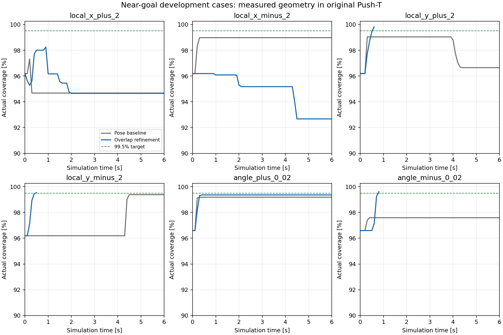

# Cập nhật căn chỉnh cuối: tối ưu phần diện tích target chưa được che phủ

Tài liệu này bổ sung cho [Detail_Report.md](../Detail_Report.md), mô tả thay đổi khi T đã gần đúng vị trí nhưng vẫn còn một dải màu xanh lá chưa được phủ. Các đường dẫn trong lệnh dưới đây được tính từ thư mục `pusht-research/`.

> Cập nhật ngày 16/11/2026: **MPC và runner live checkpoint GitHub mặc định qua màn khi coverage ≥95%**; Diffusion Policy tự viết vẫn mặc định ≥99%. Muốn xem checkpoint GitHub chạy trực tiếp, dùng `src/run_pretrained_diffusion.py` theo [README](../README.md), không dùng evaluator batch `eval.py`. Các bảng thực nghiệm ở cuối tài liệu giữ nguyên ngưỡng 99,5% của lần đo trước.

## 1. Vấn đề và hướng giải quyết

Cost trước đây so sánh pose hoặc các đỉnh tương ứng của T với goal. Cách đó tạo tín hiệu hữu ích để đưa T từ xa về đích, nhưng không đo trực tiếp diện tích màu xanh còn thừa. Khi độ lệch đã nhỏ, hạng sai số bình phương cũng nhỏ, nên các hạng chuyển động và giới hạn tìm kiếm có thể khiến controller ngừng cải thiện đủ mạnh.

Có thêm hai điểm liên quan đến giai đoạn cuối:

- Environment gốc trả `done=True` khi coverage **lớn hơn 95%**. Nếu runner dừng ngay tại đây, nó không còn cơ hội chỉnh phần 0–5% còn thiếu dù cost muốn phủ kín hơn.
- Proposal tiếp xúc cũ đặt tâm actuator cách bề mặt T bằng `radius + 3`. Với một correction nhỏ hơn khoảng hở 3 đơn vị, target cuối của proposal có thể vẫn chưa đưa actuator tới T.

Bản cập nhật bổ sung diện tích chưa phủ vào cost, cho phép tiếp tục chạy sau ngưỡng gốc, và bổ sung proposal cùng độ phân giải tìm kiếm phù hợp với correction nhỏ. World Model và dữ liệu train hiện tại không bị thay đổi bởi các cập nhật này.

## 2. Định nghĩa coverage và diện tích còn thừa

T trong source gốc là hợp của hai hình chữ nhật ở hệ tọa độ local:

$$
R_1=[-60,60]\times[0,30],\qquad
R_2=[-15,15]\times[30,120].
$$

Hai phần chỉ chung cạnh, không có phần nội thất giao nhau. Diện tích T là:

$$
A_T=120\cdot30+30\cdot90=3600+2700=6300.
$$

Đơn vị diện tích là **đơn vị mô phỏng bình phương**, không phải số pixel xanh trong ảnh render.

Gọi $P(s)$ là polygon T tại state $s$, $G$ là polygon target:

$$
c(s)=\frac{\operatorname{area}(P(s)\cap G)}{6300},
\qquad
u(s)=1-c(s),
\qquad
A_{uncovered}(s)=6300\,u(s).
$$

- $c=1$: target được phủ toàn bộ theo hình học.
- $c=0.99$: còn tối đa $6300\cdot0.01=63$ đơn vị diện tích chưa phủ.
- $c=0.995$: còn tối đa $6300\cdot0.005=31.5$ đơn vị diện tích chưa phủ.
- $c=0.95$: còn $315$ đơn vị diện tích chưa phủ; ngưỡng qua màn mặc định hiện tại của MPC và runner live checkpoint GitHub.

Đây là **intersection / target area**, cùng định nghĩa coverage của môi trường. Nó không phải IoU, vốn dùng mẫu số diện tích hợp. Code không đọc màu ảnh, không phân đoạn pixel, không phụ thuộc `render_size` hay anti-aliasing ở đường viền.

Ví dụ đơn giản, giữ hai T cùng hướng và dịch T theo trục X local một đoạn $\delta\in[0,30]$:

$$
A_{uncovered}=120\delta,\qquad
u=\frac{120\delta}{6300}.
$$

Do đó các gap rất nhỏ vẫn có giá trị cost khác nhau; không bị làm tròn vào một ô raster.

## 3. Hạng cost mới

Cho rollout dự đoán $\widehat{s}_0,\widehat{s}_1,\ldots,\widehat{s}_H$, chỉ các state tương lai $1\ldots H$ tham gia hạng overlap:

$$
J_{overlap}=(1-\lambda)\frac1H\sum_{k=1}^{H}u(\widehat{s}_k)
                 +\lambda\,u(\widehat{s}_H).
$$

Cấu hình [configs/mpc_overlap.json](../configs/mpc_overlap.json) dùng:

$$
\lambda=0.7,\qquad w_{overlap}=5.0,
\qquad J_{new}=J_{other}+5.0\,m(s_0)J_{overlap}.
$$

Hạng mới **tuyến tính theo tỷ lệ diện tích chưa phủ**, không bình phương thêm. Giá trị nhỏ nhất luôn ở coverage 100%, dù threshold kết thúc phiên MPC hiện được đặt 95% theo yêu cầu sử dụng.

Các hạng goal, distance, smoothness, time, approach, consistency và penetration vẫn tồn tại trong $J_{other}$. Goal theo hình học đỉnh tiếp tục tạo tín hiệu khi hai polygon ở xa nhau: lúc chưa giao nhau, overlap cost bằng 1 cho nhiều candidate và không phân biệt được hướng nào tiến gần target hơn.

Để giữ cách tiếp cận ban đầu, cấu hình mới dùng `overlap_activation_coverage=0.90`:

$$
m(s_0)=\mathbf{1}[c(s_0)\ge0.90].
$$

Mask này chỉ phụ thuộc state quan sát đầu lần plan, không phụ thuộc tương lai do candidate tưởng tượng. Khi chưa phủ 90%, overlap contribution bằng 0, time/approach dùng điều kiện pose cũ, sampling giữ std và proposal của giai đoạn trước. Khi phủ ít nhất 90%, bật cost diện tích, completion theo coverage, adaptive sampling và precision contact. Mask được tính lại ở lần quan sát tiếp theo, không latch/hysteresis; nếu coverage tụt dưới 90%, nhánh tiếp cận được dùng lại. Threshold 0 nghĩa là luôn bật refinement.

Trọng số 5,0 là lựa chọn cấu hình để tăng ưu tiên phần căn chỉnh cuối, không phải chứng minh đây là trọng số tối ưu cho mọi episode. Việc tăng trọng số không khắc phục được mọi sai số của World Model hoặc việc tìm kiếm chưa đề xuất được tiếp xúc phù hợp.

## 4. Tính diện tích chính xác trong Torch

Source: [src/CostFunctions.py](../src/CostFunctions.py).

Vì mỗi T gồm hai rectangle có nội thất rời nhau:

$$
\operatorname{area}(P\cap G)
=\sum_{i=1}^{2}\sum_{j=1}^{2}
\operatorname{area}(R_i^{pred}\cap R_j^{goal}).
$$

Implementation thực hiện:

1. Đổi pose T dự đoán vào hệ tọa độ target. Hai rectangle target trở thành axis-aligned; cách này cũng tránh trừ các số lớn trong công thức diện tích ở world frame.
2. Tạo bốn cặp rectangle dự đoán/target cho mỗi pose.
3. Dùng bounding box axis-aligned để bỏ các cặp chắc chắn có diện tích giao bằng 0.
4. Clip polygon dự đoán lần lượt qua bốn nửa mặt phẳng của rectangle target bằng Sutherland–Hodgman.
5. Giữ số đỉnh hợp lệ của từng polygon; rectangle sau bốn phép clip có tối đa 8 đỉnh.
6. Tính diện tích bằng công thức shoelace, cộng bốn diện tích và chia 6300.

Với polygon đã clip có các đỉnh $v_i=(x_i,y_i)$ theo thứ tự ngược chiều kim đồng hồ:

$$
A=\frac12\sum_{i=0}^{n-1}(x_i y_{i+1}-y_i x_{i+1}),
\qquad v_n=v_0.
$$

Không có vòng Python gọi Shapely cho từng candidate. Tất cả pose/candidate/horizon được xử lý theo batch Torch. Shapely chỉ được dùng làm oracle độc lập trong kiểm thử và đo coverage thật của môi trường.

“Chính xác” ở đây nghĩa là tính giao polygon bằng hình học, không dùng lưới mẫu hoặc xấp xỉ diện tích bằng khoảng cách. Kết quả vẫn có sai số floating point của dtype đang dùng; output được clamp vào `[0,1]`. Pose NaN/Inf trả NaN riêng tại vị trí tương ứng, để `total_cost` loại candidate đó bằng infinity mà không làm mất các candidate hợp lệ khác.

### Interface mới và tương thích

| Interface/field | Hợp đồng |
|---|---|
| `tee_coverage(block_xy, block_angle, goal)` | `block_xy`: floating Torch tensor `(...,2)`; angle broadcast được với leading dims; goal `(3,)`. Trả coverage shape `(...)`, cùng dtype/device |
| `overlap_cost(states, goal, config=None)` | State `(H+1,10)` hoặc `(B,H+1,10)`; trả scalar hoặc `(B,)` theo công thức mean/terminal |
| `CostConfig.overlap_weight` | Mặc định `0.0`; cấu hình mới dùng `5.0` |
| `CostConfig.goal_coverage` | Mặc định `0.0` để giữ cơ chế completion cũ; giá trị trong `(0,1]` bật completion theo coverage |
| `CostConfig.overlap_activation_coverage` | Mặc định `0.0`; cấu hình mới 0,90. Kích hoạt theo coverage của state đầu mỗi plan |
| `cost_components(...)["overlap"]` | Hạng cost chưa nhân trọng số, đã áp mask phase; 0 ở phase xa không có nghĩa diện tích còn hở bằng 0 |
| `completion_time_cost(...)` | Dùng coverage nếu `goal_coverage>0` và refinement đang bật; còn lại dùng tolerance pose cũ |
| `_rectangle_intersection_area(vertices, bounds)` | Lõi clipping batch nội bộ; input `(N,4,2)` và `(N,4)` theo `xmin,xmax,ymin,ymax` |
| `_overlap_term(coverages, terminal_weight)` | Ghép mean/terminal của `1-coverage` |
| `_completion_from_within(within, config, dtype)` | Chọn thời điểm đến sớm nhất rồi ở trong ngưỡng đến cuối horizon |
| `_refinement_coverages(states, goal, config)` | Trả mask phase, coverage đầu và coverage tương lai; chỉ clip tương lai của candidate đang active |
| `_completion_within(future, goal, config, refinement, covered)` | Ghép tiêu chí pose/coverage theo mask vào vector boolean dùng cho completion time |

`cost_components` dùng lại kết quả coverage cho overlap, completion và approach. Khi có gate, tính coverage initial trước; nếu mọi trajectory chưa active thì bỏ qua toàn bộ clipping tương lai. Với batch lẫn nhiều initial state, chỉ các trajectory active được tính future coverage. Khi cả `overlap_weight` và `goal_coverage` bằng 0, không gọi geometry overlap. `overlap_cost(...)` độc lập luôn trả diện tích chưa phủ thật của trajectory, không áp gate. Cách gọi legacy `total_cost(states, goal)` không truyền config vẫn giữ ba hạng cũ.

## 5. Completion và điều kiện dừng nhất quán

Với `goal_coverage=0.95` trong phase refinement, các state dự đoán được xem là trong vùng hoàn thành khi:

$$
b_k=\mathbf{1}[c(\widehat{s}_k)\ge0.95].
$$

Hạng thời gian vẫn yêu cầu đến đích và giữ đến cuối horizon ít nhất `goal_hold_steps=2`. Candidate chạm ngưỡng rồi rời ngưỡng trước cuối horizon không nhận thưởng thời gian. Khi initial coverage chưa đạt threshold, hạng approach vẫn hoạt động dù pose error đã nằm trong tolerance cũ.

Runner cũng có `--target-coverage` để kết thúc theo **coverage thật**. Flag này cập nhật `CostConfig.goal_coverage` cho planner, tránh việc planner và runner sử dụng hai threshold khác nhau. Nếu không truyền flag, runner lấy `cost.goal_coverage` khi được bật; nếu cấu hình cũ để 0, runner giữ điều kiện gốc `coverage > 0.95`.

Không chỉnh `env.success_threshold` trong source gốc. Mặc định hiện tại của runner MPC là `coverage >= 0.95`, nên đúng 95% đã hoàn thành, còn cờ `done` gốc dùng `> 0.95`. Khi người dùng đặt threshold cao hơn 95%, runner có thể tiếp tục gọi `env.step` sau khi environment trả `done=True`, cho đến threshold yêu cầu hoặc `max_steps`. Môi trường Push-T gốc cho phép bước tiếp mà không cần reset ở thời điểm đó.

Mục tiêu cost vẫn là phủ **100%**. Mặc định hiện tại của MPC là hoàn thành ở **coverage ≥95%**. Với `--continuous`, runner lưu lượt đã hoàn thành rồi tự chuyển sang lượt mới. Có thể yêu cầu `--target-coverage 1.0`; runner chỉ cho sai số số học `1e-9` ở ngưỡng đúng 100%, không tự hạ ngưỡng yêu cầu. Điều này không đảm bảo controller tìm được pose gần như trùng tuyệt đối trước timeout.

## 6. Proposal tiếp xúc chính xác và sampling gần đích

Source: [src/MPC_Controller.py](../src/MPC_Controller.py).

### `precision_contact=true`

Giữ target tiếp cận ban đầu:

$$
p_{stage}=p_{surface}+n\,(r_A+3),\qquad r_A=15.
$$

Khi phase refinement đang active và khoảng lỗi kết hợp đủ nhỏ:

$$
\|p_T-p_g\|+120\,|\operatorname{wrap}(\theta_T-\theta_g)|\le20,
$$

và dịch chuyển bề mặt mong muốn hướng vào T (`dot(push, current_normal) < -1e-6`), proposal kết thúc tại tâm actuator tiếp tuyến với bề mặt goal:

$$
p_{end}=p_{surface}^{goal}+r_A n^{goal},\qquad
push_{new}=p_{end}-p_{stage}.
$$

Cách này tính cả việc đóng khoảng hở tiếp cận 3 đơn vị. Nó không lấy correction nhỏ của T rồi cộng thẳng vào điểm còn đang cách T 3 đơn vị. Pháp tuyến goal được dùng để phù hợp khi có correction góc.

Ở xa đích, proposal cũ được giữ. Các proposal vẫn chịu giới hạn target/slew, được rollout bằng World Model và chấm bởi cùng hàm cost; không phải controller thay thế dùng physics thật để chọn trước action.

### `adaptive_sampling=true`, `refinement_min_std=0.5`

Giữ `min_std=3` ở giai đoạn tiếp cận, giống cấu hình trước. Chỉ trong phase refinement dùng sàn riêng `refinement_min_std=0.5`; độ lệch chuẩn khởi tạo được điều chỉnh theo lỗi hiện tại:

$$
\sigma_0=\min\left(60,
\max\left(2\sigma_{min},
0.5\,e_p+40\,e_\theta+0.5\,gap_+\right)\right),
\qquad \sigma_{min}=0.5.
$$

$e_p$ là lỗi vị trí T, $e_\theta$ là lỗi góc wrap tuyệt đối, $gap_+$ là khoảng hở agent–T không âm. Vì vậy khi T gần đích và actuator ở sát vật, CEM tìm các target nhỏ hơn thay vì luôn bắt đầu với độ lệch chuẩn 60 đơn vị. Đây vẫn là sampling trong đơn vị target XY, không phải giới hạn gia tốc thật.

Các thông số chính khác vẫn là horizon 20, population 256, 4 vòng CEM, noise correlation 0,9 và max action delta 40. Nhịp control vẫn 10 Hz; physics vẫn 100 Hz.

## 7. Metric và artifact mới

Runner tiếp tục lưu từng episode, tự chuyển lượt ở continuous mode và dừng/lưu bằng Q/Esc hoặc Ctrl+C.

Các metric bổ sung giúp phân biệt tiêu chí mới với tiêu chí gốc:

- `target_coverage`, `target_coverage_comparison`: threshold yêu cầu và toán tử so sánh.
- `original_success_threshold`: thông số gốc, thông thường 0,95.
- `original_environment_success`: coverage cuối có vượt ngưỡng gốc không.
- `original_environment_reached`: từng có thời điểm vượt ngưỡng gốc không.
- `final_uncovered_fraction`, `final_uncovered_area`: phần còn thiếu ở cuối episode.
- `min_uncovered_fraction`, `min_uncovered_area`: mức còn thiếu ít nhất từng đạt.
- NPZ có chuỗi `uncovered_fraction` và `uncovered_area`, cùng `target_coverage`, `target_area`.

Chart tổng kết coverage có threshold yêu cầu và threshold gốc nếu khác nhau. Nếu override thành 99%, không dùng “đã vượt 95% một lần” làm bằng chứng episode đã đạt tiêu chí đó. Mặc định MPC hiện dùng ≥95%; với mọi threshold, episode có thể tiến gần rồi trôi ra nên cần đọc cả final coverage và max coverage.

## 8. Chạy lại MPC: không có bước train MPC riêng

MPC này không chứa mạng hoặc checkpoint riêng cần huấn luyện. Nó tối ưu chuỗi action online bằng CEM ở mỗi control step. Thay cost/config có hiệu lực ngay khi chạy lại bằng checkpoint World Model hiện tại.

Từ `pusht-research/`, trong Conda environment đã cài:

```bash
python -B src/run_mpc.py \
  --checkpoint checkpoints/WorldModel_contact_best.pt \
  --config configs/mpc_overlap.json \
  --target-coverage 0.95 \
  --continuous --start-seed 1006 --max-steps 500 \
  --render --realtime-plotting --pace \
  --output results/ai_overlap_95
```

500 bước tương đương ngân sách 50 giây mô phỏng mỗi lượt. Thành công hoặc timeout sẽ chuyển seed tiếp theo. Q/Esc ở simulator hoặc chart dừng cả phiên và lưu lượt đang chạy. Dùng output mới để tránh ghi đè kết quả cũ.

Muốn yêu cầu phủ gần như tuyệt đối theo polygon, đổi thành:

```bash
python -B src/run_mpc.py \
  --checkpoint checkpoints/WorldModel_contact_best.pt \
  --config configs/mpc_overlap.json \
  --target-coverage 1.0 \
  --continuous --start-seed 1006 --max-steps 500 \
  --render --realtime-plotting --pace \
  --output results/ai_overlap_100
```

Ngưỡng 100% có thể khiến episode hết ngân sách dù đã nhìn gần như khớp. Giá trị threshold là điều kiện đánh giá yêu cầu, không phải cam kết solver đạt được.

Ví dụ đánh giá hữu hạn, không GUI, trên một nhóm seed mới do bạn lựa chọn:

```bash
python -B src/run_mpc.py \
  --checkpoint checkpoints/WorldModel_contact_best.pt \
  --config configs/mpc_overlap.json \
  --target-coverage 0.95 \
  --seeds 13000 13001 13002 13003 13004 \
  --max-steps 500 --threads 1 \
  --output results/overlap_evaluation_new
```

Lệnh minh họa cách đánh giá; tài liệu không khẳng định đã chạy hoặc đạt tỷ lệ thành công nào trên nhóm seed này. Khi so sánh cấu hình cũ/mới, dùng cùng threshold dừng, pose/seed khởi tạo và số bước. Nếu tiếp tục tune trên một nhóm seed, gọi chúng là development thay vì test giữ riêng.

## 9. Khi nào mới cần train lại World Model?

Thay cost không làm thay đổi ánh xạ vật lý `state + action → next_state`, nên **không cần retrain World Model chỉ để bật overlap**. Checkpoint contact hiện tại vẫn được sử dụng.

Nếu model dự đoán sai những cú đẩy rất nhỏ, cần dữ liệu bổ sung ở giai đoạn cuối rồi đánh giá lại model. Fine-tune nhiều epoch trên cùng dữ liệu cũ không tạo ra những tình huống chưa từng có và không đảm bảo accuracy hoặc tỷ lệ hoàn thành tốt hơn.

Ví dụ fine-tune tùy chọn từ các dataset hiện có, ghi checkpoint mới:

```bash
python -B src/Model_MLP_OneStepPredict.py \
  --resume checkpoints/WorldModel_contact_best.pt \
  --dataset data/demonstrations/pusht_demo.zarr data/demonstrations/demo_actions_v1.zarr \
  --epochs 50 --lr 0.0001 --torch-threads 1 --device cpu \
  --output checkpoints/WorldModel_contact_finetuned.pt \
  --last-output checkpoints/WorldModel_contact_finetuned_last.pt \
  --history experiments/world_model_contact_finetuned.json
```

`--resume` giữ normalization/kiến trúc/dt từ checkpoint và khởi tạo optimizer mới. Chỉ đổi checkpoint trong lệnh MPC sang bản fine-tune sau khi đánh giá xác nhận phù hợp; không mặc nhiên coi model mới là tốt hơn.

**Giới hạn của recorder gốc:** `demo_pusht.py` kết thúc episode ngay khi coverage vượt 95%, và không ghi observation terminal thành dòng tiếp theo. Vì vậy không thể giả định demonstration hiện tại có đủ thao tác sửa gap từ 95% lên 99,5–100%. Muốn thu bộ dữ liệu fine alignment đúng nghĩa cần recorder/luồng thu thập cho phép tiếp tục sau 95%, giữ state–action–next-state và dt nhất quán. NPZ do runner AI lưu hiện chưa tự chuyển thành Zarr training store. Thay đổi recorder/converter này không nằm trong cập nhật cost.

## 10. Kiểm chứng hình học và chi phí tính toán

`tests/test_overlap_cost.py` có 9 kiểm thử:

1. Full/no overlap và gap 0,001; công thức dịch ngang có đáp án giải tích.
2. So sánh pose ngẫu nhiên và sát đích với giao polygon Shapely độc lập.
3. Đối xứng giao diện tích, tuần hoàn góc và bất biến dưới tịnh tiến/quay toàn hệ.
4. Shape batch/broadcast, NaN/Inf riêng từng pose và validation input/config.
5. Mean/terminal uncovered cost, trọng số tham gia total cost và loại trajectory lỗi.
6. Completion theo coverage, đến sớm/đến muộn/đến rồi rời target.
7. Cấu hình cũ không gọi geometry overlap khi tính cost.
8. Phase xa cho cost giống cấu hình cũ và không clip các state tương lai.
9. Batch có cả phase xa/gần khớp kết quả từng trajectory riêng, chỉ clip tương lai của phần active.

Sai số cho phép so với oracle trong test: float64 `5e-12`, float32 `1.5e-6` của coverage. Các test này kiểm tra phép tính và hợp đồng; không thay thế đánh giá closed-loop với World Model đã học.

Microbenchmark CPU một Torch thread, batch 256 trajectory × 21 state, thời gian median mỗi lần tính `tee_coverage`:

| Phân bố pose | Thời gian |
|---|---:|
| Tập trung gần goal | Khoảng 25,7 ms |
| Phân bố rộng quanh workspace | Khoảng 4,3 ms |
| Tất cả ở xa, không giao | Khoảng 2,24 ms |

AABB rejection giảm phần lớn clipping ở giai đoạn xa. Gần target, nhiều polygon thật sự giao nên phải xử lý nhiều cặp hơn. Bốn vòng CEM có thể thêm xấp xỉ 100 ms chỉ cho hạng hình học ở giai đoạn sát đích, ngoài thời gian World Model, các cost khác, proposal và GUI. Planning thực tế có thể vượt ngân sách 100 ms của control 10 Hz. `--pace` không thể bù khi tính toán đã chậm; thời gian mô phỏng mỗi action vẫn là 0,1 s.

Các cải tiến này làm mục tiêu và điều kiện kết thúc phù hợp hơn với việc phủ kín target. Chưa có bảo đảm mọi trạng thái sẽ đạt 99,5% hoặc 100%; khả năng dự đoán vi chuyển động, horizon, tìm kiếm tiếp xúc và sai số tích lũy vẫn ảnh hưởng kết quả.

## 11. Kết quả kiểm thử và điều khiển đã đo

Các bảng/ảnh dưới đây giữ ngưỡng **99,5% của lần đo trước**. Việc đổi mặc định qua màn hiện tại sang 95% không thay đổi số liệu đã đo và chưa phải một benchmark mới.

**Mốc lịch sử của cập nhật overlap: 72 kiểm thử tự động pass**. Phép tính diện tích đã được đối chiếu với Shapely; test xác nhận cost và kế hoạch ở phase xa không đổi, batch pha trộn đúng, runner tiếp tục qua 95% khi yêu cầu threshold cao hơn, và ngưỡng 100% không bỏ qua gap có ý nghĩa. Hai smoke GUI trên environment gốc bắt đầu tại 96,19%, yêu cầu 99,5%, đi qua nhiều episode rồi dừng/lưu bằng Q ở simulation hoặc biểu đồ; dữ liệu vẫn có N+1 state và N action. Bộ kiểm thử hiện tại sau các cập nhật policy/runner được ghi trong README.

### Ca căn chỉnh gần đích

Sáu ca được tạo để kiểm tra development: lệch ±2 đơn vị theo trục local X/Y hoặc lệch góc ±0,02rad, actuator đặt ở phía có thể đẩy. Mỗi ca tối đa60 action (6 giây mô phỏng), cùng checkpoint và seed. Baseline dùng goal/pose cũ, không overlap/precision/adaptive, nhưng cùng ngưỡng dừng 99,5% và completion theo coverage để so sánh. Đây không phải tập test độc lập hay tỷ lệ thành công trên mọi trạng thái khởi tạo.

| Ca | Coverage đầu | Baseline max | Bản mới max | Bản mới cuối | Đạt 99,5% | Bước bản mới |
|---|---:|---:|---:|---:|:---:|---:|
| local_x_plus_2 | 96.19% | 97.32% | 98.25% | 94.66% | Chưa | 60 |
| local_x_minus_2 | 96.19% | 98.98% | 96.19% | 92.67% | Chưa | 60 |
| local_y_plus_2 | 96.19% | 99.04% | 99.82% | 99.82% | Có | 6 |
| local_y_minus_2 | 96.19% | 99.38% | 99.54% | 99.54% | Có | 5 |
| angle_plus_0_02 | 96.60% | 99.18% | 99.36% | 99.36% | Chưa | 60 |
| angle_minus_0_02 | 96.60% | 97.59% | 99.61% | 99.61% | Có | 8 |

Bản mới đạt 3/6 ca, baseline 0/6. Ba ca thành công mất 0,6 s, 0,5 s và 0,8 s mô phỏng. Tuy nhiên hai ca dịch theo X có coverage cuối thấp hơn baseline; việc có thêm mục tiêu đúng chưa sửa được sai số World Model và mọi vấn đề tìm kiếm. Không coi kết quả này là bằng chứng bản mới tốt hơn trong mọi trường hợp.



### Lượt đầy đủ từ reset

Cấu hình cuối cũng chạy trên hai seed development cũ 1000/1001, tối đa 300 action (30 giây mô phỏng). Không dùng các seed đánh giá giữ riêng 1005–1009 để tune bản cập nhật.

| Seed | Max coverage | Coverage cuối | Đạt 99,5% trong 300 bước |
|---:|---:|---:|:---:|
| 1000 | 98.62% | 98.28% | Chưa |
| 1001 | 96.02% | 96.02% | Chưa |

Cả hai đã vượt threshold gốc 95% nhưng chưa đạt yêu cầu 99,5% của lần đo này. Cost mới, proposal nhỏ và điều kiện dừng được triển khai đúng; khả năng điều khiển chính xác vẫn bị giới hạn bởi World Model hiện tại. Các thử nghiệm cấu hình trước khi thêm phase cũng được giữ trong `results/overlap_development/`, không trộn chúng vào bảng cấu hình cuối.

Trong sáu lượt gần đích của cấu hình cuối, planner p95 khoảng 202–241 ms, chưa gồm GUI. Đây là số đo trên máy đang dùng; không bảo đảm chu kỳ wall-clock 100 ms. Pipeline vẫn giữ dt mô phỏng 0,1 s.

Tóm tắt số liệu/config/case để đưa lên GitHub: [overlap_validation.json](overlap_validation.json). Artifact đầy đủ cục bộ: `results/overlap_alignment_pose/`, `results/overlap_alignment_final/`, `results/overlap_phased_development/`, `results/overlap_gui_simulator_q/`, `results/overlap_gui_plot_q/`.
