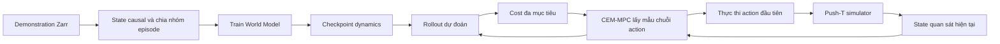

# Ngữ cảnh tổng thể và bàn giao báo cáo môn học — Push-T

**Snapshot đối chiếu: 17/11/2026, múi giờ Asia/Saigon.** Tài liệu này bàn giao cho một AI khác để viết báo cáo môn học khoảng **15–20 trang bằng tiếng Việt**, tập trung vào **World Model + MPC + Cost Function**. Đây là bản tổng hợp ngữ cảnh và chứng cứ, không phải bản báo cáo môn học đã dàn trang.

Repository: [thanhnguyen16102001/pusht-research](https://github.com/thanhnguyen16102001/pusht-research). Đường dẫn tương đối trong tài liệu tính từ root repository `pusht-research/`. Source mô phỏng gốc được clone cạnh repository này, không nằm trong thư mục `src/` tự xây dựng.

## 1. Yêu cầu bàn giao và thứ tự ưu tiên thông tin

Mục tiêu của người dùng là tái hiện bài toán Push-T bằng dữ liệu tự thu thập, tự xây dựng mô hình hiểu quan hệ state–action, rồi dùng MPC chọn chuỗi action để đẩy T vào target. Phần môn học cần giải thích **công nghệ, kỹ thuật, phương pháp, thuật toán, ý tưởng thiết kế và chiến lược xử lý**, nối công thức với code và kết quả thực nghiệm.

Đề tài gợi ý: **“Điều khiển đẩy vật thể Push-T bằng mô hình động lực học học từ dữ liệu và điều khiển dự báo tối ưu đa mục tiêu”**.

AI nhận bàn giao cần:

1. Đọc tài liệu này, sau đó đối chiếu các source và artifact được dẫn trước khi viết kết luận.
2. Giữ World Model–MPC–Cost làm trọng tâm; Diffusion Policy là nhánh đối chiếu, không đổi chủ đề thành bài báo về diffusion.
3. Phân biệt rõ cái **đã triển khai**, cái **đã đo**, quan sát phát triển và hướng **đề xuất**.
4. Dùng số liệu đúng checkpoint, seed, ngưỡng và cách tính metric; không ghép các phiên khác điều kiện thành một benchmark.
5. Chưa có tên môn học, giảng viên, trường, MSSV, mẫu trình bày hoặc chuẩn trích dẫn do người dùng cung cấp. Để placeholder hoặc hỏi khi thực sự dàn trang; không tự điền thông tin này.
6. Không tự chạy lại train, đổi thuật toán, nâng tần số hay sửa kết quả chỉ để có câu chuyện báo cáo đẹp hơn.

**Nguồn sự thật:** source/config đang dùng và JSON của từng lần chạy → file bàn giao này → tài liệu kỹ thuật/lịch sử → lời mô tả cũ trong hội thoại. Khi có mâu thuẫn, kiểm tra artifact gốc. Đặc biệt, tên thư mục kết quả không đủ để xác định ngưỡng coverage.

Các tài liệu đọc kèm:

- [README.md](README.md): cài đặt, train, lệnh chạy; hai mục cuối là GitHub pretrained và MPC local.
- [Detail_Report.md](Detail_Report.md): giải thích kỹ thuật rất chi tiết; một số phần ghi lại mốc cũ.
- [docs/overlap_refinement.md](docs/overlap_refinement.md): xử lý khe xanh còn thừa và thử nghiệm căn chỉnh cuối.
- [docs/diffusion_policy.md](docs/diffusion_policy.md): nhánh imitation, adapter pretrained và DDIM.
- [THIRD_PARTY_NOTICES.md](THIRD_PARTY_NOTICES.md): phân biệt source/checkpoint của tác giả gốc và phần tự xây dựng.

### 1.1. Diễn tiến yêu cầu trong quá trình làm dự án

| Giai đoạn | Ý định và quyết định đã chốt |
|---|---|
| Ban đầu | Đọc project để hiểu bối cảnh; mục tiêu là tự tạo dữ liệu, tự xây model và tái hiện hành vi đẩy T của source gốc. |
| Visualization | Xem episode đã thu hoặc hiển thị live bằng `realtime_plotting=False/True`; giữ style, ưu tiên Times New Roman, chỉ vẽ dữ liệu đến thời điểm hiện tại. Font có fallback khi máy thiếu font. |
| Tần số | Có yêu cầu 100 Hz, sau đó người dùng nói bỏ qua nếu 10 Hz là mặc định toàn project. Kết quả thực tế vẫn control 10 Hz, physics 100 Hz. |
| Action target | Là vị trí chuột/setpoint yêu cầu actuator đến; actuator có động học trễ nên vị trí thực không trùng ngay action. Không chủ động dịch nhãn vài timestamp. |
| World Model và MPC | Người dùng duyệt kế hoạch rồi cho phép implement, kiểm thử và đánh giá. Model học state/action → next state; MPC tìm chuỗi action tốt và thực thi từng bước. |
| Đa mục tiêu | T đến đúng target; chuyển động actuator mượt; đường đi ngắn; hoàn thành sớm. Path/smoothness là đại lượng đại diện, chưa đo nhiên liệu hoặc độ bền thiết bị thực. |
| Môi trường gốc | Dùng Push-T clone từ GitHub; continuous, tự lưu từng lượt, Q/Esc để lưu lượt dở và thoát, có biểu đồ. |
| Căn chỉnh cuối | Người dùng quan sát còn một dải xanh nhỏ dù T gần đúng pose. Bổ sung cost diện tích target chưa phủ và proposal tiếp xúc chính xác. |
| Ngưỡng qua màn | Đã thử các mốc 99% và 99,5%; quyết định hiện tại MPC và pretrained mặc định ≥95%. Policy tự viết vẫn mặc định ≥99%, nhưng lệnh so sánh đặt rõ ≥95%. |
| Diffusion | Thêm policy tự viết học từ toàn bộ Zarr, dùng lại preprocessing; thêm adapter chạy checkpoint GitHub để so sánh. |
| Lag pretrained | CPU DDPM100 chờ khoảng 2,3 giây mỗi lần tạo 8 action. Thêm DDIM20 tùy chọn; giữ DDPM100 làm cấu hình gốc. |
| Tài liệu | README đã được rút gọn; báo cáo toán/code nằm ở tài liệu riêng. Lần bàn giao này cập nhật cả các kết quả người dùng chạy sau mốc tài liệu cũ. |
| GitHub | Người dùng yêu cầu repository Public và đưa toàn bộ nội dung project có ý nghĩa lên, gồm data/results/checkpoint. Checkpoint lớn dùng Git LFS; cache, file tạm và thông tin xác thực không nằm trong repository. |

### 1.2. Những cập nhật không được bỏ sót

- Policy tự viết **đã train 100 epoch**, không còn chỉ có smoke test 1 epoch.
- Native GitHub evaluation **đã có đủ 50 test + 6 train episode**, không còn chỉ là smoke test 8 bước.
- Phiên MPC mới ngày 17/11 có **6/7 lượt hoàn tất thành công** ở ≥95%, cộng một lượt bị người dùng ngắt. Đây là quan sát phát triển, chưa phải test độc lập.
- Toàn bộ **119 tests pass trong 5,631 giây** khi kiểm tra ngày 17/11. Số test không đại diện success rate.

## 2. Kiến trúc và bản đồ source



| File/thư mục | Vai trò |
|---|---|
| [src/episode_kinematics.py](src/episode_kinematics.py) | Đọc episode, sai phân causal, vẽ replay/live và quản lý figure. |
| [src/preprocess_onestep_data.py](src/preprocess_onestep_data.py) | State 10D, transition, chia nhóm pose, normalization, cache/provenance. |
| [src/Model_MLP_OneStepPredict.py](src/Model_MLP_OneStepPredict.py) | Entry point train, baseline MLP, predict/rollout, lưu/nạp World Model. |
| [src/Model_ContactDynamics.py](src/Model_ContactDynamics.py) | Learned dynamics trong hệ local của T với prior tiếp xúc. |
| [src/CostFunctions.py](src/CostFunctions.py) | Hình học, coverage, tám thành phần cost và API legacy. |
| [src/MPC_Controller.py](src/MPC_Controller.py) | CEM, warm start, proposal, ràng buộc và fallback. |
| [src/pusht_runtime.py](src/pusht_runtime.py) | Adapter simulator, state observer, coverage thực và metrics vật lý. |
| [src/run_mpc.py](src/run_mpc.py) | Vòng kín, continuous, Q/Esc, ghi episode/summary và biểu đồ. |
| [src/evaluate_world_model.py](src/evaluate_world_model.py) | Đánh giá dự đoán đệ quy theo horizon, contact và baseline. |
| [src/Diffusion_Policy_model.py](src/Diffusion_Policy_model.py), [src/diffusion_policy_data.py](src/diffusion_policy_data.py) | Nhánh imitation tự viết và dữ liệu chuỗi. |
| [src/pretrained_diffusion_policy.py](src/pretrained_diffusion_policy.py), [src/run_pretrained_diffusion.py](src/run_pretrained_diffusion.py) | Adapter checkpoint tác giả và runner live chung. |
| [src/run_diffusion_policy.py](src/run_diffusion_policy.py) | Runner policy, queue action, metadata sampler, inference latency. |
| `configs/`, `checkpoints/`, `experiments/`, `results/`, `tests/` | Cấu hình, trọng số, lịch sử train, đánh giá và regression tests. |

Source gốc tham chiếu: [real-stanford/diffusion_policy](https://github.com/real-stanford/diffusion_policy), commit `5ba07ac6661db573af695b419a7947ecb704690f`. `src/` của dự án không sửa source gốc. Tên model/training có chữ hoa; file phụ trợ dùng chữ thường theo yêu cầu người dùng.

Môi trường local đã kiểm thử: Python 3.9.18, PyTorch 2.5.1+cpu, NumPy 1.23.3, Pymunk 6.2.1, Pygame 2.1.2, Gym 0.21, Zarr 2.12, Matplotlib 3.6.1. Manifest: [environment_research.yaml](environment_research.yaml). Máy hiện có Conda `pusht-sim`; cài manifest mới tạo tên `pusht-research`. Pretrained gốc dùng `robodiff` riêng với Torch 1.12.1 và Diffusers 0.11.1. Không trộn hai môi trường khi tái lập.

## 3. Môi trường, dữ liệu và biểu diễn

### 3.1. Quy ước vật lý và thời gian

Project dùng `PushTEnv` từ repository Diffusion Policy gốc, qua adapter [pusht_runtime.py](src/pusht_runtime.py). Không thay thế engine vật lý bằng World Model: engine sinh trạng thái thực, còn World Model dự báo trạng thái để MPC chấm các phương án.

- Workspace có kích thước `512 × 512`; vị trí đang tính bằng đơn vị mô phỏng, chưa quy đổi sang mét.
- Actuator là hình tròn bán kính 15. T gồm hai rectangle local: thanh ngang `[-60,60] × [0,30]`, thân `[-15,15] × [30,120]`; diện tích T là 6.300.
- Goal chuẩn là `[256, 256, π/4]`. Pose của T dùng body origin của simulator; không tự đổi sang tâm khối lượng khi đọc state.
- **Control 10 Hz**, `Δt=0,1 s`; **physics 100 Hz**, substep `0,01 s`. Một action được giữ qua 10 substep. Yêu cầu tăng toàn dự án lên 100 Hz trước đây đã được người dùng rút lại nếu 10 Hz là mặc định.
- Thời gian biểu đồ/hoàn thành là thời gian mô phỏng nominal. `wall_seconds` còn gồm inference, planner, GUI và pacing; hai loại thời gian có thể khác nhau đáng kể.

Action `a_t=[x_cmd,y_cmd]` là **target XY tuyệt đối của actuator**, tương ứng vị trí chuột được yêu cầu; không phải vận tốc, lực hay delta vị trí. Source gốc dùng PD control ở từng substep:

$$
\dot v_A=100(a_t-p_A)-20v_A.
$$

Vì có động lực học PD, target có thể đi trước vị trí actuator thực tế. Không được diễn giải điều này thành thao tác dịch nhãn action vài timestamp trong preprocessing.

### 3.2. State và ước lượng vận tốc nhân quả

Zarr lưu raw state 5D và action 2D:

$$
q_t=[p^A_x,p^A_y,p^T_x,p^T_y,\theta_T],\qquad a_t\in\mathbb R^2.
$$

[episode_kinematics.py](src/episode_kinematics.py) dựng state 10D:

$$
s_t=[p^A_x,p^A_y,v^A_x,v^A_y,p^T_x,p^T_y,v^T_x,v^T_y,\theta_T,\omega_T].
$$

Vận tốc dùng sai phân lùi `v_0=0`, `v_t=(p_t-p_{t-1})/Δt`. Angular velocity được tính sau `np.unwrap`; raw angle của T vẫn được giữ trong state. Không dùng sample tương lai và không thay bằng velocity tức thời của Pymunk. `StateObserver` trong runtime dùng cùng quy ước, reset ở đầu mỗi episode.

`load_episode_kinematics(zarr_path, episode_id=0, control_hz=10.0)` mở Zarr read-only, cắt episode theo `meta/episode_ends` dạng exclusive và kiểm tra shape. Runtime/plotter/checkpoint đều kiểm tra tính nhất quán của `dt`.

### 3.3. Preprocessing và chống rò rỉ dữ liệu

[preprocess_onestep_data.py](src/preprocess_onestep_data.py) cung cấp `prepare_data`, `preprocess_data` và `load_data`. Pipeline đã triển khai:

1. Đọc `data/state`, `data/action`, `meta/episode_ends`; xử lý từng episode, không ghép transition qua ranh giới episode.
2. Loại path lặp và dataset sao chép hoàn toàn bằng SHA-256 trên state, action và episode boundaries.
3. Nhóm episode theo initial pose: lấy các cột `[0,1,4,5,8]` của state 10D, wrap góc, round 4 chữ số rồi hash. Các lượt cùng pose khởi tạo ở cùng split, kể cả nằm trong hai Zarr khác nhau.
4. Chia train/validation theo nhóm, không random split từng transition. Cần ít nhất hai nhóm có transition; seed mặc định 42, validation ratio 0,1.
5. Mean/std chỉ được tính trên train; `std(ddof=1)` được chặn dưới `1e-6`.
6. Cache schema 2 giữ train/val đã chuẩn hóa, raw episodes, nguồn dữ liệu, signature, split, normalization và dt để phục vụ rollout/evaluation.

Dữ liệu đã dùng train hai World Model hiện tại, theo `experiments/world_model*_training.json`:

| Hạng mục | Giá trị xác minh |
|---|---:|
| Dataset | `pusht_demo.zarr`, `demo_actions_v1.zarr` |
| Episode / state | 224 / 41.582 |
| Nhóm initial pose | 146 |
| Train / validation episode | 199 / 25 |
| Train / validation transition | 35.894 / 5.464 |

Tổng transition là `41.582 − 224 = 41.358`. Các con số 36.093/5.489 thuộc mẫu chuỗi của Diffusion Policy, không phải transition World Model. World Model giữ action demonstration khi train; action planner/runtime được giới hạn theo miền điều khiển.

## 4. World Model: mô hình và huấn luyện

### 4.1. Học thay đổi pose và dựng state kế tiếp

[Model_MLP_OneStepPredict.py](src/Model_MLP_OneStepPredict.py) nhận `x_t=[s_t,a_t] ∈ R^12`, dự đoán **năm thay đổi pose**, không dự đoán độc lập cả 10 thành phần next-state:

$$
y_t=\Delta q_t=[\Delta p^A_x,\Delta p^A_y,\Delta p^T_x,\Delta p^T_y,\Delta\theta_T].
$$

Góc delta dùng `atan2(sin(θ_{t+1}−θ_t), cos(θ_{t+1}−θ_t))`. Normalization và inference:

$$
\tilde x=(x-\mu_x)/\sigma_x,\quad\tilde y=(y-\mu_y)/\sigma_y,
$$
$$
\widehat{\Delta q}=f_\phi(\tilde x)\odot\sigma_y+\mu_y,\quad
\hat q_{t+1}=q_t+\widehat{\Delta q},\quad\hat v_{t+1}=\widehat{\Delta q}/\Delta t.
$$

Các vận tốc tuyến tính/góc được đặt lại vào đúng cột của state 10D. Thiết kế này giữ tính nhất quán giữa displacement dự báo và vận tốc. Tên `residual_mlp_v1` nghĩa là học pose delta/residual; không phải ResNet có skip connection giữa hidden layers.

### 4.2. Baseline MLP và model contact được chọn

**Baseline `residual_mlp_v1`:** `12 → Linear128 → SiLU → Linear128 → SiLU → Linear5`, **18.821 tham số**.

**Model chính `contact_local_v2`:** [Model_ContactDynamics.py](src/Model_ContactDynamics.py), **20.709 tham số**. Đây là learned dynamics có geometric prior, không gọi simulator trong `forward`.

Nhánh actuator đặt `d=a−p_A`, `b=v_AΔt`, dùng invariant `||d||/128`, `||b||/32`, `(d·b)/(128·32)`. MLP `3→32→32→2` với SiLU, cuối qua sigmoid để tạo hai hệ số:

$$
\widehat{\Delta p_A}=\alpha d+\beta b,\quad\alpha,\beta\in(0,1).
$$

Nhánh block chuyển vector sang hệ local của T bằng `R(θ_T)^T`. Signed distance tới box có tâm `c`, half-size `h`:

$$
r=|p-c|-h,\quad d_{box}=\|\max(r,0)\|_2+\min(\max(r_x,r_y),0).
$$

Lấy min khoảng cách của hai box T để dựng geometric features; actuator gap là signed distance trừ 15. MLP block `19→128→128→3`, SiLU, output scale `[5,5,0.1]` dự đoán `(Δx_local,Δy_local,Δθ)`.

**19 feature** gồm: relative actuator position (2), command delta (2), actuator velocity (2), block velocity (2), angular velocity (1), predicted actuator delta (2), closest point (2), normal (2), gap đầu (1), torque proxy (1), normal velocity (1), gap cuối (1). Các feature có scale cố định trong code. Torque proxy `τ=ℓ_xv_y−ℓ_yv_x`, với `ℓ=closest−(0,45)`.

**Contact gate:** lấy 5 điểm trên đoạn actuator dự báo, dựng:

$$
c_{low}=\min_i gap_i-\|\Delta p_A\|/8-\|v_A\Delta t-\Delta p_A\|/4,
\quad g_c=\operatorname{clip}((5-c_{low})/5,0,1).
$$

Nếu `||v_T||Δt + |ω_T|Δt·120 > 0.05`, gate bằng 1 để giữ chuyển động của block đang có quán tính; ngược lại dùng `g_c`. Nhân block delta với gate rồi quay XY về world frame. Đây là prior hạn chế T tự di chuyển khi actuator ở xa; allowance cho đường cong là heuristic, không phải bảo đảm vật lý tuyệt đối. Cách dùng invariant/vector local hỗ trợ rotation/translation equivariance, nhưng toàn controller còn có giới hạn workspace.

### 4.3. Training, checkpoint và số liệu đã xác minh

Loss là MSE trên delta đã chuẩn hóa: `L = mean((fφ(x̃)−ỹ)^2)`. Dùng Adam, shuffle minibatch mỗi epoch, validation với `no_grad`; lưu riêng checkpoint best validation loss và last epoch. Không gọi normalized loss là sai số vị trí theo đơn vị vật lý.

| Thông số | Baseline MLP | Contact model |
|---|---:|---:|
| Epoch / best epoch | 150 / 70 | 200 / 191 |
| Batch / learning rate | 256 / 0,001 | 256 / 0,001 |
| Seed / thiết bị / thread | 42 / CPU / 1 | 42 / CPU / 1 |
| Best normalized val MSE | 0,0772906467 | 0,0128031233 |
| Training seconds trong history | 15,301960 | 68,467043 |
| Checkpoint best | `WorldModel_best.pt` | `WorldModel_contact_best.pt` |

Nguồn: [history baseline](experiments/world_model_training.json), [history contact](experiments/world_model_contact_training.json); checkpoint đã được load read-only để đối chiếu kiến trúc, số tham số, `dt=0.1` và metadata held-out.

Checkpoint schema 2 chứa `architecture`, `weights`, `stats`; stats giữ normalization, dt và provenance. Fine-tune `--resume` giữ weights/kiến trúc/normalization, yêu cầu dt khớp nhưng **tạo Adam mới**; không phải khôi phục optimizer/scheduler nguyên trạng. Ancestry dữ liệu được giữ; nếu validation từng có trong training trước đó, World Model đánh dấu `validation_is_heldout=False`.

### 4.4. API, rollout và giới hạn diễn giải

- `build_model(architecture, stats)`, `prepare_stats(stats, device, dtype)` tạo model và kiểm tra normalization.
- `predict_batch(model, stats, states[B,10], actions[B,2]) → Tensor[B,10]`; `predict(...) → numpy[10]` là API một sample.
- `rollout(model, stats, initial_states, actions) → Tensor[B,H+1,10]`; action nhận `[H,2]` hoặc `[B,H,2]`, initial nhận `[10]`, `[1,10]` hoặc `[B,10]`. Index 0 là initial state.
- Rollout đệ quy hoàn toàn trong Torch, không chèn ground truth giữa chuỗi. Nonfinite prediction được giữ để planner loại candidate.
- `train_model(...)`, `save_model(...)`, `load_model(...)` quản lý training và checkpoint.

Model hiện là **deterministic one-step dynamics được rollout nhiều bước**, chưa phải RNN/Transformer học sequence hay ensemble bất định. One-step loss thấp không bảo đảm closed-loop MPC thành công; contact discontinuity, drift tích lũy và action ngoài phân phối demonstration vẫn là hạn chế.

[evaluate_world_model.py](src/evaluate_world_model.py) kiểm tra provenance/signature, so cùng window với hold-state và constant-velocity, báo lỗi theo horizon và subset contact/no-contact. Explicit `--episodes` là exploratory; thiếu provenance phải dùng `--allow-exploratory`, không được gọi held-out. Contact tại index `k+1` là nhãn tác động của action `k`; nhãn thiếu giữ unknown. RMSE vị trí dùng norm vector; angle error wrap rồi đổi degree.

## 5. Hàm chi phí và xử lý phần target còn thừa

Nguồn chính: [CostFunctions.py](src/CostFunctions.py), [mpc_overlap.json](configs/mpc_overlap.json). Hai file `mpc_default.json` và `mpc_overlap.json` hiện có cùng nội dung. Cần phân biệt **default trong dataclass** với **cấu hình JSON thực tế runner đang đọc**.

### 5.1. Hình học T và coverage

T gồm hai hình chữ nhật có nội thất không chồng nhau trong hệ tọa độ body:

$$
R_1=[-60,60]\times[0,30],\qquad R_2=[-15,15]\times[30,120].
$$

Diện tích target là $A_T=120\cdot30+30\cdot90=6300$. Một điểm local $q$ biến đổi sang world theo $R(\theta_T)q+p_T$. `block.position` là **body origin**, không thay bằng centroid hình học. Coverage và diện tích xanh còn thừa:

$$
c(s,g)=\frac{|T(s)\cap T(g)|}{6300},\qquad A_{\mathrm{uncovered}}=6300(1-c).
$$

Đây là intersection/target area, **không phải IoU** hay phép đếm pixel xanh. `tee_coverage` đổi predicted T về hệ tọa độ goal, cắt bốn cặp rectangle bằng **Sutherland–Hodgman**, tính diện tích bằng công thức shoelace rồi cộng kết quả. AABB rejection bỏ các cặp chắc chắn có giao diện tích bằng 0. Các phép toán chạy theo batch bằng Torch, không gọi simulator hoặc Shapely khi chấm candidate.

Coverage **thực tế** trong runner được tính độc lập bằng Shapely từ geometry của simulator qua `pusht_runtime.coverage(env)`. Cần tách biệt coverage dự đoán trong planning với coverage thật trong đánh giá.

### 5.2. Tám hạng chi phí đang sử dụng

Với future states $s_1,\ldots,s_H$, đặt $\lambda=0.7$, $L=512\sqrt2$, position scale $P=80$, angle scale $A=\pi/2$, $dt=0.1$ và $a_{ref}=2000$. Hàm mục tiêu thực tế:

$$
J=10J_g+0.005J_d+0.005J_s+0.2J_t+0.03J_a+0.1J_c+0.1J_p+5J_o.
$$

Các hạng được chuẩn hóa để không mang đơn vị; trọng số là cấu hình thủ công, chưa được học tự động. Ký hiệu $\operatorname{wrap}(\phi)=\operatorname{atan2}(\sin\phi,\cos\phi)$.

**Goal.** Sai số pose cơ sở và sai số hình học của tám đỉnh contour tương ứng:

$$
e_k^{pose}=\frac{\|p_k^T-p^*\|^2}{P^2}+\frac{\operatorname{wrap}(\theta_k-\theta^*)^2}{A^2},
\quad e_k^{geom}=\frac18\sum_{j=1}^{8}\frac{\|R(\theta_k)q_j+p_k^T-R(\theta^*)q_j-p^*\|^2}{P^2}.
$$

$$
e_k=(1-\gamma)e_k^{pose}+\gamma e_k^{geom},\qquad J_g=(1-\lambda)\frac1H\sum_{k=1}^H e_k+\lambda e_H.
$$

Cấu hình hiện tại có `geometry_mix=1.0`, nên goal term dùng hoàn toàn sai lệch tám đỉnh, ghép ảnh hưởng của translation và rotation. Không cộng thêm riêng angle error vào geometry term ở cấu hình này.

**Quãng đường actuator.**

$$
J_d=\frac1L\sum_{k=1}^H\|p_k^a-p_{k-1}^a\|.
$$

Đây là quãng đường chuyển động actuator được dự đoán, không phải khoảng cách giữa các setpoint action. Nó là surrogate cho mục tiêu giảm di chuyển; project chưa tính nhiên liệu hoặc năng lượng vật lý.

**Độ mượt.**

$$
J_s=\frac1H\sum_{k=1}^H\left\|\frac{v_k^a-v_{k-1}^a}{dt\,a_{ref}}\right\|^2.
$$

Hạng này phạt thay đổi **vector vận tốc**, kể cả đổi hướng ở cùng tốc độ. Đây là gia tốc bình phương chuẩn hóa, **không phải jerk**.

**Approach.** Đặt $d_k=\operatorname{SDF}_T(p_k^a)-r_a$, với bán kính actuator $r_a=15$. `tee_signed_distance` dùng khoảng cách tới tám cạnh contour T, mang dấu âm khi center nằm bên trong T:

$$
J_a=b(s_0)\frac1H\sum_{k=1}^H\left(\frac{\max(d_k,0)}P\right)^2.
$$

$b(s_0)=1$ nếu chưa đạt goal theo tiêu chí của phase hiện tại. Bật/tắt dựa vào state đầu quan sát, không dựa vào candidate tự tưởng tượng đã hoàn thành.

**Consistency.**

$$
J_c=\frac1H\sum_{k=1}^H\mathbf1[\min(d_{k-1},d_k)>10]\left[\frac{\|p_k^T-p_{k-1}^T\|^2}{10^2}+\frac{\operatorname{wrap}(\theta_k-\theta_{k-1})^2}{0.1^2}\right].
$$

Phạt model dự đoán T tự dịch chuyển/xoay khi actuator còn xa. Đây là heuristic mềm, không phải định luật vật lý tuyệt đối; vật đang chuyển động có thể tiếp tục chuyển động sau tiếp xúc.

**Penetration.**

$$
J_p=\frac1H\sum_{k=1}^H\left(\frac{\max(-d_k-3,0)}{15}\right)^2.
$$

Tolerance 3 đơn vị được cho phép trước khi phạt xuyên lấn.

**Overlap.**

$$
J_o=b_{refine}(s_0)\left[(1-\lambda)\frac1H\sum_{k=1}^H(1-c_k)+\lambda(1-c_H)\right].
$$

`overlap_activation_coverage=0.90`: phase refinement chỉ bật khi **coverage của state đầu hiện tại ≥90%**. Ngoài phase, overlap term bằng 0, kể cả candidate dự đoán sẽ tới gần goal. Ngưỡng 0 có nghĩa bật ở mọi nơi. Khi bật, objective vẫn muốn giảm diện tích chưa phủ về 0 dù runtime có thể kết thúc tại 95%.

**Thời gian hoàn thành.** Đặt $w_k$ là boolean đạt goal. Trong phase refinement, dùng $c_k\ge0.95$; ngoài phase, dùng position error ≤2 và wrapped angle error ≤0.02 rad. Tìm:

$$
k^*=\min\{k:w_k=w_{k+1}=\cdots=w_H=1,\ H-k+1\ge2\},\qquad J_t=\frac{k^*}{H+1}.
$$

Nếu không tồn tại thì $k^*=H+1$, nên $J_t=1$. Điều kiện phải giữ tới **cuối horizon** và còn ít nhất `goal_hold_steps=2`, không chỉ đạt trong hai bước bất kỳ. Tới goal rồi rời goal không được nhận lợi ích thời gian. Không viết hạng thời gian thành hằng số $Hdt$, vì hằng số không phân biệt được các candidate.

### 5.3. Các phân biệt cần giữ khi viết báo cáo

- `total_cost(states, goal, config, return_components)` nhận `(H+1,10)` hoặc `(B,H+1,10)` và trả scalar hoặc `(B,)`; có thể trả thêm dictionary thành phần. State không hữu hạn hoặc cost không hợp lệ nhận vô cùng để bị loại.
- `total_cost(..., config=None)` giữ API cũ ba hạng bằng nhau với `Q=diag(1/3,1/3,1/3)`; original distance cost là mean path/step. **Current runner truyền config**, nên dùng tám hạng và total path như trên.
- **Contact gate của World Model**, **consistency penalty**, và **coverage gate của refinement** là ba cơ chế khác nhau. Không mô tả coverage≥90% là bộ phân loại contact.
- Planning time cost yêu cầu giữ goal qua suffix của horizon; **runner thực tế dừng ngay khi coverage thật≥95%**, không yêu cầu giữ hai bước.
- Source đối chiếu: `CostFunctions.py` các hàm `tee_coverage`, `_refinement_coverages`, `_completion_from_within`, `cost_components`, `total_cost`.

## 6. CEM-MPC và runtime vòng kín

Nguồn: [MPC_Controller.py](src/MPC_Controller.py), [run_mpc.py](src/run_mpc.py), [pusht_runtime.py](src/pusht_runtime.py). MPC là bộ tối ưu online, **không cần train riêng**. Model rollout không được thay bằng simulator rollout trong mô tả thuật toán này.

### 6.1. Contract và cấu hình thực tế

`MPCController(model, stats, config, cost_config, action_low, action_high, rollout_fn)` kiểm tra `stats['dt']` trùng cost dt; model được chuyển sang eval. `plan(state, goal)` nhận state `(10,)`, goal `(3,)`, trả `PlanResult`: `action (2,)`, `actions (H,2)`, `states (H+1,10)`, cost, components, latency, fallback và valid-candidate count. `reset(seed)` xóa warm start và khởi tạo RNG theo episode.

| Tham số | Giá trị cấu hình đang dùng |
|---|---:|
| Horizon / thời gian dự đoán | 20 bước / 2 giây |
| Population / iterations | 256 / 4 |
| Elite fraction / elite khi đủ valid | 0.1 / 26 |
| Initial std / min std / refinement min std | 60 / 3 / 0.5 |
| CEM smoothing $\alpha$ / noise correlation $\rho$ | 0.2 / 0.9 |
| Action bounds / maximum increment norm | `[0,512]²` / 40 mỗi bước |
| Maximum predicted linear speed | 2500 cho cả actuator và T |
| Prediction margin | 100: XY dự đoán trong `[-100,612]²` |
| Contact / route / adaptive / precision proposals | Đều bật |

### 6.2. Warm start, noise và candidate có cấu trúc

Mean đầu tiên là chuỗi giữ actuator tại vị trí hiện tại. Sau mỗi lần plan, dịch chuỗi tốt nhất cũ sang trái, lặp action cuối để đủ horizon. Anchor giới hạn bước action đầu là **setpoint đã gửi ở bước trước**, không phải vị trí actuator đang đuổi theo; lượt đầu dùng vị trí actuator.

Noise tương quan theo thời gian:

$$
\epsilon_0\sim\mathcal N(0,I),\quad \epsilon_k=\rho\epsilon_{k-1}+\sqrt{1-\rho^2}\xi_k,\quad A=\mu+\sigma\odot\epsilon.
$$

Contact proposals gồm hold và 12 điểm bề mặt T. Staging actuator center cách bề mặt `radius+3=18`; push hướng tới điểm tương ứng của goal surface, độ dài tối đa80. Mỗi mặt có hai tỷ lệ approach 0.35/0.7 và hai route quanh T theo hai cung tròn. Với cấu hình hiện tại có **49 proposals**: 1 hold +12×4. Chúng chiếm tối đa khoảng một phần tư population; tất cả đều bị bound, rollout và chấm bằng cùng World Model/cost, không bypass bằng controller scripted.

Precision chỉ bật khi coverage hiện tại≥90%. Nếu $\|p_T-p^*\|+120|\Delta\theta|\le20$, các mặt đẩy inward dùng endpoint actuator tangent với **goal surface**, gồm hướng normal đích. Cách này khắc phục staging clearance3 lớn hơn gap cần chỉnh, khiến target cũ chưa thực sự chạm T.

Adaptive std trong phase refinement:

$$
\sigma_0=\min\left(60,\max\left(2\sigma_{min},0.5\|p_T-p^*\|+40|\Delta\theta|+0.5\max(d_0,0)\right)\right).
$$

Trong phase này dùng std floor0.5; ngoài phase giữ floor3 và initial std60.

### 6.3. Một lần lập kế hoạch bằng CEM

1. Tạo population quanh mean/std với noise AR(1); chèn mean, incumbent tốt nhất đã chấm và các contact/route proposals.
2. Clip target về workspace; giới hạn chuẩn Euclidean của từng increment≤40, bắt đầu từ anchor.
3. Dùng World Model rollout batch thành `(256,H+1,10)`; tính cost của từng candidate.
4. Loại NaN/Inf, predicted XY hoặc linear speed vượt giới hạn; chọn các elite có cost nhỏ nhất, tối đa26 khi đủ valid.
5. Nếu có candidate tốt hơn, lưu nguyên action sequence, predicted trajectory và thành phần cost của candidate đó.
6. Cập nhật $\mu\leftarrow\alpha\mu+(1-\alpha)\operatorname{mean}(A_{elite})$; cập nhật $\sigma\leftarrow\max(\sigma_{min},\alpha\sigma+(1-\alpha)\operatorname{std}(A_{elite}))$, dùng population std (`unbiased=False`).
7. Sau bốn iterations, trả **candidate tốt nhất thực sự đã chấm**, không trả mean cuối chưa được đánh giá.

Một plan tối đa1024 candidate trajectories ×20 bước: tương đương20480 scalar model transitions, thường80 forward calls theo batch. Đây **không phải1024 simulator rollouts**. Nếu mọi candidate đều invalid, fallback giữ vị trí actuator hiện tại đã clip, trả cost∞ và cờ fallback; trajectory lặp state đầu không được báo là dự đoán World Model thật. Các bounds/heuristics không phải chứng minh an toàn phần cứng; fallback cũng không phải chứng minh slew đối với target cũ.

### 6.4. Receding horizon, thời gian và lưu kết quả

Vòng kín là `observe → plan → execute first action → observe again`. Runner chỉ gọi `env.step` cho action đã chọn; candidate futures là tưởng tượng qua World Model. StateObserver dùng sai phân causal, reset vận tốc về0 ở đầu episode. Control **10 Hz**, physics **100 Hz**; đổi tần số cần đồng bộ dataset, checkpoint, cost và simulator, không chỉ sửa tốc độ vẽ.

`--target-coverage` cập nhật cả planner completion target và tiêu chí dừng runner. Mặc định hiện tại **coverage thật≥95%**. Environment gốc dùng strict `>95%`; runner báo metric gốc riêng. Ở target100% chỉ có tolerance1e-9 cho polygon roundoff. Live runner dùng `legacy=False`; native GitHub benchmark dùng `legacy=True`, có thể tạo pose khác dù cùng seed.

Trong continuous mode, thành công hoặc hết300 bước sẽ lưu lượt, tăng seed và reset biểu đồ. **Q/Esc/đóng cửa sổ/Ctrl+C** lưu các complete transitions của lượt dở rồi kết thúc. NPZ/JSON và summary được ghi trước PNG; các episode đã lưu vẫn được giữ. Trace có states/actions, coverage thật, predicted next states, whole planned trajectories, cost terms, latency và fallback flags.

Simulation time=`completed_steps*dt`, khác wall time. `--pace` chỉ ngủ thời gian dư; không biến planner chậm thành hệ realtime10Hz. Summary loại lượt bị người dùng ngắt khỏi mẫu số success rate; completion time chỉ trung bình trên lượt thành công. Đọc cùng success rate để tránh chỉ chọn các lượt dễ.

Metrics chính: actual coverage/uncovered area, actuator path, velocity total variation, acceleration RMS/peak, T pose error, one-step prediction error, planning mean/p50/p95/deadline misses và fallback count. Test chức năng kiểm tra geometry, vector smoothness, CEM, bound/slew, warm start, fallback, không đổi weights, precision/phase và threshold; số test pass không phải success rate điều khiển.

Giới hạn cần nêu: learned model deterministic chưa có uncertainty ensemble; sai số rollout có thể bị optimizer khai thác; CEM không bảo đảm global optimum; heuristics chưa có chứng minh ổn định hoặc hardware safety. Chất lượng World Model one-step và khả năng hoàn thành closed-loop là hai phép đánh giá riêng.

## 7. Kết quả đã đo và cách diễn giải

Các số dưới đây được đối chiếu từ artifact hiện có ngày **17/11/2026**. Đường dẫn tương đối tính từ `pusht-research/`. Phải phân biệt kiểm thử phần mềm, đánh giá sai số dự đoán và đánh giá điều khiển vòng kín; một loại kết quả không thay thế hai loại còn lại.

### 7.1. Training và sai số World Model

Nguồn training: [MLP](experiments/world_model_training.json) và [contact model](experiments/world_model_contact_training.json). Hai lần train dùng cùng 224 episode từ `pusht_demo.zarr` và `demo_actions_v1.zarr`: **199 train/25 validation**, tương ứng **35.894/5.464 transition**, seed 42, chia theo nhóm pose ban đầu, `dt=0.1 s`.

| Chỉ tiêu | Residual MLP | Contact model |
|---|---:|---:|
| Epoch đã chạy | 150 | 200 |
| Epoch tốt nhất | 70 | 191 |
| Validation loss tốt nhất | 0,077290647 | 0,012803123 |
| Train loss epoch cuối | 0,034134915 | 0,004260092 |
| Val loss epoch cuối | 0,079643302 | 0,013384391 |
| Thời gian train ghi trong artifact | 15,302 s | 68,467 s |

Đây là loss theo biểu diễn/chuẩn hóa của training, không phải RMSE vị trí vật lý. Thời gian chỉ phản ánh môi trường đã đo. Validation được dùng chọn checkpoint nên không gọi nó là tập test hoàn toàn độc lập.

Nguồn đánh giá rollout: [MLP report](results/world_model_v1/model_report.json) và [contact report](results/world_model_contact/model_report.json). Evaluator dùng **1.010 cửa sổ từ 25 episode validation**, stride 5, tối đa 1.024 cửa sổ, seed 42; cấp chuỗi action đã ghi và tự hồi quy state dự đoán.

| Horizon | Thời gian dự báo | T-position RMSE MLP | T-position RMSE contact | T-angle RMSE MLP | T-angle RMSE contact |
|---|---:|---:|---:|---:|---:|
| 1 | 0,1 s | 1,052457 | 0,361036 | 0,742922° | 0,259692° |
| 5 | 0,5 s | 6,830088 | 1,704859 | 4,731517° | 0,841923° |
| 10 | 1,0 s | 14,909780 | 3,004304 | 14,582211° | 1,584502° |
| 20 | 2,0 s | 28,960786 | 6,831715 | 35,280641° | 4,172454° |

Vị trí dùng đơn vị mô phỏng; cột góc là **RMSE**, không phải MAE. Các hàng trên có `invalid_fraction=0`. Ở H10, 318 cửa sổ không tiếp xúc có T-position RMSE giảm từ 12,013355 xuống 0,502627; 692 cửa sổ có tiếp xúc vẫn có RMSE 3,613511 với contact model. Điều này hỗ trợ nhận xét rằng prior tiếp xúc hạn chế chuyển động giả của T ở vùng không tiếp xúc, nhưng tiếp xúc và tích lũy sai số vẫn khó.

Hình sẵn có: [rollout contact](results/world_model_contact/rollout_errors.png), [ví dụ contact](results/world_model_contact/example_rollout.png), [rollout MLP](results/world_model_v1/rollout_errors.png). Khi đưa hình vào báo cáo, ghi rõ validation và horizon.

### 7.2. MPC: benchmark lịch sử và phiên sử dụng mới

Các run MPC được dẫn ở đây dùng checkpoint `checkpoints/WorldModel_contact_best.pt`, SHA-256 `60bd2bf2d8bd817cfa6ef9bad79528d12b4099c46b25e32eb1f40e778b149f6b`, CPU/1 thread, `dt=0.1`, tối đa 300 bước điều khiển mỗi episode.

**Benchmark lịch sử:** [MPC evaluation](results/mpc_evaluation/summary.json) và [hold evaluation](results/hold_evaluation/summary.json), seeds **1005–1009**, cấu hình `configs/mpc_tuning_priority_h20.json`. Cấu hình này chưa bật overlap/adaptive sampling/precision contact; điều kiện thành công là ngưỡng gốc **coverage >95%**.

| Chỉ tiêu | MPC lịch sử | Giữ nguyên actuator |
|---|---:|---:|
| Thành công | 2/5 = 40% | 0/5 |
| Mean maximum coverage | 0,937069 | 0,092560 |
| Thời gian hoàn thành trung bình, chỉ lượt thành công | 7,5 s mô phỏng | Không có |
| Mean actuator path | 2.987,840 | 0 |
| Mean acceleration RMS | 1.075,861 | 0 |

Hai lượt MPC thành công: seed 1006 sau 44 bước, seed 1008 sau 106 bước. Development trước đó đạt 3/3 trên seeds 1000–1002, theo [development summary](results/mpc_tuning_priority_h20/summary.json); các seed đã dùng chọn cấu hình không đại diện cho test độc lập.

**Phiên mới ngày 17/11:** [mpc_95_20261117_211103](results/mpc_95_20261117_211103/summary.json), cấu hình overlap hiện tại, coverage **≥95%**, bật adaptive sampling và precision contact. Có 8 episode lưu, nhưng **7 hoàn tất và 1 bị người dùng ngắt**.

| Seed | Bước | Kết thúc | Maximum coverage |
|---|---:|---|---:|
| 1000 | 59 | Thành công | 0,967864 |
| 1001 | 71 | Thành công | 0,954081 |
| 1002 | 79 | Thành công | 0,974888 |
| 1003 | 205 | Thành công | 0,966478 |
| 1004 | 300 | Hết thời gian | 0,947519 |
| 1005 | 112 | Thành công | 0,951113 |
| 1006 | 44 | Thành công | 0,960561 |
| 1007 | 13 | Người dùng ngắt, loại khỏi tổng kết | 0 |

Phiên này đạt **6/7 = 85,714%** trên lượt hoàn tất; mean maximum coverage 0,960358; thời gian thành công trung bình 9,5 s mô phỏng; mean path 1.696,897; mean acceleration RMS 942,113. Đây là phiên sử dụng có seed development và bị dừng theo chủ ý, **không phải held-out benchmark**. Không so trực tiếp 6/7 với 2/5 để kết luận mức cải thiện vì seed, cấu hình và điều kiện dừng khác nhau; cũng không cộng những phiên trùng seed thành mẫu độc lập.

Hai bẫy diễn giải cần tránh:

- [mpc_95_20261116_194801](results/mpc_95_20261116_194801/summary.json) có `target_coverage=0.92`, dù tên folder chứa `95`. Kết quả 11/13 hoàn tất của nó thuộc **92%**, không phải 95%.
- [compare_mpc](results/compare_mpc/summary.json) yêu cầu 5 seed nhưng bị Ctrl+C: chỉ seed 100000 hoàn tất, seed 100001 bị ngắt. Không gọi đây là benchmark hoàn chỉnh 5 seed hoặc phép so sánh ba controller đã xong.

### 7.3. Kiểm chứng căn chỉnh overlap

Nguồn [overlap_validation.json](docs/overlap_validation.json) và [báo cáo overlap](docs/overlap_refinement.md). Sáu ca tổng hợp gần đích lệch ±2 đơn vị theo trục local X/Y hoặc ±0,02 rad, tối đa 60 bước, cùng ngưỡng yêu cầu **99,5%**. Baseline đạt **0/6**, bản overlap/căn chỉnh đạt **3/6**. Ba lượt thắng mất 6, 5 và 8 bước; maximum coverage lần lượt 0,9981655; 0,9953691; 0,9961264.

Hai ca dịch X có final coverage thoái lui so với baseline. Hai lượt development từ đầu seeds 1000/1001 trong [overlap_phased_development](results/overlap_phased_development/summary.json) đều chưa đạt 99,5% trong 300 bước; maximum coverage là 0,9862221 và 0,9602069. Đây là kiểm tra development nhỏ, không phải đảm bảo phủ kín mọi trạng thái. Không đổi nhãn các kết quả lịch sử này sang 95% chỉ vì default runtime hiện đã đổi. Một số thử nghiệm chạy song song nên không dùng latency của chúng làm benchmark tốc độ độc lập.

### 7.4. Kiểm thử phần mềm

Ngày **17/11/2026**, root đã chạy **119 tests pass trong 5,631 s**. Các nhóm kiểm tra dữ liệu/split, model/serialization/rollout, hình học và coverage, cost/MPC, runtime liên tục/Q/lưu trace, diffusion và adapter pretrained. Đây là chứng cứ tính đúng của các hành vi được kiểm tra; không phải tỷ lệ thành công Push-T.

## 8. Diffusion Policy: nhánh đối chiếu, không phải lõi MPC

Báo cáo môn học nên ưu tiên World Model + cost + CEM-MPC. Diffusion là nhánh imitation độc lập để đối chiếu: nó dự đoán action theo lịch sử observation, không dùng World Model và cost MPC để tìm kế hoạch ở runtime.

**Policy tự viết đã train đầy đủ 100 epoch**, không còn chỉ có smoke test một epoch. [Training history](experiments/diffusion_policy_training.json) ghi 36.093 mẫu train/5.489 validation, best epoch **18**, validation epsilon-MSE trên EMA tốt nhất **0,080234291**. Epoch cuối train loss 0,032074628 và validation loss 0,082822961. Loss giảm không tự chứng minh điều khiển thành công. [Phiên live](results/diffusion_policy/summary.json) đặt ngưỡng 99%, bị ngắt ở 248 bước, max coverage 0,352906; không có episode hoàn tất, `success_rate=null`.

**Native evaluation GitHub đã có kết quả đầy đủ** trong [eval_log.json](results/github_diffusion_native_cpu/eval_log.json): 50 test seed `4300000..4300049` và 6 train seed `0..5`; `test/mean_score=0.9453262254`, `train/mean_score=0.9956782501`. Đây là cập nhật sau tài liệu cũ chỉ mô tả smoke test 8 bước.

Score native là trung bình reward lớn nhất từng episode, với reward `clip(coverage/0.95, 0, 1)`. Nó **không phải success rate 94,53%**. Native dùng reset `legacy=True` và done nghiêm ngặt `>95%`; runner chung dùng `legacy=False` và ngưỡng `≥95%`. Có 30/50 test đạt max reward đúng 1; chỉ nên gọi đó là số lượt reward bão hòa. Giá trị 0,969 trong tên checkpoint là tên artifact tác giả, không phải kết quả lần chạy hiện tại.

[Pretrained live DDPM100](results/github_live_95/summary.json) có hai lượt hoàn tất thành công (seed 1000/132 bước, 1001/218 bước), rồi một lượt bị ngắt. [Pretrained live DDIM20](results/github_live_ddim20_95/summary.json) chỉ có một lượt bị ngắt ở 244 bước, max coverage 0,925653; **chưa có lượt hoàn tất để tính success rate**, nên chưa kết luận DDIM20 giữ nguyên chất lượng.

[Phép đo latency](results/pretrained_latency_benchmark/summary.json), CPU/1 thread, cùng observation, ba lần lấy mẫu mỗi mode: **DDPM100 trung bình 2,277585 s; DDIM20 0,445599 s**, nhanh hơn khoảng 5,11 lần. Đây là thời gian lấy mẫu action, không phải toàn bộ vòng điều khiển. Runner tạo chuỗi mới sau mỗi 8 action; việc lấy mẫu đồng bộ giải thích khoảng khựng định kỳ trên CPU. DDIM20 là tùy chọn `--sampler ddim --inference-steps 20`; default vẫn DDPM100. Không giảm riêng bước DDPM với Diffusers 0.11.1 vì scheduler cũ không xử lý đúng timestep bị bỏ qua.

## 9. Giới hạn và việc chưa triển khai

- Chưa có benchmark đầy đủ ba controller trên cùng danh sách seed, reset, ngưỡng và giới hạn bước. Các kết quả hiện có chỉ hỗ trợ kết luận trong đúng điều kiện đã ghi.
- World Model có sai số tăng theo horizon; contact và fine alignment còn khó. Validation dùng chọn checkpoint nên cần test độc lập hơn để đánh giá tổng quát hóa.
- Chưa có ensemble hoặc propagation bất định được hiệu chuẩn; không gọi hệ thống là bản tái hiện đầy đủ PETS. MPC ở đây là planner tối ưu online, không phải một mạng MPC đã được train riêng.
- Cost đa mục tiêu dùng trọng số và chuẩn hóa do thiết kế/tuning; chưa có bảo đảm tối ưu toàn cục hoặc chứng minh ổn định/độ an toàn cho robot thật. Quãng đường và độ mượt chỉ là proxy, không phải nhiên liệu hay năng lượng vật lý đã đo.
- Coverage cost vẫn hướng tới phủ 100%, trong khi dừng thực dụng mặc định ở ≥95%. Tăng ngưỡng dừng không tự tăng năng lực World Model hoặc tạo thêm dữ liệu căn chỉnh cuối.
- Recorder gốc thường dừng khi >95% và không ghi terminal observation thành dòng tiếp theo; không mặc định dữ liệu đủ cho căn chỉnh 99,5–100%. Trace NPZ của runner chưa tự chuyển thành Zarr training store.
- Control vẫn **10 Hz**, physics **100 Hz**; không được viết rằng toàn project đã nâng control lên 100 Hz. `--pace` không bảo đảm deadline khi inference/planning/GUI chậm.
- Môi trường và dữ liệu đang xoay quanh goal cố định. Policy imitation chưa nhận goal như input riêng; không khẳng định đã tổng quát hóa sang mọi target.
- Cần giữ phân biệt thời gian mô phỏng với thời gian thực, maximum coverage với final coverage, episode hoàn tất với episode bị ngắt, RMSE với MAE, và score native với success rate.
- Hướng phát triển có thể đề xuất: dữ liệu fine alignment có terminal transition đầy đủ; đánh giá held-out nhiều seed; loss nhiều bước; ensemble/uncertainty; tối ưu latency; tuning trọng số có kiểm soát; test trên goal đa dạng. Các mục này phải ghi là **đề xuất**, không mô tả như tính năng đã triển khai.

## 10. Tái lập, lựa chọn artifact và trạng thái bàn giao

Các lệnh đầy đủ nằm trong [README](README.md): train World Model và policy ở mục 3; chuẩn bị checkpoint gốc ở mục 4; hai mục cuối chạy pretrained và MPC. Với core MPC, chọn `checkpoints/WorldModel_contact_best.pt` và `configs/mpc_overlap.json`. Không cần train một “MPC model” riêng.

Ví dụ chạy MPC trong terminal Linux/WSL của workspace hiện tại:

```bash
conda activate pusht-sim
cd ~/AI-application/pusht-research
python -B src/run_mpc.py \
  --checkpoint checkpoints/WorldModel_contact_best.pt \
  --config configs/mpc_overlap.json \
  --continuous --start-seed 1000 --max-steps 300 \
  --target-coverage 0.95 --device cpu --threads 1 \
  --render --realtime-plotting --pace \
  --output "results/mpc_report_$(date +%Y%m%d_%H%M%S)"
```

Nếu cài từ manifest mới, tên Conda là `pusht-research`. Để đánh giá hữu hạn, thay continuous/start-seed bằng cùng một danh sách `--seeds` cho mọi controller. Chỉ dùng checkpoint đã train, không chọn nhầm file trong thư mục smoke test. Mỗi lần chạy dùng output riêng và giữ nguyên artifact gốc khi phân tích.

Kiểm thử đã chạy ngày 17/11:

```bash
SDL_VIDEODRIVER=dummy SDL_AUDIODRIVER=dummy MPLBACKEND=Agg \
  python -B -m unittest discover -s tests
```

Các artifact nên giao cùng báo cáo:

| Nội dung | File gốc |
|---|---|
| Công thức/cấu hình triển khai | `src/CostFunctions.py`, `src/MPC_Controller.py`, `configs/mpc_overlap.json` |
| Training World Model | `experiments/world_model_training.json`, `experiments/world_model_contact_training.json` |
| So sánh sai số dự đoán | `results/world_model_v1/model_report.json`, `results/world_model_contact/model_report.json` |
| MPC baseline lịch sử | `results/mpc_evaluation/summary.json`, `results/hold_evaluation/summary.json` |
| MPC phiên hiện tại | `results/mpc_95_20261117_211103/summary.json` và từng `episode_SEED.json/.npz/.png` |
| Căn chỉnh gần đích | `docs/overlap_validation.json`, `docs/overlap_validation.png` |
| Pretrained native | `results/github_diffusion_native_cpu/eval_log.json`, `media/*.mp4` |
| Latency pretrained | `results/pretrained_latency_benchmark/summary.json` |
| Policy tự viết đã train | `experiments/diffusion_policy_training.json` |

Dữ liệu Zarr hiện có: `pusht_demo.zarr` gồm 146 episode/30.486 state; `demo_actions_v1.zarr` gồm 78 episode/11.096 state. Cả hai lưu `state (N,5)`, `action (N,2)`, `keypoint (N,9,2)`, `n_contacts (N,1)` dạng float32; `img (N,96,96,3)` dạng uint8. World Model hiện dùng state/action số, không dùng ảnh làm input.

**Trạng thái GitHub khi bàn giao ngày 17/11:** repository Public đã được tạo, Git local và remote `origin` đã cấu hình. Người dùng yêu cầu tự chạy lệnh commit/push trong terminal; AI đã dừng upload đang chạy. Không coi việc tạo repository là chứng cứ rằng mọi file đã có trên remote. Sau khi người dùng push xong, kiểm tra branch `main`, commit và Git LFS trước khi ghi “đã công bố đầy đủ” vào báo cáo.

Snapshot Git bao gồm source, configs, tests, docs, data, checkpoints và results; `.gitignore` chỉ loại cache/file tạm/thông tin xác thực. Checkpoint gốc khoảng 1 GiB được track bằng Git LFS. Người clone cần Git LFS và `git lfs pull` để có trọng số thật, không chỉ pointer. Source simulator gốc vẫn được clone riêng theo README. Người dùng còn cung cấp video screen recording ngày 17/11/2026 để thêm vào bản công bố; tại thời điểm tài liệu này được tạo, thao tác copy/commit/push video được bàn giao cho người dùng.

## 11. Đề cương báo cáo môn học 15–20 trang

Bố cục đề xuất **19 trang**, đã tính bìa/mục lục và tài liệu tham khảo. Đây là ngân sách dàn trang, không phải yêu cầu viết đủ số dòng cố định.

| Phần | Trang | Nội dung cần thể hiện |
|---|---:|---|
| Bìa và mục lục | 1 | Tên đề tài; placeholder cho thông tin môn học chưa được cung cấp. |
| 1. Đặt vấn đề | 1 | Bài toán đẩy T, mục tiêu đa tiêu chí, lý do học dynamics và dùng MPC. |
| 2. Cơ sở lý thuyết | 2 | Learned dynamics, one-step/multi-step, MPC receding horizon, CEM; phân biệt với imitation/RL. |
| 3. Mô phỏng và dữ liệu | 2 | State/action/PD/timing; hình học T; causal velocity; split theo initial pose và normalization. |
| 4. World Model | 3 | MLP baseline, contact local model, 19 feature/gate, loss/train/checkpoint và rollout. |
| 5. Hàm mục tiêu | 3 | Tám cost, chuẩn hóa/trọng số, vector smoothness, thời gian có ý nghĩa, diện tích còn xanh và phase refinement. |
| 6. Bộ lập kế hoạch | 2 | CEM, warm start, correlated noise, constraints, contact/route/precision proposals, fallback. |
| 7. Triển khai hệ thống | 1 | Module/API, vòng kín, lưu trace, realtime chart và tái lập. |
| 8. Thực nghiệm và thảo luận | 2 | Bảng World Model; MPC lịch sử/phiên mới/overlap; điều kiện đo, thất bại và giới hạn so sánh. |
| 9. Kết luận và hướng phát triển | 1 | Đóng góp triển khai, hạn chế, việc sẽ làm; không tuyên bố tối ưu/an toàn tuyệt đối. |
| Tài liệu tham khảo | 1 | Nguồn học thuật chính và source gốc, trích dẫn thống nhất. |
| **Tổng** | **19** | Diffusion chỉ chiếm khoảng 0,5–1 trang trong bối cảnh/thực nghiệm. |

Nếu môn học không tính bìa/mục lục/tài liệu tham khảo vào giới hạn, có thể mở rộng thảo luận kết quả nhưng vẫn giữ phần chính trong 15–20 trang. Không lấp trang bằng toàn bộ source code hoặc nhiều bảng log lặp lại; đưa chi tiết đó vào phụ lục/repository.

### 11.1. Hình và bảng nên dùng

1. Sơ đồ vòng kín `state → CEM → World Model rollout → Cost → action → simulator`.
2. Hình T thực và T target, vùng giao/vùng chưa phủ; chú thích coverage không phải IoU.
3. Pipeline dữ liệu: raw Zarr → episode → causal state → group split → normalization train-only.
4. Sơ đồ contact model hai nhánh actuator/block và contact gate; chỉ ra 19 feature.
5. Pseudocode CEM một lần plan, tách khỏi loop thực thi action đầu tiên.
6. Đồ thị RMSE theo horizon từ artifact validation; ghi rõ position unit và angle degree.
7. Coverage, action target, vị trí/vận tốc actuator từ một episode thành công và một episode timeout, cùng điều kiện.
8. Bảng điều kiện thực nghiệm: checkpoint/config/seed/threshold/horizon/thiết bị/số episode hoàn tất.

Có thể dùng các PNG được dẫn ở mục 7; khi tự vẽ lại từ JSON/NPZ, giữ nguyên dữ liệu và ghi rõ phép tổng hợp. Video chỉ minh họa hành vi, không thay thế benchmark nhiều episode.

### 11.2. Các kết luận được phép và các lỗi cần tránh

Có thể kết luận contact model giảm lỗi rollout so với baseline trên validation đã nêu; pipeline MPC chạy được vòng kín trong simulator gốc; cost overlap đo đúng phần target chưa phủ và có cải thiện ở một số ca căn chỉnh tổng hợp. Có thể mô tả cụ thể các thất bại còn lại.

Không kết luận hệ thống luôn tối ưu, luôn an toàn, đạt 100% success, hay tốt hơn pretrained chỉ từ các tỷ lệ khác metric. Không gọi `J_s` là jerk, path là năng lượng đo được, coverage là IoU, model là PETS đầy đủ, hoặc MPC là neural network đã train. Không viết rằng giảm bước DDIM chỉ tăng tốc mà không đổi chất lượng. Không dùng episode bị ngắt làm thất bại hoàn tất trong mẫu số.

## 12. Tài liệu tham khảo và prompt bàn giao

Nguồn kỹ thuật ưu tiên:

1. [Source Diffusion Policy](https://github.com/real-stanford/diffusion_policy/tree/5ba07ac6661db573af695b419a7947ecb704690f): Push-T, PD, hình học, reward, recorder và native evaluator.
2. Chi và cộng sự, [Diffusion Policy: Visuomotor Policy Learning via Action Diffusion](https://arxiv.org/abs/2303.04137): nền tảng nhánh imitation để đối chiếu; không phải mô tả thuật toán MPC của dự án.
3. Chua, Calandra, McAllister, Levine, [Deep Reinforcement Learning in a Handful of Trials using Probabilistic Dynamics Models](https://arxiv.org/abs/1805.12114): tham khảo learned dynamics và planning có bất định. Project hiện chưa triển khai ensemble/trajectory sampling của PETS.
4. de Boer, Kroese, Mannor, Rubinstein, [A Tutorial on the Cross-Entropy Method](https://link.springer.com/article/10.1007/s10479-005-5724-z), Annals of Operations Research 134, 19–67, 2005: cơ sở CEM. Các contact/route proposals cụ thể là thiết kế của project.
5. Rawlings, Mayne, Diehl, [Model Predictive Control: Theory, Computation, and Design](https://sites.engineering.ucsb.edu/~jbraw/mpc/), ấn bản 2: nền tảng receding horizon và tối ưu dự báo; không suy từ lý thuyết tổng quát rằng implementation đã có chứng minh ổn định.

Công thức đặc thù của project phải dẫn source/config tương ứng, không gán toàn bộ cho một bài báo. Kiểm tra bibliographic metadata và quy định trích dẫn của môn học trước bản nộp cuối.

Có thể gửi cho AI tiếp theo prompt sau cùng repository:

> Hãy đọc `overall_context_detail.md`, source và các artifact được dẫn, rồi viết báo cáo môn học tiếng Việt khoảng 15–20 trang về Push-T dùng World Model + MPC + Cost Function. Trình bày vấn đề, nền tảng lý thuyết, toán học, lựa chọn thiết kế, thuật toán, implementation, thực nghiệm có chứng cứ, hạn chế và hướng phát triển. Dùng bố cục 19 trang gợi ý, giữ Diffusion Policy là nhánh đối chiếu nhỏ. Phân biệt kết quả lịch sử với hiện tại, validation với test, coverage với score/success rate, simulated time với wall time. Không bịa số liệu hoặc thông tin trường/lớp; không chạy lại train hay sửa code nếu chưa được yêu cầu. Chuẩn bị hình/bảng từ artifact thật, trích dẫn nguồn chính và ghi rõ các kết luận chưa có bằng chứng.
